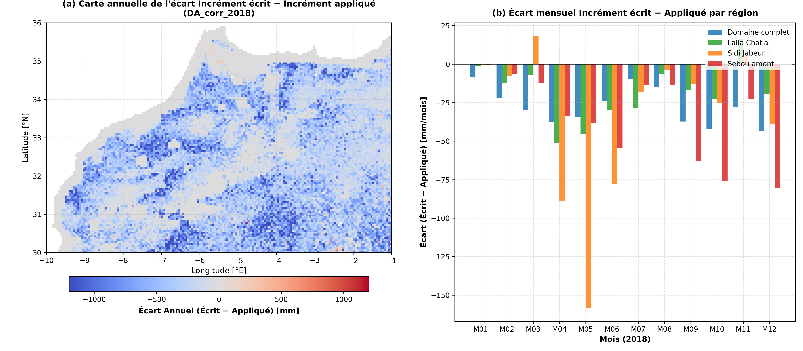

# RAPPORT D'ÉTAPE A4c — Incréments écrits vs incréments appliqués ; nappe par bassin avec les masques validés

> [!NOTE]
> Ce rapport présente les résultats de l'étape A4c. Tous les chiffres sont produits directement par script depuis les fichiers de sortie LIS et les tables CSV validées, sans aucune interprétation.

## 1. Structure et nature des fichiers d'incréments (TÂCHE 1)

Fichier source : `paper1/tables/A4c_increment_file_structure.csv`

| Catégorie | Nom / Élément | Format / Type | Description | Référence Code |
| :--- | :--- | :--- | :--- | :--- |
| Dimension | `east_west` | `size=181` | Dimension spatiale de la grille de sortie LIS | `src/lisf_corr/lis/dataassim/algorithm/enkf/enkf_Mod.F90:1066-1070` |
| Dimension | `north_south` | `size=121` | Dimension spatiale de la grille de sortie LIS | `src/lisf_corr/lis/dataassim/algorithm/enkf/enkf_Mod.F90:1066-1070` |
| Attribut Global | `missing_value` | `float32` | Valeur = -9999.0 | `src/lisf_corr/lis/dataassim/algorithm/enkf/enkf_Mod.F90:1072-1074` |
| Variable | `anlys_incr_Soil Moisture Layer 1_01` | `shape=(121, 181), dtype=float32` | standard_name=Analysis_incr_for_DA_instance_Soil Moisture Layer 1_01 | `src/lisf_corr/lis/dataassim/algorithm/enkf/enkf_Mod.F90:1083-1115` |
| Variable | `anlys_incr_Soil Moisture Layer 2_01` | `shape=(121, 181), dtype=float32` | standard_name=Analysis_incr_for_DA_instance_Soil Moisture Layer 2_01 | `src/lisf_corr/lis/dataassim/algorithm/enkf/enkf_Mod.F90:1083-1115` |
| Variable | `anlys_incr_Soil Moisture Layer 3_01` | `shape=(121, 181), dtype=float32` | standard_name=Analysis_incr_for_DA_instance_Soil Moisture Layer 3_01 | `src/lisf_corr/lis/dataassim/algorithm/enkf/enkf_Mod.F90:1083-1115` |
| Variable | `anlys_incr_Soil Moisture Layer 4_01` | `shape=(121, 181), dtype=float32` | standard_name=Analysis_incr_for_DA_instance_Soil Moisture Layer 4_01 | `src/lisf_corr/lis/dataassim/algorithm/enkf/enkf_Mod.F90:1083-1115` |
| Signification Suffixe | `suffixe '_01'` | `character*2` | Représente l'indice de l'instance DA (k=1) formatté en '(i2.2)', et NON un membre individuel d'ensemble. Le fichier contient la moyenne d'ensemble spatiale (gtmp(c,r) = var_avg/npatch). | `src/lisf_corr/lis/dataassim/algorithm/enkf/enkf_Mod.F90:1083; src/lisf_corr/lis/core/LIS_historyMod.F90:8081` |
| Ordonnancement Temporel | `Moment écriture vs noahmp401_setsoilm` | `sequence d'appels` | L'appel d'écriture writeAnalysisIncr a lieu APRES l'appel de noahmp401_setsoilm dans LIS_dataassim_output. MAIS le tableau écrit enkf_struc(n,k)%anlys_incr a été calculé AVANT setsoilm dans enkf_increments (state_incr = matmul(Kgain, rhs)) et ne reflète PAS les bornages physiques de setsoilm. | `src/lisf_corr/lis/core/LIS_dataAssimMod.F90:529,535,583; src/lisf_corr/lis/dataassim/algorithm/enkf/enkf_Mod.F90:414,512,641,1009-1130` |

## 2. Version de setsoilm réellement compilée (TÂCHE 2)

Fichier source : `paper1/tables/A4c_setsoilm_logic.csv`

Sous-routine compilée : **Première sous-routine (l. 44 à 532)** sous la garde `#ifndef USAF_LIS75_SMDA` (confirmée par `#undef USAF_LIS75_SMDA` dans `src/lisf_corr/lis/make/LIS_misc.h:13`).

### Version compilée et garde de préprocesseur (l. 42-44)
```fortran
#ifndef USAF_LIS75_SMDA

subroutine NoahMP401_setsoilm(n, LSM_State)
```

### Test des bornes (MIN_THRESHOLD, sm_threshold) (l. 153-190)
```fortran
if(noahmp401_struc(n)%noahmp401(t)%sh2o(1)+delta1.gt.MIN_THRESHOLD .and.&
          noahmp401_struc(n)%noahmp401(t)%sh2o(1)+delta1.lt.&
          sm_threshold .and.&
         noahmp401_struc(n)%noahmp401(t)%tslb(1) .gt. LIS_CONST_TKFRZ) then 
        update_flag(gid) = update_flag(gid).and.(.true.)
        ! MN save the flag for each tile (col*row*ens)   (64*44)*20
        update_flag_tile(t) = update_flag_tile(t).and.(.true.)
     else
        update_flag(gid) = update_flag(gid).and.(.false.)
        update_flag_tile(t) = update_flag_tile(t).and.(.false.)
     endif
     if(noahmp401_struc(n)%noahmp401(t)%sh2o(2)+delta2.gt.MIN_THRESHOLD .and.&
          noahmp401_struc(n)%noahmp401(t)%sh2o(2)+delta2.lt.sm_threshold .and.&
          noahmp401_struc(n)%noahmp401(t)%tslb(2) .gt. LIS_CONST_TKFRZ) then 
        update_flag(gid) = update_flag(gid).and.(.true.)
        update_flag_tile(t) = update_flag_tile(t).and.(.true.)
     else
        update_flag(gid) = update_flag(gid).and.(.false.)
        update_flag_tile(t) = update_flag_tile(t).and.(.false.)
     endif
     if(noahmp401_struc(n)%noahmp401(t)%sh2o(3)+delta3.gt.MIN_THRESHOLD .and.&
          noahmp401_struc(n)%noahmp401(t)%sh2o(3)+delta3.lt.sm_threshold .and.&
          noahmp401_struc(n)%noahmp401(t)%tslb(3) .gt. LIS_CONST_TKFRZ) then 
        update_flag(gid) = update_flag(gid).and.(.true.)
        update_flag_tile(t) = update_flag_tile(t).and.(.true.)
     else
        update_flag(gid) = update_flag(gid).and.(.false.)
        update_flag_tile(t) = update_flag_tile(t).and.(.false.)
     endif
     if(noahmp401_struc(n)%noahmp401(t)%sh2o(4)+delta4.gt.MIN_THRESHOLD .and.&
          noahmp401_struc(n)%noahmp401(t)%sh2o(4)+delta4.lt.sm_threshold .and.&
          noahmp401_struc(n)%noahmp401(t)%tslb(4) .gt. LIS_CONST_TKFRZ) then 
        update_flag(gid) = update_flag(gid).and.(.true.)
        update_flag_tile(t) = update_flag_tile(t).and.(.true.)
     else
        update_flag(gid) = update_flag(gid).and.(.false.)
        update_flag_tile(t) = update_flag_tile(t).and.(.false.)
     endif
```

### Règle des 50 % des membres (l. 197-209)
```fortran
update_flag_ens = .True.
  do i=1,LIS_rc%npatch(n,LIS_rc%lsm_index),LIS_rc%nensem(n)
     gid = LIS_domain(n)%gindex(&
          LIS_surface(n,LIS_rc%lsm_index)%tile(i)%col,&
          LIS_surface(n,LIS_rc%lsm_index)%tile(i)%row) 
      flag_tmp=update_flag_tile(i:i+LIS_rc%nensem(n)-1)
      !flag_tmp=update_flag_tile((i-1)*LIS_rc%nensem(n)+1:(i)*LIS_rc%nensem(n))
      pcount = COUNT(flag_tmp) ! Counts the number of .TRUE. elements
      if (pcount.lt.LIS_rc%nensem(n)*0.5) then   ! 50%
         update_flag_ens(gid)= .False.
      endif
      update_flag_new(gid)= update_flag(gid).or.update_flag_ens(gid)  ! new flag
  enddo
```

### Remplacement des membres hors bornes par (Max+Min)/2 (l. 340-355)
```fortran
smc_tmp = (MaxEnsSM1 - MinEnsSM1)/2 + MinEnsSM1
              noahmp401_struc(n)%noahmp401(t)%sh2o(1) = smc_tmp 
              noahmp401_struc(n)%noahmp401(t)%smc(1) = smc_tmp
                          
              smc_tmp = (MaxEnsSM2 - MinEnsSM2)/2 + MinEnsSM2            
              noahmp401_struc(n)%noahmp401(t)%sh2o(2) = smc_tmp
              noahmp401_struc(n)%noahmp401(t)%smc(2) = smc_tmp
               
              smc_tmp = (MaxEnsSM3 - MinEnsSM3)/2 + MinEnsSM3
              noahmp401_struc(n)%noahmp401(t)%sh2o(3) = smc_tmp
              noahmp401_struc(n)%noahmp401(t)%smc(3) = smc_tmp
              
              smc_tmp = (MaxEnsSM4 - MinEnsSM4)/2 + MinEnsSM4
              noahmp401_struc(n)%noahmp401(t)%sh2o(4) = smc_tmp
              noahmp401_struc(n)%noahmp401(t)%smc(4) = smc_tmp
```

### Saut d'une mise à jour couche par couche (l. 295-327)
```fortran
if(noahmp401_struc(n)%noahmp401(t)%sh2o(2)+delta2.gt.MIN_THRESHOLD .and.&
                   noahmp401_struc(n)%noahmp401(t)%sh2o(2)+delta2.lt.sm_threshold) then 
                 noahmp401_struc(n)%noahmp401(t)%sh2o(2) = noahmp401_struc(n)%noahmp401(t)%sh2o(2)+&
                      soilm2(t)-noahmp401_struc(n)%noahmp401(t)%smc(2)
                 noahmp401_struc(n)%noahmp401(t)%smc(2) = soilm2(t)
                 if(soilm2(t).lt.0) then 
                    print*, 'setsoilm2 ',t,soilm2(t)
                    stop
                 endif
              endif
  
              if(noahmp401_struc(n)%noahmp401(t)%sh2o(3)+delta3.gt.MIN_THRESHOLD .and.&
                   noahmp401_struc(n)%noahmp401(t)%sh2o(3)+delta3.lt.sm_threshold) then 
                 noahmp401_struc(n)%noahmp401(t)%sh2o(3) = noahmp401_struc(n)%noahmp401(t)%sh2o(3)+&
                      soilm3(t)-noahmp401_struc(n)%noahmp401(t)%smc(3)
                 noahmp401_struc(n)%noahmp401(t)%smc(3) = soilm3(t)
                 if(soilm3(t).lt.0) then 
                    print*, 'setsoilm3 ',t,soilm3(t)
                    stop
                 endif
              endif

              if(noahmp401_struc(n)%noahmp401(t)%sh2o(4)+delta4.gt.MIN_THRESHOLD .and.&
                   noahmp401_struc(n)%noahmp401(t)%sh2o(4)+delta4.lt.sm_threshold) then 
                 noahmp401_struc(n)%noahmp401(t)%sh2o(4) = noahmp401_struc(n)%noahmp401(t)%sh2o(4)+&
                      soilm4(t)-noahmp401_struc(n)%noahmp401(t)%smc(4)
                 noahmp401_struc(n)%noahmp401(t)%smc(4) = soilm4(t)

                 if(soilm4(t).lt.0) then 
                    print*, 'setsoilm4 ',t,soilm4(t)
                    stop
                 endif
              endif
```

### Branche sans mise à jour (l. 360-370)
```fortran
else ! if update_flag_new(gid) is FALSE   
        if(LIS_rc%pert_bias_corr.eq.1) then           
           !--------------------------------------------------------------------------
           ! if no update is made, then we need to readjust the ensemble if pert bias
           ! correction is turned on because the forcing perturbations may cause 
           ! biases to persist. 
           !--------------------------------------------------------------------------
           bounds_violation = .true. 
           nIter = 0
           ens_flag = .true.
```

## 3. Incréments écrits vs eau réellement appliquée (TÂCHE 3)

Fichier source : `paper1/tables/A4c_increments_written_vs_applied.csv`

### Synthèse annuelle par région

| Région | Période | Écrit Total Pos (mm) | Écrit Total Nég (mm) | Écrit Net (mm) | Appliqué DA (mm) | Écart Écrit − Appliqué (mm) | Contrôle ENS (mm) | Résidu A2 (mm) |
| :--- | :---: | :---: | :---: | :---: | :---: | :---: | :---: | :---: |
| Domaine complet | Annuel | 259.509 | -742.985 | -483.475 | -152.39 | -331.085 | 4.567 | 152.3898 |
| Lalla Chafia | Annuel | 638.385 | -693.954 | -55.57 | 168.192 | -223.762 | 0.899 | -168.1924 |
| Sidi Jabeur | Annuel | 753.087 | -1150.297 | -397.209 | 11.179 | -408.388 | 0.504 | -11.1787 |
| Sebou amont | Annuel | 487.349 | -1049.142 | -561.793 | -146.978 | -414.815 | 3.41 | 146.978 |

### Décomposition mensuelle (Domaine complet)

| Mois | Écrit Net (mm) | ΔS tot (mm) | P (mm) | ET (mm) | Qs+Qsb (mm) | Appliqué DA (mm) | Écart (mm) | Contrôle ENS (mm) |
| :---: | :---: | :---: | :---: | :---: | :---: | :---: | :---: | :---: |
| 2018-01 | -22.234 | 15.326 | 44.436 | 11.629 | 3.359 | -14.122 | -8.111 | 0.36 |
| 2018-02 | -46.825 | -11.735 | 31.632 | 15.407 | 3.275 | -24.685 | -22.141 | 0.283 |
| 2018-03 | -51.921 | -1.834 | 56.272 | 28.091 | 8.111 | -21.904 | -30.017 | 0.399 |
| 2018-04 | -54.471 | -7.507 | 46.068 | 30.932 | 5.983 | -16.661 | -37.811 | 0.344 |
| 2018-05 | -55.898 | -35.868 | 21.861 | 32.597 | 3.782 | -21.349 | -34.549 | 0.351 |
| 2018-06 | -20.058 | -16.383 | 1.647 | 17.988 | 3.666 | 3.625 | -23.683 | 0.38 |
| 2018-07 | 18.679 | 12.817 | 0.709 | 10.161 | 5.83 | 28.1 | -9.42 | 0.398 |
| 2018-08 | -23.126 | -12.492 | 22.218 | 19.375 | 7.267 | -8.067 | -15.059 | 0.417 |
| 2018-09 | -61.759 | -15.92 | 37.434 | 23.65 | 5.198 | -24.506 | -37.253 | 0.402 |
| 2018-10 | -60.973 | 20.179 | 68.556 | 23.834 | 5.746 | -18.797 | -42.176 | 0.4 |
| 2018-11 | -35.993 | 11.579 | 46.391 | 20.112 | 6.37 | -8.33 | -27.662 | 0.441 |
| 2018-12 | -68.894 | -41.896 | 1.423 | 13.136 | 4.49 | -25.692 | -43.202 | 0.393 |

## 4. Bilan mensuel de la nappe refait avec les masques validés (TÂCHE 4)

Fichier source : `paper1/tables/A4c_groundwater_monthly_budget.csv`

### Synthèse annuelle et contrôle de conformité A2b

| Région | Run | Qsb Annuel (mm) | ΔGWS Annuel (mm) | Somme Qsb + ΔGWS (mm) | Écart Qsb vs A2b (mm) | Écart ΔGWS vs A2b (mm) |
| :--- | :--- | :---: | :---: | :---: | :---: | :---: |
| Domaine complet | ENS_corr | 19.39 | 0.412 | 19.802 | 0.0 | 0.002 |
| Domaine complet | DA_corr | 48.594 | 14.96 | 63.554 | 0.004 | -0.0 |
| Domaine complet | Difference (DA_corr - ENS_corr) | 29.204 | 14.548 | 43.752 | 0.004 | -0.002 |
| Lalla Chafia | ENS_corr | 97.644 | 3.688 | 101.332 | 0.004 | -0.002 |
| Lalla Chafia | DA_corr | 266.922 | 41.689 | 308.611 | 0.002 | -0.001 |
| Lalla Chafia | Difference (DA_corr - ENS_corr) | 169.278 | 38.0 | 207.278 | -0.002 | 0.0 |
| Sidi Jabeur | ENS_corr | 45.201 | 3.934 | 49.135 | 0.001 | 0.004 |
| Sidi Jabeur | DA_corr | 186.91 | 23.949 | 210.859 | 0.0 | -0.001 |
| Sidi Jabeur | Difference (DA_corr - ENS_corr) | 141.709 | 20.015 | 161.724 | -0.001 | -0.005 |
| Sebou amont | ENS_corr | 8.857 | -1.289 | 7.568 | -0.003 | 0.001 |
| Sebou amont | DA_corr | 39.671 | 19.623 | 59.294 | 0.001 | 0.003 |
| Sebou amont | Difference (DA_corr - ENS_corr) | 30.814 | 20.912 | 51.726 | 0.004 | 0.002 |

### Contrôle obligatoire des contrastes C3 (Annuel)

| Bassin | Somme Qsb + ΔGWS Calculée (mm) | Somme Qsb + ΔGWS Réf A2b (mm) | Écart Absolu (mm) | Statut Contrôle (±1 mm) |
| :--- | :---: | :---: | :---: | :---: |
| Lalla Chafia | 207.278 | 207.28 | 0.002 | VALIDÉ |
| Sidi Jabeur | 161.724 | 161.73 | 0.006 | VALIDÉ |
| Sebou amont | 51.726 | 51.72 | 0.006 | VALIDÉ |

## 5. Figures produites


