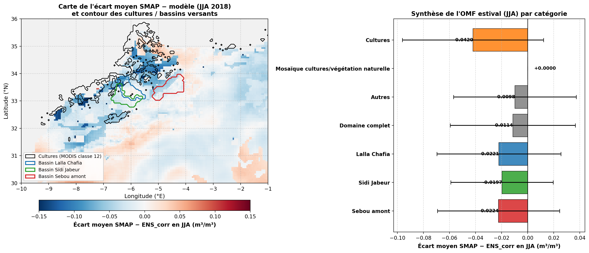

# RAPPORT D'ÉTAPE A5 — Irrigation (H3) et filtrage des observations SMAP (H4), 2018

> [!NOTE]
> Ce rapport présente les résultats de l'étape A5. Tous les chiffres sont produits directement par script depuis les fichiers LIS, LDT, SPL3SMP_E et les tables CSV validées, sans aucune interprétation.

## 1. Inventaire des données d'irrigation et d'occupation du sol (TÂCHE 1)

Fichier source : `paper1/tables/A5_irrigation_data_inventory.csv`

| Catégorie | Variable | Chemin | Résolution | Description Métadonnées | Statut / Valeurs |
| :--- | :--- | :--- | :--- | :--- | :--- |
| lis_input_NorthMor_5km.nc | `IRRIGFRAC` | `data/lis_input/lis_input_NorthMor_5km.nc` | 5 km (121 x 181) | User Derived Irrig gridcell fraction | Variable présente mais uniformément égale à 0.0 sur toutes les cellules (aucune irrigation active définie) |
| lis_input_NorthMor_5km.nc | `LANDCOVER` | `data/lis_input/lis_input_NorthMor_5km.nc` | 5 km (20 x 121 x 181) | MODIS-IGBP (NCEP-modified) landcover map | 14 classes terrestres présentes. Cultures (classe 12) : 1127 cellules (28594.1 km²). Mosaïque cultures/végétation (classe 14) : 1 cellule (26.9 km²). Autres : 14902 cellules (376280.6 km²) |
| lis_input_NorthMor_5km.nc | `SURFACETYPE` | `data/lis_input/lis_input_NorthMor_5km.nc` | 5 km (20 x 121 x 181) | Surface type | Fractions de type de surface (num_bins=20), identique à la décomposition MODIS |
| lis_input_NorthMor_5km.nc | `ELEVATION` | `data/lis_input/lis_input_NorthMor_5km.nc` | 5 km (121 x 181) | GTOPO30 (Native) elevation (m) | Altitude du modèle, plage 0.0 m à 3409.0 m sur terre ferme |
| LDT (lis_input_corrigee.d01.nc) | `Variables liées à l'irrigation` | `experiments/NorthMor/routing/ldt_hymap/lis_input_corrigee.d01.nc` | 5 km (120 x 180) | Fichier LDT HyMAP | absent (aucune variable d'irrigation présente dans le fichier LDT) |
| data/ directory | `Jeux d'irrigation externes` | `data/` | absent | Recherche récursive dans le répertoire data/ | absent (aucun fichier ou répertoire d'irrigation présent sous data/) |

**Constat formel** : Aucune donnée d'irrigation active n'est présente (`IRRIGFRAC = 0.0` sur tout le domaine et aucune donnée sous `data/`). Conformément aux règles permanentes, les classes d'occupation du sol LIS (Cultures, Mosaïque, Autres) sont utilisées comme substitut d'analyse.

## 2. Signal d'irrigation dans l'écart SMAP − modèle (TÂCHE 2)

Fichier source : `paper1/tables/A5_omf_by_irrigation_class.csv`

### Synthèse estivale (JJA) et annuelle par classe et région

| Type | Catégorie | Période | n Pixels-Jours | OMF Moyen (m³/m³) | OMF Écart-type | OMF Médiane | Fraction OMF > 0 (%) | SMAP Moyen | Modèle Moyen |
| :--- | :--- | :---: | :---: | :---: | :---: | :---: | :---: | :---: | :---: |
| Classe d'occupation du sol | Cultures | JJA | 37382 | -0.042 | 0.0542 | -0.0495 | 22.02 | 0.0883 | 0.1303 |
| Classe d'occupation du sol | Cultures | Annuel | 143603 | -0.0434 | 0.0617 | -0.0497 | 23.54 | 0.1791 | 0.2225 |
| Classe d'occupation du sol | Mosaïque cultures/végétation naturelle | JJA | 0 | absent | absent | absent | absent | absent | absent |
| Classe d'occupation du sol | Mosaïque cultures/végétation naturelle | Annuel | 0 | absent | absent | absent | absent | absent | absent |
| Classe d'occupation du sol | Autres | JJA | 736922 | -0.0098 | 0.0471 | -0.0014 | 48.45 | 0.087 | 0.0968 |
| Classe d'occupation du sol | Autres | Annuel | 2676627 | -0.0448 | 0.0553 | -0.0489 | 22.75 | 0.1107 | 0.1555 |
| Région / Bassin | Domaine complet | JJA | 774304 | -0.0114 | 0.048 | -0.0027 | 47.17 | 0.087 | 0.0984 |
| Région / Bassin | Domaine complet | Annuel | 2820230 | -0.0447 | 0.0556 | -0.0489 | 22.79 | 0.1142 | 0.1589 |
| Région / Bassin | Lalla Chafia | JJA | 10094 | -0.0221 | 0.0476 | -0.0059 | 43.2 | 0.0902 | 0.1123 |
| Région / Bassin | Lalla Chafia | Annuel | 36253 | -0.006 | 0.0589 | -0.0007 | 49.46 | 0.1947 | 0.2007 |
| Région / Bassin | Sidi Jabeur | JJA | 9546 | -0.0197 | 0.0393 | -0.0069 | 37.82 | 0.0852 | 0.1049 |
| Région / Bassin | Sidi Jabeur | Annuel | 34966 | -0.0096 | 0.0491 | -0.007 | 42.49 | 0.1799 | 0.1896 |
| Région / Bassin | Sebou amont | JJA | 12627 | -0.0224 | 0.0469 | -0.0183 | 34.91 | 0.1157 | 0.1381 |
| Région / Bassin | Sebou amont | Annuel | 37407 | -0.031 | 0.0486 | -0.0317 | 26.35 | 0.1771 | 0.2081 |

## 3. Eau appliquée par l'analyse, par classe (TÂCHE 3)

Fichier source : `paper1/tables/A5_applied_increment_by_class.csv`

### Bilan hydrique fermé (JJA et Annuel)

| Type | Catégorie | Période | Cellules | Surface (km²) | Incr. Appliqué (mm) | Incr. Écrit (mm) | Écart Écrit − Appliqué (mm) | ΔQsb (mm) | ΔGWS (mm) | ΔET (mm) | P (mm) | ET (mm) |
| :--- | :--- | :---: | :---: | :---: | :---: | :---: | :---: | :---: | :---: | :---: | :---: | :---: |
| Classe d'occupation du sol | Cultures | JJA | 1127 | 28594.05 | 29.49 | 15.213 | -14.276 | 0.163 | 4.126 | -23.859 | 4.738 | 76.352 |
| Classe d'occupation du sol | Cultures | Annuel | 1127 | 28594.05 | -153.661 | -380.364 | -226.704 | 25.095 | 0.456 | -86.603 | 794.112 | 529.339 |
| Classe d'occupation du sol | Mosaïque cultures/végétation naturelle | JJA | 1 | 26.89 | 0.213 | 0.0 | -0.213 | -0.768 | 0.771 | -0.015 | 1.024 | 108.983 |
| Classe d'occupation du sol | Mosaïque cultures/végétation naturelle | Annuel | 1 | 26.89 | -5.654 | 0.0 | 5.654 | -4.845 | -0.444 | -0.175 | 885.227 | 697.633 |
| Classe d'occupation du sol | Autres | JJA | 14902 | 376280.62 | 23.217 | -27.511 | -50.728 | 12.893 | 12.093 | -12.885 | 26.075 | 45.341 |
| Classe d'occupation du sol | Autres | Annuel | 14902 | 376280.62 | -152.304 | -491.306 | -339.002 | 29.517 | 15.614 | -63.626 | 347.192 | 225.522 |
| Région / Bassin | Domaine complet | JJA | 16030 | 404901.55 | 23.657 | -24.506 | -48.163 | 11.997 | 11.532 | -13.655 | 24.574 | 47.525 |
| Région / Bassin | Domaine complet | Annuel | 16030 | 404901.55 | -152.39 | -483.475 | -331.085 | 29.204 | 14.548 | -65.238 | 378.647 | 246.912 |
| Région / Bassin | Lalla Chafia | JJA | 180 | 4450.29 | 57.764 | -7.14 | -64.904 | 19.875 | 5.668 | -25.114 | 11.959 | 85.167 |
| Région / Bassin | Lalla Chafia | Annuel | 180 | 4450.29 | 168.192 | -55.57 | -223.762 | 169.278 | 38.0 | -24.501 | 761.154 | 582.556 |
| Région / Bassin | Sidi Jabeur | JJA | 170 | 4103.59 | 13.937 | -85.811 | -99.749 | 15.139 | -12.238 | -38.086 | 11.431 | 65.016 |
| Région / Bassin | Sidi Jabeur | Annuel | 170 | 4103.59 | 11.179 | -397.209 | -408.388 | 141.709 | 20.015 | -65.522 | 636.242 | 466.535 |
| Région / Bassin | Sebou amont | JJA | 227 | 5543.78 | 18.223 | -62.743 | -80.966 | 7.236 | 11.335 | -31.966 | 31.427 | 88.556 |
| Région / Bassin | Sebou amont | Annuel | 227 | 5543.78 | -146.978 | -561.793 | -414.815 | 30.814 | 20.912 | -75.129 | 575.309 | 385.952 |

## 4. Filtrage des observations SMAP (TÂCHE 4)

Fichier source : `paper1/tables/A5_obs_screening_2018.csv`

### Synthèse annuelle du filtrage par étape

| Région | Période | Total Potentiel | Rejet Manquant | Rejet Qual Flag | Rejet VWC>5 | Accepté Lecture | Rejet Gel | Rejet Neige | Rejet Forêt | Rejet Shdfac>0.9 | Rejet SMCMAX | Rejet SMCWLT | Assimilé DAOBS |
| :--- | :---: | :---: | :---: | :---: | :---: | :---: | :---: | :---: | :---: | :---: | :---: | :---: | :---: |
| Domaine complet | Annuel | 11701900 | 6890979 | 901369 | 0 | 2941515 | 103912 | 22713 | 4718 | 0 | 3773 | 0 | 2806399 |
| Lalla Chafia | Annuel | 131400 | 73935 | 3040 | 0 | 38510 | 849 | 190 | 433 | 0 | 764 | 0 | 36274 |
| Sidi Jabeur | Annuel | 124100 | 71238 | 3703 | 0 | 35659 | 378 | 148 | 0 | 0 | 138 | 0 | 34995 |
| Sebou amont | Annuel | 165710 | 95708 | 12782 | 0 | 42587 | 2669 | 1942 | 402 | 0 | 4 | 0 | 37570 |

**Citations des lignes de code associées** :

- Lecture (`read_NASASMAPsm.F90`) : missing_value (l. 1156), retrieval_qual_flag bit 0 (l. 1157-1161), VWC > 5 (l. 1152-1153)

- Contrôle qualité modèle (`noahmp401_qc_soilmobs.F90`) : gel (l. 234-255), neige (l. 259-262), forêt vegt<=4 (l. 256-257), shdfac > 0.9 (l. 264-268), bornes SMCMAX - 0.02 (l. 270-271), bornes SMCWLT + 0.02 (l. 272-274, désactivé/commenté dans DA_corr)

## 5. Indicateurs de surface SMAP des observations assimilées (TÂCHE 5)

Fichier source : `paper1/tables/A5_obs_surface_flags.csv`

### Décodage bit par bit (Domaine complet)

| Bit | Masque | Signification Standard | Définition FR | Obs. Flag Levé | Fraction (%) | OMF Avec Flag (m³/m³) | OMF Sans Flag (m³/m³) | Cellules > 50% | Incr. Appliqué Moyen (mm) |
| :---: | :---: | :--- | :--- | :---: | :---: | :---: | :---: | :---: | :---: |
| 0 | 1 | `9_km_static_water_body` | Eau statique | 0 | 0.0 | absent | -0.0444 | 0 | absent |
| 1 | 2 | `9_km_radar_water_body_detection` | Détection eau radar | 0 | 0.0 | absent | -0.0444 | 0 | absent |
| 2 | 4 | `9_km_coastal_proximity` | Proximité côtière | 0 | 0.0 | absent | -0.0444 | 0 | absent |
| 3 | 8 | `9_km_urban_area` | Zone urbaine | 0 | 0.0 | absent | -0.0444 | 0 | absent |
| 4 | 16 | `9_km_precipitation` | Précipitation | 0 | 0.0 | absent | -0.0444 | 0 | absent |
| 5 | 32 | `9_km_snow_or_ice` | Neige ou glace | 0 | 0.0 | absent | -0.0444 | 0 | absent |
| 6 | 64 | `9_km_permanent_snow_or_ice` | Neige ou glace permanente | 0 | 0.0 | absent | -0.0444 | 0 | absent |
| 7 | 128 | `9_km_radiometer_frozen_ground` | Gel sol radiomètre | 957160 | 34.11 | -0.0449 | -0.0441 | 4175 | -164.353 |
| 8 | 256 | `9_km_model_frozen_ground` | Gel sol modèle | 0 | 0.0 | absent | -0.0444 | 0 | absent |
| 9 | 512 | `9_km_mountainous_terrain` | Relief montagneux | 0 | 0.0 | absent | -0.0444 | 0 | absent |
| 10 | 1024 | `9_km_dense_vegetation` | Végétation dense | 0 | 0.0 | absent | -0.0444 | 0 | absent |
| 11 | 2048 | `9_km_nadir_region` | Région nadir | 0 | 0.0 | absent | -0.0444 | 0 | absent |

## 6. Figure produite

