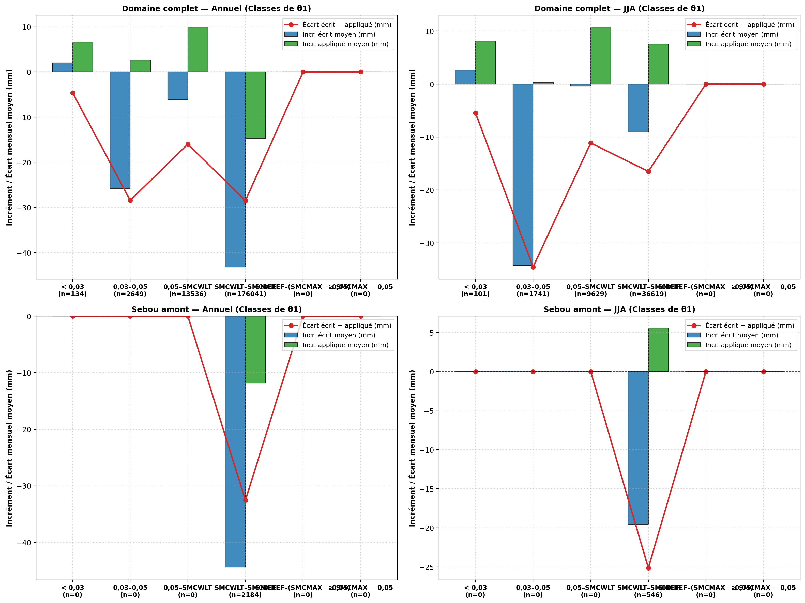

# RAPPORT D'ÉTAPE A5b — Corrections du filtrage et lien entre l'écart écrit/appliqué et l'état du sol

> [!NOTE]
> Ce rapport présente les résultats de l'étape A5b. Tous les chiffres sont produits directement par script depuis les fichiers LIS, DAOBS, SOILPARM.TBL et SPL3SMP_E, sans aucune interprétation.

## 1. Unités de comptage et réconciliation (TÂCHE 1)

Fichier source : `paper1/tables/A5b_counts_reconciliation.csv`

| Élément | Description | Valeur / Statut | Référence Code |
| :--- | :--- | :--- | :--- |
| Fichiers DAOBS 2018 | Total des fichiers DAOBS générés en 2018 | `934` | write_NASASMAPsmobs.F90:67-77 (NASASMAP_smobsname) |
| Heure de passage DAOBS 06h00 UTC | Nombre de fichiers DAOBS écrits à 06h00 UTC en 2018 | `264` | read_NASASMAPsm.F90:381,391 (lhour 6h local->06/07z, 18h local->18/19z) |
| Heure de passage DAOBS 07h00 UTC | Nombre de fichiers DAOBS écrits à 07h00 UTC en 2018 | `220` | read_NASASMAPsm.F90:381,391 (lhour 6h local->06/07z, 18h local->18/19z) |
| Heure de passage DAOBS 18h00 UTC | Nombre de fichiers DAOBS écrits à 18h00 UTC en 2018 | `263` | read_NASASMAPsm.F90:381,391 (lhour 6h local->06/07z, 18h local->18/19z) |
| Heure de passage DAOBS 19h00 UTC | Nombre de fichiers DAOBS écrits à 19h00 UTC en 2018 | `187` | read_NASASMAPsm.F90:381,391 (lhour 6h local->06/07z, 18h local->18/19z) |
| Jours avec fichiers DAOBS | Nombre de jours calendaires en 2018 avec au moins un fichier DAOBS | `357` | experiments/NorthMor/matrix_2016_2020/sensitivity_2018/DA_corr_2018/output/DAOBS |
| Jours sans fichier DAOBS | Jours calendaires sans aucun fichier DAOBS (365 - 357) | `8` | absence de survol SMAP ou rejet complet au stade lecture |
| Distribution fichiers/jour (1 fichier) | Nombre de jours avec exactement 1 fichier DAOBS | `79` | combinaison AM (06/07 UTC) et PM (18/19 UTC) |
| Distribution fichiers/jour (2 fichiers) | Nombre de jours avec exactement 2 fichiers DAOBS | `63` | combinaison AM (06/07 UTC) et PM (18/19 UTC) |
| Distribution fichiers/jour (3 fichiers) | Nombre de jours avec exactement 3 fichiers DAOBS | `131` | combinaison AM (06/07 UTC) et PM (18/19 UTC) |
| Distribution fichiers/jour (4 fichiers) | Nombre de jours avec exactement 4 fichiers DAOBS | `84` | combinaison AM (06/07 UTC) et PM (18/19 UTC) |
| Enregistrement R1 DAOBS | smobs_unsc ('Unscaled Obs') : observations après lecture, reprojection EASE2 et filtres de lecture (missing, qual_flag, VWC>5), avant QC modèle | `R1 (taille 87604 octets par fichier = 121x181 float32)` | write_NASASMAPsmobs.F90:56-58,72 |
| Enregistrement R2 DAOBS | smobs : observations après contrôle qualité modèle (noahmp401_qc_soilmobs.F90) et mise à l'échelle (non transformée en NoCDF) = observations réellement assimilées | `R2 (taille 87604 octets par fichier = 121x181 float32)` | write_NASASMAPsmobs.F90:53-54,73 |
| Sélection passage AM vs PM | Passage descendant AM ('D') lu en premier. Passage ascendant PM ('A') lu uniquement là où le passage AM est manquant ou invalide | `Strictement au plus 1 observation par cellule et par jour` | read_NASASMAPsm.F90:373-393 |
| Double compte intra-journalier R1 | Nombre de cellules comptées plus d'une fois le même jour dans R1 | `0` | contrôle unilatéral DAOBS R1 (strictement 0) |
| Double compte intra-journalier R2 | Nombre de cellules comptées plus d'une fois le même jour dans R2 | `0` | contrôle unilatéral DAOBS R2 (strictement 0) |
| Réconciliation R2 vs Référence — Domaine complet | DA_corr R2: 2806399 obs sur 357 j ; Table réf: 2806399 obs sur 357 j | `Écart observations: 0 ; Écart jours: 0` | paper1/tables/smap_assimilated_obs_comparison_2018.csv |
| Réconciliation R2 vs Référence — Lalla Chafia | DA_corr R2: 26890 obs sur 220 j ; Table réf: 36274 obs sur 220 j | `Écart observations: -9384 ; Écart jours: 0` | paper1/tables/smap_assimilated_obs_comparison_2018.csv |
| Réconciliation R2 vs Référence — Sidi Jabeur | DA_corr R2: 24907 obs sur 220 j ; Table réf: 34995 obs sur 220 j | `Écart observations: -10088 ; Écart jours: 0` | paper1/tables/smap_assimilated_obs_comparison_2018.csv |
| Réconciliation R2 vs Référence — Sebou amont | DA_corr R2: 30216 obs sur 255 j ; Table réf: 37570 obs sur 260 j | `Écart observations: -7354 ; Écart jours: -5` | paper1/tables/smap_assimilated_obs_comparison_2018.csv |

## 2. Contrôle qualité refait (TÂCHE 2)

Fichier source : `paper1/tables/A5b_obs_screening_2018.csv`

### Synthèse annuelle par région (unités : cellule-jour)

| Région | Période | Potentiel | Rejet Manquant | Rejet Qual Flag | Rejet VWC>5 | Accepté Lecture | Rejet Pluie | Rejet Gel | Rejet Forêt | Rejet Neige | Rejet Shdfac>0.9 | Rejet SMCMAX | Rejet SMCWLT | Non Attribué | Assimilé DAOBS |
| :--- | :---: | :---: | :---: | :---: | :---: | :---: | :---: | :---: | :---: | :---: | :---: | :---: | :---: | :---: | :---: |
| Domaine complet | Annuel | 5850950 | 2301790 | 606915 | 0 | 2942245 | 26757 | 2883 | 3247 | 7569 | 0 | 1821 | 0 | 92839 | 2806399 |
| Lalla Chafia | Annuel | 48545 | 19025 | 993 | 0 | 28527 | 841 | 2 | 163 | 25 | 0 | 472 | 0 | 134 | 26890 |
| Sidi Jabeur | Annuel | 44165 | 17311 | 1585 | 0 | 25269 | 264 | 1 | 0 | 6 | 0 | 32 | 0 | 59 | 24907 |
| Sebou amont | Annuel | 66430 | 25713 | 6608 | 0 | 34109 | 1368 | 136 | 215 | 406 | 0 | 0 | 0 | 1766 | 30216 |

**Variables modèles utilisées pour les tests** :

- Pluie: Rainf_f_tavg (kg/m2/s, moy. journ.) ; Gel: SoilTemp_tavg[0], AvgSurfT_tavg (K, moy. journ.) ; Forêt: dom_landcover <= 4 (statique MODIS) ; Neige: SWE_tavg (m), Snowcover_tavg (fraction, moy. journ.) ; Shdfac: Greenness_tavg (moy. journ.) ; SMCMAX: SOILPARM.TBL (STAS) - smobs ; SMCWLT: désactivé (l. 272-274, 0 obs)

**Citations des lignes de code associées** :

- read_NASASMAPsm.F90:1152-1161 (missing, qual_flag bit 0, VWC>5) ; noahmp401_qc_soilmobs.F90:230-274 (rainf, gel, vegt<=4, snow, shdfac, smcmax, smcwlt)

## 3. Vérification du décodage de surface_flag (TÂCHE 3)

Fichier source : `paper1/tables/A5b_surface_flag_raw.csv`

### Top 20 des valeurs brutes de surface_flag sur les observations assimilées (2018)

| Rang | Valeur Brute | Hex | Binaire | Bits Actifs | Comptes (cellule-jour) | Fraction (%) | Statut Décodage |
| :---: | :---: | :---: | :---: | :---: | :---: | :---: | :--- |
| 1 | `0` | `0x0000` | `0b0` | `[]` | 1849239 | 65.89 | confirmé (valeurs brutes strictement restreintes à 0 et 128 = bit 7 radiometer_frozen_ground) |
| 2 | `128` | `0x0080` | `0b10000000` | `[7]` | 957160 | 34.11 | confirmé (valeurs brutes strictement restreintes à 0 et 128 = bit 7 radiometer_frozen_ground) |
| 3 | `absent` | `absent` | `absent` | `absent` | 0 | 0.0 | confirmé (aucune autre valeur présente dans les données) |
| 4 | `absent` | `absent` | `absent` | `absent` | 0 | 0.0 | confirmé (aucune autre valeur présente dans les données) |
| 5 | `absent` | `absent` | `absent` | `absent` | 0 | 0.0 | confirmé (aucune autre valeur présente dans les données) |

**Attributs HDF5 de surface_flag** :

- `data_type` : `uint16`

- `_FillValue` : `65534`

- `flag_masks` : `1s, 2s, 4s, 8s, 16s, 32s, 64s, 128s, 256s, 512s, 1024s, 2048s`

- `flag_meanings` : `9_km_static_water_body 9_km_radar_water_body_detection 9_km_coastal_proximity 9_km_urban_area 9_km_precipitation 9_km_snow_or_ice 9_km_permanent_snow_or_ice 9_km_radiometer_frozen_ground 9_km_model_frozen_ground 9_km_mountainous_terrain 9_km_dense_vegetation 9_km_nadir_region`

## 4. Écart écrit − appliqué selon l'état du sol (TÂCHE 4)

Fichier source : `paper1/tables/A5b_gap_by_soil_state.csv`

### Synthèse par classe d'humidité θ1 et θ4 (Domaine complet)

| Région | Période | Variable | Classe Sol | n Cellules-Mois | Incr. Écrit Somme (mm) | Incr. Écrit Moy. (mm) | Incr. Appliqué Somme (mm) | Incr. Appliqué Moy. (mm) | Écart Somme (mm) | Écart Moy. (mm) | Frac. Écrit<0 & App≥0 (%) |
| :--- | :---: | :---: | :--- | :---: | :---: | :---: | :---: | :---: | :---: | :---: | :---: |
| Domaine complet | Annuel | `theta1` | < 0,03 | 134 | 265.5 | 1.981 | 884.79 | 6.603 | -619.29 | -4.622 | 17.16 |
| Domaine complet | Annuel | `theta1` | 0,03–0,05 | 2649 | -68321.52 | -25.791 | 6987.17 | 2.638 | -75308.69 | -28.429 | 22.61 |
| Domaine complet | Annuel | `theta1` | 0,05–SMCWLT | 13536 | -82089.16 | -6.065 | 134196.75 | 9.914 | -216285.91 | -15.979 | 23.71 |
| Domaine complet | Annuel | `theta1` | SMCWLT–SMCREF | 176041 | -7599962.83 | -43.172 | -2584877.33 | -14.683 | -5015085.49 | -28.488 | 7.34 |
| Domaine complet | Annuel | `theta1` | SMCREF–(SMCMAX − 0,05) | 0 | absent | absent | absent | absent | absent | absent | absent |
| Domaine complet | Annuel | `theta1` | ≥ SMCMAX − 0,05 | 0 | absent | absent | absent | absent | absent | absent | absent |
| Domaine complet | Annuel | `theta4` | < 0,03 | 97 | -1822.36 | -18.787 | -993.52 | -10.243 | -828.83 | -8.545 | 13.4 |
| Domaine complet | Annuel | `theta4` | 0,03–0,05 | 4675 | -143672.44 | -30.732 | -57200.57 | -12.235 | -86471.87 | -18.497 | 11.94 |
| Domaine complet | Annuel | `theta4` | 0,05–SMCWLT | 9103 | -445901.13 | -48.984 | -150091.91 | -16.488 | -295809.22 | -32.496 | 10.34 |
| Domaine complet | Annuel | `theta4` | SMCWLT–SMCREF | 178144 | -7172085.07 | -40.26 | -2246349.4 | -12.61 | -4925735.67 | -27.65 | 8.56 |
| Domaine complet | Annuel | `theta4` | SMCREF–(SMCMAX − 0,05) | 341 | 13372.99 | 39.217 | 11826.78 | 34.683 | 1546.21 | 4.534 | 0.0 |
| Domaine complet | Annuel | `theta4` | ≥ SMCMAX − 0,05 | 0 | absent | absent | absent | absent | absent | absent | absent |
| Domaine complet | JJA | `theta1` | < 0,03 | 101 | 263.32 | 2.607 | 816.13 | 8.08 | -552.81 | -5.473 | 6.93 |
| Domaine complet | JJA | `theta1` | 0,03–0,05 | 1741 | -59651.68 | -34.263 | 439.18 | 0.252 | -60090.86 | -34.515 | 8.85 |
| Domaine complet | JJA | `theta1` | 0,05–SMCWLT | 9629 | -4025.81 | -0.418 | 103106.2 | 10.708 | -107132.0 | -11.126 | 17.01 |
| Domaine complet | JJA | `theta1` | SMCWLT–SMCREF | 36619 | -329409.75 | -8.996 | 274860.27 | 7.506 | -604270.01 | -16.502 | 13.24 |
| Domaine complet | JJA | `theta1` | SMCREF–(SMCMAX − 0,05) | 0 | absent | absent | absent | absent | absent | absent | absent |
| Domaine complet | JJA | `theta1` | ≥ SMCMAX − 0,05 | 0 | absent | absent | absent | absent | absent | absent | absent |
| Domaine complet | JJA | `theta4` | < 0,03 | 47 | -217.52 | -4.628 | -126.85 | -2.699 | -90.67 | -1.929 | 17.02 |
| Domaine complet | JJA | `theta4` | 0,03–0,05 | 1494 | -9365.09 | -6.268 | -3052.26 | -2.043 | -6312.82 | -4.225 | 26.51 |
| Domaine complet | JJA | `theta4` | 0,05–SMCWLT | 2661 | -30931.79 | -11.624 | -9151.53 | -3.439 | -21780.26 | -8.185 | 18.79 |
| Domaine complet | JJA | `theta4` | SMCWLT–SMCREF | 43862 | -359532.36 | -8.197 | 385187.36 | 8.782 | -744719.72 | -16.979 | 13.1 |
| Domaine complet | JJA | `theta4` | SMCREF–(SMCMAX − 0,05) | 26 | 7222.85 | 277.802 | 6365.06 | 244.81 | 857.79 | 32.992 | 0.0 |
| Domaine complet | JJA | `theta4` | ≥ SMCMAX − 0,05 | 0 | absent | absent | absent | absent | absent | absent | absent |

## 5. Figure produite

