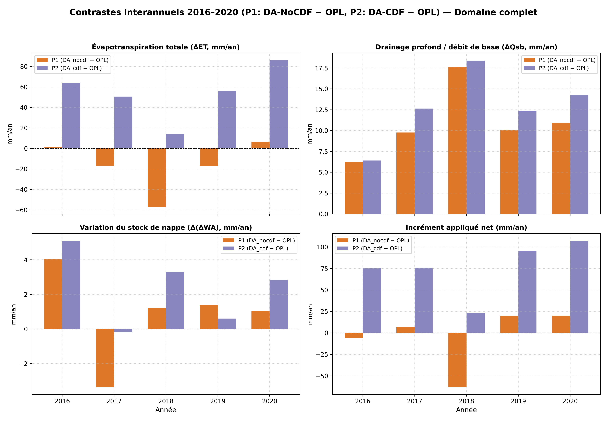
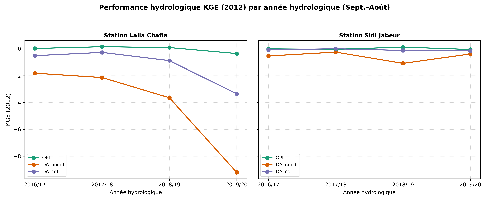

# RAPPORT D'ÉTAPE A6 — Variabilité interannuelle 2016–2020 (H9)

> [!NOTE]
> Ce rapport présente les résultats de la variabilité interannuelle 2016–2020 pour les trois simulations de production autorisées (OPL, DA_nocdf et DA_cdf). Tous les chiffres sont produits directement par script depuis les sorties LIS, les restarts, les DAOBS, les fichiers d'incréments EnKF et les observations de référence (GLEAM v4.3a, WaPOR v3, débits jaugés).

## 1. Inventaire des données et simulations (TÂCHE 1)

Fichier source : `paper1/tables/A6_inventory.csv`

| run | year | n_daily_output_files | restarts_available | routing_outputs_available | enkf_increment_files | gleam_path | gleam_version | gleam_variables | gleam_years | wapor_path | wapor_version | wapor_variables | wapor_years | validated_stations_valid_days |
| :---: | :---: | :--- | :--- | :--- | :--- | :--- | :--- | :--- | :---: | :--- | :--- | :--- | :---: | :--- |
| OPL | 2016 | 366 | 13 restarts (2016-01-01 au 2016-12-31) | 366 fichiers journaliers (/home/mohammad.elaabaribao/lustre/empowermed-ahl6xm8o7mg/users/mohammad.elaabaribao/NoahMP_Morocco/experiments/NorthMor/routing/output/OPL_linres0_2016_2020/ROUTING) | absent (run déterministe OPL sans assimilation) | data/validation/evapotranspiration/GLEAM/raw | v4.3a | E, Ep (Eb, Et, Ei: absent) | 2015-2020 | data/validation/evapotranspiration/WaPOR | v3 (annuel: WaPOR_v3_E, WaPOR_v3_T, WaPOR_v3_AETI) | E, T, AETI (I: absent) | 2018, 2019, 2020 | Lalla Chafia: 366 j, Sidi Jabeur: 366 j, Sebou amont: absent (non j.) |
| OPL | 2017 | 365 | 13 restarts (2017-01-01 au 2017-12-31) | 366 fichiers journaliers (/home/mohammad.elaabaribao/lustre/empowermed-ahl6xm8o7mg/users/mohammad.elaabaribao/NoahMP_Morocco/experiments/NorthMor/routing/output/OPL_linres0_2016_2020/ROUTING) | absent (run déterministe OPL sans assimilation) | data/validation/evapotranspiration/GLEAM/raw | v4.3a | E, Ep (Eb, Et, Ei: absent) | 2015-2020 | data/validation/evapotranspiration/WaPOR | v3 (annuel: WaPOR_v3_E, WaPOR_v3_T, WaPOR_v3_AETI) | E, T, AETI (I: absent) | 2018, 2019, 2020 | Lalla Chafia: 365 j, Sidi Jabeur: 365 j, Sebou amont: absent (non j.) |
| OPL | 2018 | 365 | 13 restarts (2018-01-01 au 2018-12-31) | 366 fichiers journaliers (/home/mohammad.elaabaribao/lustre/empowermed-ahl6xm8o7mg/users/mohammad.elaabaribao/NoahMP_Morocco/experiments/NorthMor/routing/output/OPL_linres0_2016_2020/ROUTING) | absent (run déterministe OPL sans assimilation) | data/validation/evapotranspiration/GLEAM/raw | v4.3a | E, Ep (Eb, Et, Ei: absent) | 2015-2020 | data/validation/evapotranspiration/WaPOR | v3 (annuel: WaPOR_v3_E, WaPOR_v3_T, WaPOR_v3_AETI) | E, T, AETI (I: absent) | 2018, 2019, 2020 | Lalla Chafia: 364 j, Sidi Jabeur: 365 j, Sebou amont: absent (non j.) |
| OPL | 2019 | 365 | 13 restarts (2019-01-01 au 2019-12-31) | 366 fichiers journaliers (/home/mohammad.elaabaribao/lustre/empowermed-ahl6xm8o7mg/users/mohammad.elaabaribao/NoahMP_Morocco/experiments/NorthMor/routing/output/OPL_linres0_2016_2020/ROUTING) | absent (run déterministe OPL sans assimilation) | data/validation/evapotranspiration/GLEAM/raw | v4.3a | E, Ep (Eb, Et, Ei: absent) | 2015-2020 | data/validation/evapotranspiration/WaPOR | v3 (annuel: WaPOR_v3_E, WaPOR_v3_T, WaPOR_v3_AETI) | E, T, AETI (I: absent) | 2018, 2019, 2020 | Lalla Chafia: 365 j, Sidi Jabeur: 365 j, Sebou amont: absent (non j.) |
| OPL | 2020 | 366 | 13 restarts (2020-01-01 au 2020-12-31) | 367 fichiers journaliers (/home/mohammad.elaabaribao/lustre/empowermed-ahl6xm8o7mg/users/mohammad.elaabaribao/NoahMP_Morocco/experiments/NorthMor/routing/output/OPL_linres0_2016_2020/ROUTING) | absent (run déterministe OPL sans assimilation) | data/validation/evapotranspiration/GLEAM/raw | v4.3a | E, Ep (Eb, Et, Ei: absent) | 2015-2020 | data/validation/evapotranspiration/WaPOR | v3 (annuel: WaPOR_v3_E, WaPOR_v3_T, WaPOR_v3_AETI) | E, T, AETI (I: absent) | 2018, 2019, 2020 | Lalla Chafia: 366 j, Sidi Jabeur: 366 j, Sebou amont: absent (non j.) |
| DA_nocdf | 2016 | 366 | 13 restarts (2016-01-01 au 2016-12-31) | 366 fichiers journaliers (/home/mohammad.elaabaribao/lustre/empowermed-ahl6xm8o7mg/users/mohammad.elaabaribao/NoahMP_Morocco/experiments/NorthMor/routing/output/DA_nocdf_linres0_2016_2020/ROUTING) | 944 fichiers d'incréments | data/validation/evapotranspiration/GLEAM/raw | v4.3a | E, Ep (Eb, Et, Ei: absent) | 2015-2020 | data/validation/evapotranspiration/WaPOR | v3 (annuel: WaPOR_v3_E, WaPOR_v3_T, WaPOR_v3_AETI) | E, T, AETI (I: absent) | 2018, 2019, 2020 | Lalla Chafia: 366 j, Sidi Jabeur: 366 j, Sebou amont: absent (non j.) |
| DA_nocdf | 2017 | 365 | 13 restarts (2017-01-01 au 2017-12-31) | 366 fichiers journaliers (/home/mohammad.elaabaribao/lustre/empowermed-ahl6xm8o7mg/users/mohammad.elaabaribao/NoahMP_Morocco/experiments/NorthMor/routing/output/DA_nocdf_linres0_2016_2020/ROUTING) | 945 fichiers d'incréments | data/validation/evapotranspiration/GLEAM/raw | v4.3a | E, Ep (Eb, Et, Ei: absent) | 2015-2020 | data/validation/evapotranspiration/WaPOR | v3 (annuel: WaPOR_v3_E, WaPOR_v3_T, WaPOR_v3_AETI) | E, T, AETI (I: absent) | 2018, 2019, 2020 | Lalla Chafia: 365 j, Sidi Jabeur: 365 j, Sebou amont: absent (non j.) |
| DA_nocdf | 2018 | 365 | 13 restarts (2018-01-01 au 2018-12-31) | 366 fichiers journaliers (/home/mohammad.elaabaribao/lustre/empowermed-ahl6xm8o7mg/users/mohammad.elaabaribao/NoahMP_Morocco/experiments/NorthMor/routing/output/DA_nocdf_linres0_2016_2020/ROUTING) | 929 fichiers d'incréments | data/validation/evapotranspiration/GLEAM/raw | v4.3a | E, Ep (Eb, Et, Ei: absent) | 2015-2020 | data/validation/evapotranspiration/WaPOR | v3 (annuel: WaPOR_v3_E, WaPOR_v3_T, WaPOR_v3_AETI) | E, T, AETI (I: absent) | 2018, 2019, 2020 | Lalla Chafia: 364 j, Sidi Jabeur: 365 j, Sebou amont: absent (non j.) |
| DA_nocdf | 2019 | 365 | 13 restarts (2019-01-01 au 2019-12-31) | 366 fichiers journaliers (/home/mohammad.elaabaribao/lustre/empowermed-ahl6xm8o7mg/users/mohammad.elaabaribao/NoahMP_Morocco/experiments/NorthMor/routing/output/DA_nocdf_linres0_2016_2020/ROUTING) | 860 fichiers d'incréments | data/validation/evapotranspiration/GLEAM/raw | v4.3a | E, Ep (Eb, Et, Ei: absent) | 2015-2020 | data/validation/evapotranspiration/WaPOR | v3 (annuel: WaPOR_v3_E, WaPOR_v3_T, WaPOR_v3_AETI) | E, T, AETI (I: absent) | 2018, 2019, 2020 | Lalla Chafia: 365 j, Sidi Jabeur: 365 j, Sebou amont: absent (non j.) |
| DA_nocdf | 2020 | 366 | 13 restarts (2020-01-01 au 2020-12-31) | 367 fichiers journaliers (/home/mohammad.elaabaribao/lustre/empowermed-ahl6xm8o7mg/users/mohammad.elaabaribao/NoahMP_Morocco/experiments/NorthMor/routing/output/DA_nocdf_linres0_2016_2020/ROUTING) | 941 fichiers d'incréments | data/validation/evapotranspiration/GLEAM/raw | v4.3a | E, Ep (Eb, Et, Ei: absent) | 2015-2020 | data/validation/evapotranspiration/WaPOR | v3 (annuel: WaPOR_v3_E, WaPOR_v3_T, WaPOR_v3_AETI) | E, T, AETI (I: absent) | 2018, 2019, 2020 | Lalla Chafia: 366 j, Sidi Jabeur: 366 j, Sebou amont: absent (non j.) |
| DA_cdf | 2016 | 366 | 13 restarts (2016-01-01 au 2016-12-31) | 366 fichiers journaliers (/home/mohammad.elaabaribao/lustre/empowermed-ahl6xm8o7mg/users/mohammad.elaabaribao/NoahMP_Morocco/experiments/NorthMor/routing/output/DA_cdf_linres0_2016_2020/ROUTING) | 933 fichiers d'incréments | data/validation/evapotranspiration/GLEAM/raw | v4.3a | E, Ep (Eb, Et, Ei: absent) | 2015-2020 | data/validation/evapotranspiration/WaPOR | v3 (annuel: WaPOR_v3_E, WaPOR_v3_T, WaPOR_v3_AETI) | E, T, AETI (I: absent) | 2018, 2019, 2020 | Lalla Chafia: 366 j, Sidi Jabeur: 366 j, Sebou amont: absent (non j.) |
| DA_cdf | 2017 | 365 | 13 restarts (2017-01-01 au 2017-12-31) | 366 fichiers journaliers (/home/mohammad.elaabaribao/lustre/empowermed-ahl6xm8o7mg/users/mohammad.elaabaribao/NoahMP_Morocco/experiments/NorthMor/routing/output/DA_cdf_linres0_2016_2020/ROUTING) | 939 fichiers d'incréments | data/validation/evapotranspiration/GLEAM/raw | v4.3a | E, Ep (Eb, Et, Ei: absent) | 2015-2020 | data/validation/evapotranspiration/WaPOR | v3 (annuel: WaPOR_v3_E, WaPOR_v3_T, WaPOR_v3_AETI) | E, T, AETI (I: absent) | 2018, 2019, 2020 | Lalla Chafia: 365 j, Sidi Jabeur: 365 j, Sebou amont: absent (non j.) |
| DA_cdf | 2018 | 365 | 13 restarts (2018-01-01 au 2018-12-31) | 366 fichiers journaliers (/home/mohammad.elaabaribao/lustre/empowermed-ahl6xm8o7mg/users/mohammad.elaabaribao/NoahMP_Morocco/experiments/NorthMor/routing/output/DA_cdf_linres0_2016_2020/ROUTING) | 911 fichiers d'incréments | data/validation/evapotranspiration/GLEAM/raw | v4.3a | E, Ep (Eb, Et, Ei: absent) | 2015-2020 | data/validation/evapotranspiration/WaPOR | v3 (annuel: WaPOR_v3_E, WaPOR_v3_T, WaPOR_v3_AETI) | E, T, AETI (I: absent) | 2018, 2019, 2020 | Lalla Chafia: 364 j, Sidi Jabeur: 365 j, Sebou amont: absent (non j.) |
| DA_cdf | 2019 | 365 | 13 restarts (2019-01-01 au 2019-12-31) | 366 fichiers journaliers (/home/mohammad.elaabaribao/lustre/empowermed-ahl6xm8o7mg/users/mohammad.elaabaribao/NoahMP_Morocco/experiments/NorthMor/routing/output/DA_cdf_linres0_2016_2020/ROUTING) | 863 fichiers d'incréments | data/validation/evapotranspiration/GLEAM/raw | v4.3a | E, Ep (Eb, Et, Ei: absent) | 2015-2020 | data/validation/evapotranspiration/WaPOR | v3 (annuel: WaPOR_v3_E, WaPOR_v3_T, WaPOR_v3_AETI) | E, T, AETI (I: absent) | 2018, 2019, 2020 | Lalla Chafia: 365 j, Sidi Jabeur: 365 j, Sebou amont: absent (non j.) |
| DA_cdf | 2020 | 366 | 13 restarts (2020-01-01 au 2020-12-31) | 367 fichiers journaliers (/home/mohammad.elaabaribao/lustre/empowermed-ahl6xm8o7mg/users/mohammad.elaabaribao/NoahMP_Morocco/experiments/NorthMor/routing/output/DA_cdf_linres0_2016_2020/ROUTING) | 931 fichiers d'incréments | data/validation/evapotranspiration/GLEAM/raw | v4.3a | E, Ep (Eb, Et, Ei: absent) | 2015-2020 | data/validation/evapotranspiration/WaPOR | v3 (annuel: WaPOR_v3_E, WaPOR_v3_T, WaPOR_v3_AETI) | E, T, AETI (I: absent) | 2018, 2019, 2020 | Lalla Chafia: 366 j, Sidi Jabeur: 366 j, Sebou amont: absent (non j.) |

## 2. Bilan annuel par run (TÂCHE 2)

Fichier source : `paper1/tables/A6_annual_budget.csv`

### Bilan hydrique annuel complet (Domaine complet et 3 bassins)

| run | year | region | P_mm | ET_mm | ESoil_mm | TVeg_mm | ECanop_mm | Qs_mm | Qsb_mm | Delta_S_sol_mm | Delta_WA_mm | Delta_CANWAT_mm | Delta_SNEQV_mm | Delta_S_total_mm | residual_mm | applied_increment_mm |
| :---: | :---: | :--- | :--- | :--- | :--- | :--- | :--- | :--- | :--- | :--- | :--- | :--- | :--- | :--- | :--- | :--- |
| OPL | 2016 | Domaine complet | 281.65 | 209.23 | 144.79 | 55.28 | 8.7 | 7.78 | 9.27 | 63.37 | -7.13 | -0.0 | 1.01 | 57.25 | -1.88 | absent |
| OPL | 2016 | Lalla Chafia | 450.61 | 326.0 | 181.78 | 124.26 | 19.94 | 9.32 | 15.68 | 113.54 | -13.97 | 0.0 | 0.0 | 99.57 | 0.04 | absent |
| OPL | 2016 | Sidi Jabeur | 393.66 | 263.12 | 183.15 | 67.35 | 12.61 | 7.72 | 13.18 | 118.97 | -13.63 | 0.0 | 0.0 | 105.34 | 4.3 | absent |
| OPL | 2016 | Sebou amont | 496.17 | 367.8 | 178.13 | 148.81 | 35.31 | 7.44 | 9.47 | 115.61 | -11.44 | 0.0 | 8.07 | 112.23 | -0.77 | absent |
| OPL | 2017 | Domaine complet | 177.03 | 223.07 | 125.11 | 87.78 | 9.79 | 5.42 | 11.75 | -55.69 | -2.21 | 0.0 | -0.94 | -58.84 | -4.37 | absent |
| OPL | 2017 | Lalla Chafia | 380.74 | 421.33 | 163.64 | 227.02 | 30.27 | 7.2 | 14.04 | -63.66 | 2.82 | 0.01 | 0.0 | -60.83 | -0.99 | absent |
| OPL | 2017 | Sidi Jabeur | 331.72 | 380.24 | 157.53 | 197.77 | 24.83 | 6.05 | 13.06 | -71.32 | 5.11 | 0.0 | 0.0 | -66.2 | -1.42 | absent |
| OPL | 2017 | Sebou amont | 277.4 | 391.44 | 167.8 | 184.66 | 35.9 | 4.74 | 10.5 | -118.61 | 0.61 | 0.0 | -8.07 | -126.06 | -3.22 | absent |
| OPL | 2018 | Domaine complet | 379.39 | 326.61 | 208.68 | 103.13 | 14.33 | 11.93 | 16.29 | 25.73 | 3.28 | -0.0 | -0.06 | 28.95 | -4.39 | absent |
| OPL | 2018 | Lalla Chafia | 762.54 | 607.85 | 253.42 | 311.62 | 42.34 | 23.21 | 52.44 | 48.93 | 30.85 | -0.01 | 0.0 | 79.77 | -0.72 | absent |
| OPL | 2018 | Sidi Jabeur | 637.39 | 533.55 | 234.71 | 264.62 | 33.99 | 15.19 | 24.53 | 44.93 | 20.05 | -0.0 | 0.0 | 64.98 | -0.85 | absent |
| OPL | 2018 | Sebou amont | 576.56 | 471.3 | 230.53 | 193.17 | 45.22 | 8.65 | 8.8 | 92.09 | -1.15 | -0.0 | -0.0 | 90.94 | -3.13 | absent |
| OPL | 2019 | Domaine complet | 184.13 | 213.95 | 126.16 | 77.58 | 10.06 | 4.88 | 9.59 | -33.03 | -6.4 | -0.0 | -0.0 | -39.43 | -4.85 | absent |
| OPL | 2019 | Lalla Chafia | 257.39 | 329.63 | 120.15 | 186.12 | 23.36 | 6.61 | 24.34 | -80.18 | -21.7 | 0.0 | 0.0 | -101.88 | -1.32 | absent |
| OPL | 2019 | Sidi Jabeur | 238.99 | 306.92 | 119.24 | 163.17 | 24.52 | 5.17 | 18.64 | -75.55 | -17.49 | 0.0 | 0.0 | -93.04 | 1.31 | absent |
| OPL | 2019 | Sebou amont | 287.08 | 364.54 | 148.29 | 180.82 | 34.8 | 4.13 | 8.36 | -80.53 | -6.03 | 0.0 | 0.0 | -86.55 | -3.4 | absent |
| OPL | 2020 | Domaine complet | 192.3 | 191.39 | 125.44 | 57.34 | 8.48 | 4.58 | 6.65 | -0.8 | -3.71 | 0.0 | 0.06 | -4.45 | -5.86 | absent |
| OPL | 2020 | Lalla Chafia | 293.5 | 282.93 | 151.07 | 114.62 | 17.24 | 5.87 | 13.79 | 5.59 | -15.09 | 0.0 | 0.0 | -9.5 | 0.41 | absent |
| OPL | 2020 | Sidi Jabeur | 276.15 | 251.52 | 155.18 | 83.25 | 13.09 | 5.01 | 11.17 | 19.09 | -13.78 | 0.0 | 0.0 | 5.31 | 3.13 | absent |
| OPL | 2020 | Sebou amont | 373.43 | 363.98 | 185.61 | 142.13 | 35.62 | 4.6 | 5.9 | 8.63 | -5.0 | 0.0 | 0.25 | 3.88 | -4.93 | absent |
| DA_nocdf | 2016 | Domaine complet | 282.37 | 210.29 | 160.56 | 42.42 | 6.91 | 8.51 | 15.47 | 43.76 | -3.08 | -0.0 | 1.01 | 41.68 | 6.41 | -6.41 |
| DA_nocdf | 2016 | Lalla Chafia | 451.46 | 399.45 | 230.16 | 147.41 | 21.88 | 11.44 | 36.12 | 183.73 | 22.89 | -0.0 | 0.0 | 206.63 | -202.18 | 202.18 |
| DA_nocdf | 2016 | Sidi Jabeur | 394.96 | 290.17 | 204.88 | 73.14 | 12.14 | 8.66 | 19.98 | 154.44 | -1.63 | -0.0 | 0.0 | 152.8 | -76.64 | 76.64 |
| DA_nocdf | 2016 | Sebou amont | 497.6 | 309.99 | 192.65 | 89.16 | 23.39 | 7.88 | 12.13 | 106.78 | -6.54 | 0.0 | 7.98 | 108.22 | 59.38 | -59.38 |
| DA_nocdf | 2017 | Domaine complet | 177.47 | 205.8 | 136.71 | 61.33 | 7.42 | 6.15 | 21.51 | -42.93 | -5.57 | 0.0 | -0.93 | -49.43 | -6.57 | 6.57 |
| DA_nocdf | 2017 | Lalla Chafia | 381.9 | 440.44 | 213.84 | 197.97 | 28.19 | 19.49 | 126.86 | -93.68 | -6.11 | 0.01 | 0.0 | -99.78 | -105.12 | 105.12 |
| DA_nocdf | 2017 | Sidi Jabeur | 332.36 | 385.0 | 182.83 | 179.38 | 22.69 | 11.83 | 73.76 | -78.17 | 15.78 | 0.01 | 0.0 | -62.39 | -75.85 | 75.85 |
| DA_nocdf | 2017 | Sebou amont | 278.21 | 301.99 | 154.04 | 118.26 | 27.2 | 4.88 | 13.22 | -101.93 | -5.24 | 0.0 | -7.97 | -115.14 | 73.26 | -73.26 |
| DA_nocdf | 2018 | Domaine complet | 380.33 | 269.8 | 182.63 | 75.14 | 11.59 | 13.99 | 33.9 | -4.85 | 4.51 | -0.0 | -0.06 | -0.4 | 63.05 | -63.05 |
| DA_nocdf | 2018 | Lalla Chafia | 764.3 | 650.19 | 305.71 | 300.15 | 43.68 | 53.5 | 286.64 | 36.43 | 47.21 | -0.01 | 0.0 | 83.63 | -309.65 | 309.65 |
| DA_nocdf | 2018 | Sidi Jabeur | 639.25 | 568.22 | 270.4 | 262.47 | 35.06 | 32.19 | 157.71 | 54.89 | 40.16 | -0.01 | 0.0 | 95.04 | -213.91 | 213.91 |
| DA_nocdf | 2018 | Sebou amont | 577.97 | 365.01 | 218.72 | 112.86 | 31.09 | 9.84 | 22.3 | 46.33 | 6.77 | -0.0 | -0.0 | 53.1 | 127.72 | -127.72 |
| DA_nocdf | 2019 | Domaine complet | 184.59 | 196.82 | 135.55 | 53.77 | 7.39 | 5.51 | 19.69 | -13.03 | -5.03 | -0.0 | -0.0 | -18.06 | -19.37 | 19.37 |
| DA_nocdf | 2019 | Lalla Chafia | 258.16 | 413.9 | 195.94 | 195.02 | 22.94 | 13.6 | 130.09 | 15.46 | -17.23 | 0.0 | 0.0 | -1.76 | -297.67 | 297.67 |
| DA_nocdf | 2019 | Sidi Jabeur | 239.65 | 343.36 | 161.84 | 157.98 | 23.54 | 9.47 | 74.11 | -21.98 | -29.01 | 0.0 | 0.0 | -50.99 | -136.29 | 136.29 |
| DA_nocdf | 2019 | Sebou amont | 287.9 | 302.11 | 159.27 | 116.47 | 25.8 | 4.81 | 16.6 | -25.23 | -6.64 | 0.0 | 0.0 | -31.86 | -3.76 | 3.76 |
| DA_nocdf | 2020 | Domaine complet | 192.79 | 197.96 | 142.83 | 48.07 | 6.95 | 5.42 | 17.52 | -5.49 | -2.67 | 0.0 | 0.06 | -8.11 | -20.01 | 20.01 |
| DA_nocdf | 2020 | Lalla Chafia | 294.42 | 454.59 | 204.04 | 221.95 | 28.6 | 12.81 | 103.58 | -58.68 | -31.27 | 0.0 | 0.0 | -89.95 | -186.62 | 186.62 |
| DA_nocdf | 2020 | Sidi Jabeur | 276.71 | 364.79 | 178.81 | 163.4 | 22.58 | 9.15 | 52.65 | -52.98 | -16.56 | 0.0 | 0.0 | -69.53 | -80.34 | 80.34 |
| DA_nocdf | 2020 | Sebou amont | 374.35 | 296.45 | 177.79 | 91.75 | 26.31 | 5.48 | 13.65 | -13.8 | -3.42 | 0.0 | 0.28 | -16.94 | 75.7 | -75.7 |
| DA_cdf | 2016 | Domaine complet | 282.37 | 273.15 | 204.74 | 59.24 | 8.7 | 8.45 | 15.68 | 61.62 | -2.03 | -0.0 | 1.02 | 60.61 | -75.53 | 75.53 |
| DA_cdf | 2016 | Lalla Chafia | 451.46 | 400.7 | 229.4 | 150.02 | 21.28 | 11.21 | 31.91 | 118.81 | 1.05 | -0.0 | 0.0 | 119.86 | -112.22 | 112.22 |
| DA_cdf | 2016 | Sidi Jabeur | 394.96 | 338.75 | 231.16 | 93.27 | 14.32 | 8.85 | 21.59 | 120.4 | -5.96 | -0.0 | 0.0 | 114.44 | -88.67 | 88.67 |
| DA_cdf | 2016 | Sebou amont | 497.6 | 406.72 | 230.17 | 139.58 | 31.54 | 8.08 | 13.9 | 112.58 | -5.41 | 0.0 | 7.98 | 115.15 | -46.26 | 46.26 |
| DA_cdf | 2017 | Domaine complet | 177.47 | 273.66 | 181.53 | 82.52 | 9.22 | 6.25 | 24.39 | -47.58 | -2.41 | 0.0 | -0.95 | -50.93 | -75.9 | 75.9 |
| DA_cdf | 2017 | Lalla Chafia | 381.9 | 443.53 | 212.39 | 203.03 | 27.77 | 12.97 | 77.54 | -74.12 | 7.12 | 0.01 | 0.0 | -66.99 | -85.14 | 85.14 |
| DA_cdf | 2017 | Sidi Jabeur | 332.36 | 403.13 | 205.41 | 174.96 | 22.66 | 8.9 | 47.24 | -65.95 | 8.48 | 0.01 | 0.0 | -57.46 | -69.44 | 69.44 |
| DA_cdf | 2017 | Sebou amont | 278.21 | 416.97 | 205.24 | 174.6 | 34.27 | 5.19 | 16.1 | -95.36 | -0.61 | 0.0 | -7.98 | -103.95 | -56.09 | 56.09 |
| DA_cdf | 2018 | Domaine complet | 380.33 | 340.63 | 232.36 | 94.06 | 13.7 | 14.23 | 34.67 | 7.61 | 6.57 | -0.0 | -0.06 | 14.12 | -23.32 | 23.32 |
| DA_cdf | 2018 | Lalla Chafia | 764.3 | 586.31 | 271.18 | 275.36 | 39.29 | 32.93 | 116.8 | 31.68 | 20.43 | -0.01 | 0.0 | 52.09 | -23.83 | 23.83 |
| DA_cdf | 2018 | Sidi Jabeur | 639.25 | 543.05 | 266.48 | 243.67 | 32.67 | 23.91 | 98.84 | 28.23 | 21.68 | -0.01 | 0.0 | 49.9 | -76.45 | 76.45 |
| DA_cdf | 2018 | Sebou amont | 577.97 | 457.5 | 245.75 | 167.89 | 41.32 | 11.02 | 23.83 | 42.45 | 7.27 | -0.0 | -0.0 | 49.71 | 35.9 | -35.9 |
| DA_cdf | 2019 | Domaine complet | 184.59 | 269.64 | 189.54 | 70.96 | 8.99 | 5.71 | 21.9 | -11.82 | -5.8 | -0.0 | -0.0 | -17.62 | -95.04 | 95.04 |
| DA_cdf | 2019 | Lalla Chafia | 258.16 | 375.46 | 184.97 | 169.65 | 20.84 | 9.02 | 62.0 | -18.75 | -18.04 | 0.0 | 0.0 | -36.79 | -151.53 | 151.53 |
| DA_cdf | 2019 | Sidi Jabeur | 239.65 | 348.08 | 185.1 | 141.67 | 21.31 | 7.23 | 48.24 | -14.3 | -12.34 | 0.0 | 0.0 | -26.64 | -137.25 | 137.25 |
| DA_cdf | 2019 | Sebou amont | 287.9 | 398.66 | 200.65 | 165.38 | 32.01 | 5.3 | 19.8 | -22.6 | -6.18 | 0.0 | 0.0 | -28.78 | -107.07 | 107.07 |
| DA_cdf | 2020 | Domaine complet | 192.79 | 277.32 | 199.88 | 68.09 | 9.22 | 5.72 | 20.89 | -3.02 | -0.88 | 0.0 | 0.06 | -3.84 | -107.31 | 107.31 |
| DA_cdf | 2020 | Lalla Chafia | 294.42 | 415.92 | 215.33 | 177.67 | 22.92 | 8.9 | 52.79 | -23.64 | -7.33 | 0.0 | 0.0 | -30.96 | -152.22 | 152.22 |
| DA_cdf | 2020 | Sidi Jabeur | 276.71 | 382.37 | 215.65 | 147.17 | 19.55 | 8.02 | 48.16 | -25.67 | -6.33 | 0.0 | 0.0 | -31.99 | -129.86 | 129.86 |
| DA_cdf | 2020 | Sebou amont | 374.35 | 411.44 | 219.93 | 153.46 | 37.34 | 7.09 | 29.6 | -8.77 | 3.74 | 0.0 | 0.3 | -4.74 | -69.05 | 69.05 |

### Contrastes interannuels P1 (DA_nocdf − OPL) et P2 (DA_cdf − OPL)

Fichier source : `paper1/tables/A6_annual_contrasts.csv`

| contrast | year | region | delta_P_mm | delta_ET_mm | delta_ESoil_mm | delta_TVeg_mm | delta_ECanop_mm | delta_Qs_mm | delta_Qsb_mm | delta_Delta_S_sol_mm | delta_Delta_WA_mm | delta_Delta_CANWAT_mm | delta_Delta_SNEQV_mm | delta_Delta_S_total_mm | delta_residual_mm | applied_increment_mm |
| :--- | :---: | :--- | :--- | :--- | :--- | :--- | :--- | :--- | :--- | :--- | :--- | :--- | :--- | :--- | :--- | :--- |
| P1 (DA_nocdf - OPL) | 2016 | Domaine complet | 0.72 | 1.06 | 15.77 | -12.86 | -1.79 | 0.73 | 6.2 | -19.61 | 4.05 | 0.0 | 0.0 | -15.57 | 8.29 | -6.41 |
| P2 (DA_cdf - OPL) | 2016 | Domaine complet | 0.72 | 63.92 | 59.95 | 3.96 | 0.0 | 0.67 | 6.41 | -1.75 | 5.1 | 0.0 | 0.01 | 3.36 | -73.65 | 75.53 |
| P1 (DA_nocdf - OPL) | 2016 | Lalla Chafia | 0.85 | 73.45 | 48.38 | 23.15 | 1.94 | 2.12 | 20.44 | 70.19 | 36.86 | -0.0 | 0.0 | 107.06 | -202.22 | 202.18 |
| P2 (DA_cdf - OPL) | 2016 | Lalla Chafia | 0.85 | 74.7 | 47.62 | 25.76 | 1.34 | 1.89 | 16.23 | 5.27 | 15.02 | -0.0 | 0.0 | 20.29 | -112.26 | 112.22 |
| P1 (DA_nocdf - OPL) | 2016 | Sidi Jabeur | 1.3 | 27.05 | 21.73 | 5.79 | -0.47 | 0.94 | 6.8 | 35.47 | 12.0 | -0.0 | 0.0 | 47.46 | -80.94 | 76.64 |
| P2 (DA_cdf - OPL) | 2016 | Sidi Jabeur | 1.3 | 75.63 | 48.01 | 25.92 | 1.71 | 1.13 | 8.41 | 1.43 | 7.67 | -0.0 | 0.0 | 9.1 | -92.97 | 88.67 |
| P1 (DA_nocdf - OPL) | 2016 | Sebou amont | 1.43 | -57.81 | 14.52 | -59.65 | -11.92 | 0.44 | 2.66 | -8.83 | 4.9 | 0.0 | -0.09 | -4.01 | 60.15 | -59.38 |
| P2 (DA_cdf - OPL) | 2016 | Sebou amont | 1.43 | 38.92 | 52.04 | -9.23 | -3.77 | 0.64 | 4.43 | -3.03 | 6.03 | 0.0 | -0.09 | 2.92 | -45.49 | 46.26 |
| P1 (DA_nocdf - OPL) | 2017 | Domaine complet | 0.44 | -17.27 | 11.6 | -26.45 | -2.37 | 0.73 | 9.76 | 12.76 | -3.36 | 0.0 | 0.01 | 9.41 | -2.2 | 6.57 |
| P2 (DA_cdf - OPL) | 2017 | Domaine complet | 0.44 | 50.59 | 56.42 | -5.26 | -0.57 | 0.83 | 12.64 | 8.11 | -0.2 | 0.0 | -0.01 | 7.91 | -71.53 | 75.9 |
| P1 (DA_nocdf - OPL) | 2017 | Lalla Chafia | 1.16 | 19.11 | 50.2 | -29.05 | -2.08 | 12.29 | 112.82 | -30.02 | -8.93 | 0.0 | 0.0 | -38.95 | -104.13 | 105.12 |
| P2 (DA_cdf - OPL) | 2017 | Lalla Chafia | 1.16 | 22.2 | 48.75 | -23.99 | -2.5 | 5.77 | 63.5 | -10.46 | 4.3 | 0.0 | 0.0 | -6.16 | -84.15 | 85.14 |
| P1 (DA_nocdf - OPL) | 2017 | Sidi Jabeur | 0.64 | 4.76 | 25.3 | -18.39 | -2.14 | 5.78 | 60.7 | -6.85 | 10.67 | 0.01 | 0.0 | 3.81 | -74.43 | 75.85 |
| P2 (DA_cdf - OPL) | 2017 | Sidi Jabeur | 0.64 | 22.89 | 47.88 | -22.81 | -2.17 | 2.85 | 34.18 | 5.37 | 3.37 | 0.01 | 0.0 | 8.74 | -68.02 | 69.44 |
| P1 (DA_nocdf - OPL) | 2017 | Sebou amont | 0.81 | -89.45 | -13.76 | -66.4 | -8.7 | 0.14 | 2.72 | 16.68 | -5.85 | 0.0 | 0.1 | 10.92 | 76.48 | -73.26 |
| P2 (DA_cdf - OPL) | 2017 | Sebou amont | 0.81 | 25.53 | 37.44 | -10.06 | -1.63 | 0.45 | 5.6 | 23.25 | -1.22 | 0.0 | 0.09 | 22.11 | -52.87 | 56.09 |
| P1 (DA_nocdf - OPL) | 2018 | Domaine complet | 0.94 | -56.81 | -26.05 | -27.99 | -2.74 | 2.06 | 17.61 | -30.58 | 1.23 | 0.0 | 0.0 | -29.35 | 67.44 | -63.05 |
| P2 (DA_cdf - OPL) | 2018 | Domaine complet | 0.94 | 14.02 | 23.68 | -9.07 | -0.63 | 2.3 | 18.38 | -18.12 | 3.29 | 0.0 | 0.0 | -14.83 | -18.93 | 23.32 |
| P1 (DA_nocdf - OPL) | 2018 | Lalla Chafia | 1.76 | 42.34 | 52.29 | -11.47 | 1.34 | 30.29 | 234.2 | -12.5 | 16.36 | 0.0 | 0.0 | 3.86 | -308.93 | 309.65 |
| P2 (DA_cdf - OPL) | 2018 | Lalla Chafia | 1.76 | -21.54 | 17.76 | -36.26 | -3.05 | 9.72 | 64.36 | -17.25 | -10.42 | 0.0 | 0.0 | -27.68 | -23.11 | 23.83 |
| P1 (DA_nocdf - OPL) | 2018 | Sidi Jabeur | 1.86 | 34.67 | 35.69 | -2.15 | 1.07 | 17.0 | 133.18 | 9.96 | 20.11 | -0.01 | 0.0 | 30.06 | -213.06 | 213.91 |
| P2 (DA_cdf - OPL) | 2018 | Sidi Jabeur | 1.86 | 9.5 | 31.77 | -20.95 | -1.32 | 8.72 | 74.31 | -16.7 | 1.63 | -0.01 | 0.0 | -15.08 | -75.6 | 76.45 |
| P1 (DA_nocdf - OPL) | 2018 | Sebou amont | 1.41 | -106.29 | -11.81 | -80.31 | -14.13 | 1.19 | 13.5 | -45.76 | 7.92 | 0.0 | 0.0 | -37.84 | 130.85 | -127.72 |
| P2 (DA_cdf - OPL) | 2018 | Sebou amont | 1.41 | -13.8 | 15.22 | -25.28 | -3.9 | 2.37 | 15.03 | -49.64 | 8.42 | 0.0 | 0.0 | -41.23 | 39.03 | -35.9 |
| P1 (DA_nocdf - OPL) | 2019 | Domaine complet | 0.46 | -17.13 | 9.39 | -23.81 | -2.67 | 0.63 | 10.1 | 20.0 | 1.37 | 0.0 | 0.0 | 21.37 | -14.52 | 19.37 |
| P2 (DA_cdf - OPL) | 2019 | Domaine complet | 0.46 | 55.69 | 63.38 | -6.62 | -1.07 | 0.83 | 12.31 | 21.21 | 0.6 | 0.0 | 0.0 | 21.81 | -90.19 | 95.04 |
| P1 (DA_nocdf - OPL) | 2019 | Lalla Chafia | 0.77 | 84.27 | 75.79 | 8.9 | -0.42 | 6.99 | 105.75 | 95.64 | 4.47 | 0.0 | 0.0 | 100.12 | -296.35 | 297.67 |
| P2 (DA_cdf - OPL) | 2019 | Lalla Chafia | 0.77 | 45.83 | 64.82 | -16.47 | -2.52 | 2.41 | 37.66 | 61.43 | 3.66 | 0.0 | 0.0 | 65.09 | -150.21 | 151.53 |
| P1 (DA_nocdf - OPL) | 2019 | Sidi Jabeur | 0.66 | 36.44 | 42.6 | -5.19 | -0.98 | 4.3 | 55.47 | 53.57 | -11.52 | 0.0 | 0.0 | 42.05 | -137.6 | 136.29 |
| P2 (DA_cdf - OPL) | 2019 | Sidi Jabeur | 0.66 | 41.16 | 65.86 | -21.5 | -3.21 | 2.06 | 29.6 | 61.25 | 5.15 | 0.0 | 0.0 | 66.4 | -138.56 | 137.25 |
| P1 (DA_nocdf - OPL) | 2019 | Sebou amont | 0.82 | -62.43 | 10.98 | -64.35 | -9.0 | 0.68 | 8.24 | 55.3 | -0.61 | 0.0 | 0.0 | 54.69 | -0.36 | 3.76 |
| P2 (DA_cdf - OPL) | 2019 | Sebou amont | 0.82 | 34.12 | 52.36 | -15.44 | -2.79 | 1.17 | 11.44 | 57.93 | -0.15 | 0.0 | 0.0 | 57.77 | -103.67 | 107.07 |
| P1 (DA_nocdf - OPL) | 2020 | Domaine complet | 0.49 | 6.57 | 17.39 | -9.27 | -1.53 | 0.84 | 10.87 | -4.69 | 1.04 | 0.0 | 0.0 | -3.66 | -14.15 | 20.01 |
| P2 (DA_cdf - OPL) | 2020 | Domaine complet | 0.49 | 85.93 | 74.44 | 10.75 | 0.74 | 1.14 | 14.24 | -2.22 | 2.83 | 0.0 | 0.0 | 0.61 | -101.45 | 107.31 |
| P1 (DA_nocdf - OPL) | 2020 | Lalla Chafia | 0.92 | 171.66 | 52.97 | 107.33 | 11.36 | 6.94 | 89.79 | -64.27 | -16.18 | 0.0 | 0.0 | -80.45 | -187.03 | 186.62 |
| P2 (DA_cdf - OPL) | 2020 | Lalla Chafia | 0.92 | 132.99 | 64.26 | 63.05 | 5.68 | 3.03 | 39.0 | -29.23 | 7.76 | 0.0 | 0.0 | -21.46 | -152.63 | 152.22 |
| P1 (DA_nocdf - OPL) | 2020 | Sidi Jabeur | 0.56 | 113.27 | 23.63 | 80.15 | 9.49 | 4.14 | 41.48 | -72.07 | -2.78 | 0.0 | 0.0 | -74.84 | -83.47 | 80.34 |
| P2 (DA_cdf - OPL) | 2020 | Sidi Jabeur | 0.56 | 130.85 | 60.47 | 63.92 | 6.46 | 3.01 | 36.99 | -44.76 | 7.45 | 0.0 | 0.0 | -37.3 | -132.99 | 129.86 |
| P1 (DA_nocdf - OPL) | 2020 | Sebou amont | 0.92 | -67.53 | -7.82 | -50.38 | -9.31 | 0.88 | 7.75 | -22.43 | 1.58 | 0.0 | 0.03 | -20.82 | 80.63 | -75.7 |
| P2 (DA_cdf - OPL) | 2020 | Sebou amont | 0.92 | 47.46 | 34.32 | 11.33 | 1.72 | 2.49 | 23.7 | -17.4 | 8.74 | 0.0 | 0.05 | -8.62 | -64.12 | 69.05 |

### Contrôle 2018 face aux valeurs de l'étape A2b

| simulation | variable | valeur_A6 | valeur_A2b | ecart_A6_minus_A2b |
| :--- | :--- | :--- | :--- | :--- |
| DA_nocdf | P_mm | 380.33 | 380.33 | 0.0 |
| DA_nocdf | ET_mm | 269.8 | 269.8 | 0.0 |
| DA_nocdf | Qs_mm | 13.99 | 13.99 | 0.0 |
| DA_nocdf | Qsb_mm | 33.9 | 33.9 | 0.0 |
| DA_nocdf | Delta_S_total_mm | -0.4 | -0.4 | 0.0 |
| DA_nocdf | residual_mm | 63.05 | 63.05 | 0.0 |
| OPL (continu 2016-2020 vs OL_DAIC) | P_mm | 379.39 | 379.39 | 0.0 |
| OPL (continu 2016-2020 vs OL_DAIC) | ET_mm | 326.61 | 313.35 | 13.26 |
| OPL (continu 2016-2020 vs OL_DAIC) | Qs_mm | 11.93 | 12.46 | -0.53 |
| OPL (continu 2016-2020 vs OL_DAIC) | Qsb_mm | 16.29 | 18.67 | -2.38 |
| OPL (continu 2016-2020 vs OL_DAIC) | Delta_S_total_mm | 28.95 | 39.49 | -10.54 |
| OPL (continu 2016-2020 vs OL_DAIC) | residual_mm | -4.39 | -4.58 | 0.19 |

## 3. Incréments écrits vs appliqués par année (TÂCHE 3)

Fichier source : `paper1/tables/A6_increments_written_vs_applied.csv`

| run | year | region | written_incr_L1_net_mm | written_incr_L2_net_mm | written_incr_L3_net_mm | written_incr_L4_net_mm | written_incr_total_net_mm | applied_increment_mm | diff_written_minus_applied_mm |
| :---: | :---: | :--- | :--- | :--- | :--- | :--- | :--- | :--- | :--- |
| DA_nocdf | 2016 | Domaine complet | 0.0 | 0.0 | 0.0 | 0.0 | 0.0 | -6.41 | 6.41 |
| DA_nocdf | 2016 | Lalla Chafia | 0.0 | 0.0 | 0.0 | 0.0 | 0.0 | 202.18 | -202.18 |
| DA_nocdf | 2016 | Sidi Jabeur | 0.0 | 0.0 | 0.0 | 0.0 | 0.0 | 76.64 | -76.64 |
| DA_nocdf | 2016 | Sebou amont | 0.0 | 0.0 | 0.0 | 0.0 | 0.0 | -59.38 | 59.38 |
| DA_nocdf | 2017 | Domaine complet | 0.0 | 0.0 | 0.0 | 0.0 | 0.0 | 6.57 | -6.57 |
| DA_nocdf | 2017 | Lalla Chafia | 0.0 | 0.0 | 0.0 | 0.0 | 0.0 | 105.12 | -105.12 |
| DA_nocdf | 2017 | Sidi Jabeur | 0.0 | 0.0 | 0.0 | 0.0 | 0.0 | 75.85 | -75.85 |
| DA_nocdf | 2017 | Sebou amont | 0.0 | 0.0 | 0.0 | 0.0 | 0.0 | -73.26 | 73.26 |
| DA_nocdf | 2018 | Domaine complet | 0.0 | 0.0 | 0.0 | 0.0 | 0.0 | -63.05 | 63.05 |
| DA_nocdf | 2018 | Lalla Chafia | 0.0 | 0.0 | 0.0 | 0.0 | 0.0 | 309.65 | -309.65 |
| DA_nocdf | 2018 | Sidi Jabeur | 0.0 | 0.0 | 0.0 | 0.0 | 0.0 | 213.91 | -213.91 |
| DA_nocdf | 2018 | Sebou amont | 0.0 | 0.0 | 0.0 | 0.0 | 0.0 | -127.72 | 127.72 |
| DA_nocdf | 2019 | Domaine complet | 0.0 | 0.0 | 0.0 | 0.0 | 0.0 | 19.37 | -19.37 |
| DA_nocdf | 2019 | Lalla Chafia | 0.0 | 0.0 | 0.0 | 0.0 | 0.0 | 297.67 | -297.67 |
| DA_nocdf | 2019 | Sidi Jabeur | 0.0 | 0.0 | 0.0 | 0.0 | 0.0 | 136.29 | -136.29 |
| DA_nocdf | 2019 | Sebou amont | 0.0 | 0.0 | 0.0 | 0.0 | 0.0 | 3.76 | -3.76 |
| DA_nocdf | 2020 | Domaine complet | 0.0 | 0.0 | 0.0 | 0.0 | 0.0 | 20.01 | -20.01 |
| DA_nocdf | 2020 | Lalla Chafia | 0.0 | 0.0 | 0.0 | 0.0 | 0.0 | 186.62 | -186.62 |
| DA_nocdf | 2020 | Sidi Jabeur | 0.0 | 0.0 | 0.0 | 0.0 | 0.0 | 80.34 | -80.34 |
| DA_nocdf | 2020 | Sebou amont | 0.0 | 0.0 | 0.0 | 0.0 | 0.0 | -75.7 | 75.7 |
| DA_cdf | 2016 | Domaine complet | 0.0 | 0.0 | 0.0 | 0.0 | 0.0 | 75.53 | -75.53 |
| DA_cdf | 2016 | Lalla Chafia | 0.0 | 0.0 | 0.0 | 0.0 | 0.0 | 112.22 | -112.22 |
| DA_cdf | 2016 | Sidi Jabeur | 0.0 | 0.0 | 0.0 | 0.0 | 0.0 | 88.67 | -88.67 |
| DA_cdf | 2016 | Sebou amont | 0.0 | 0.0 | 0.0 | 0.0 | 0.0 | 46.26 | -46.26 |
| DA_cdf | 2017 | Domaine complet | 0.0 | 0.0 | 0.0 | 0.0 | 0.0 | 75.9 | -75.9 |
| DA_cdf | 2017 | Lalla Chafia | 0.0 | 0.0 | 0.0 | 0.0 | 0.0 | 85.14 | -85.14 |
| DA_cdf | 2017 | Sidi Jabeur | 0.0 | 0.0 | 0.0 | 0.0 | 0.0 | 69.44 | -69.44 |
| DA_cdf | 2017 | Sebou amont | 0.0 | 0.0 | 0.0 | 0.0 | 0.0 | 56.09 | -56.09 |
| DA_cdf | 2018 | Domaine complet | 0.0 | 0.0 | 0.0 | 0.0 | 0.0 | 23.32 | -23.32 |
| DA_cdf | 2018 | Lalla Chafia | 0.0 | 0.0 | 0.0 | 0.0 | 0.0 | 23.83 | -23.83 |
| DA_cdf | 2018 | Sidi Jabeur | 0.0 | 0.0 | 0.0 | 0.0 | 0.0 | 76.45 | -76.45 |
| DA_cdf | 2018 | Sebou amont | 0.0 | 0.0 | 0.0 | 0.0 | 0.0 | -35.9 | 35.9 |
| DA_cdf | 2019 | Domaine complet | 0.0 | 0.0 | 0.0 | 0.0 | 0.0 | 95.04 | -95.04 |
| DA_cdf | 2019 | Lalla Chafia | 0.0 | 0.0 | 0.0 | 0.0 | 0.0 | 151.53 | -151.53 |
| DA_cdf | 2019 | Sidi Jabeur | 0.0 | 0.0 | 0.0 | 0.0 | 0.0 | 137.25 | -137.25 |
| DA_cdf | 2019 | Sebou amont | 0.0 | 0.0 | 0.0 | 0.0 | 0.0 | 107.07 | -107.07 |
| DA_cdf | 2020 | Domaine complet | 0.0 | 0.0 | 0.0 | 0.0 | 0.0 | 107.31 | -107.31 |
| DA_cdf | 2020 | Lalla Chafia | 0.0 | 0.0 | 0.0 | 0.0 | 0.0 | 152.22 | -152.22 |
| DA_cdf | 2020 | Sidi Jabeur | 0.0 | 0.0 | 0.0 | 0.0 | 0.0 | 129.86 | -129.86 |
| DA_cdf | 2020 | Sebou amont | 0.0 | 0.0 | 0.0 | 0.0 | 0.0 | 69.05 | -69.05 |

## 4. Évapotranspiration face aux références (TÂCHE 4)

### 4.1 Évaluation contre GLEAM v4.3a (2016–2020)

Fichier source : `paper1/tables/A6_et_vs_gleam.csv`

| year | run | region | ET_total_bias_mm | E_sol_vs_Eb | T_vs_Et | E_canopee_vs_Ei | variation_abs_bias_vs_OPL_mm | n_cells |
| :---: | :---: | :--- | :--- | :--- | :--- | :--- | :--- | :--- |
| 2016 | OPL | Domaine complet | 25.57 | absent (Eb non disponible sur disque) | absent (Et non disponible sur disque) | absent (Ei non disponible sur disque) | - | 4201 |
| 2016 | OPL | Lalla Chafia | -11.19 | absent (Eb non disponible sur disque) | absent (Et non disponible sur disque) | absent (Ei non disponible sur disque) | - | 100 |
| 2016 | OPL | Sidi Jabeur | -37.35 | absent (Eb non disponible sur disque) | absent (Et non disponible sur disque) | absent (Ei non disponible sur disque) | - | 99 |
| 2016 | OPL | Sebou amont | 19.04 | absent (Eb non disponible sur disque) | absent (Et non disponible sur disque) | absent (Ei non disponible sur disque) | - | 116 |
| 2016 | DA_nocdf | Domaine complet | 29.11 | absent (Eb non disponible sur disque) | absent (Et non disponible sur disque) | absent (Ei non disponible sur disque) | 3.53 | 4201 |
| 2016 | DA_nocdf | Lalla Chafia | 17.43 | absent (Eb non disponible sur disque) | absent (Et non disponible sur disque) | absent (Ei non disponible sur disque) | 6.24 | 100 |
| 2016 | DA_nocdf | Sidi Jabeur | -9.85 | absent (Eb non disponible sur disque) | absent (Et non disponible sur disque) | absent (Ei non disponible sur disque) | -27.51 | 99 |
| 2016 | DA_nocdf | Sebou amont | -32.05 | absent (Eb non disponible sur disque) | absent (Et non disponible sur disque) | absent (Ei non disponible sur disque) | 13.01 | 116 |
| 2016 | DA_cdf | Domaine complet | 88.73 | absent (Eb non disponible sur disque) | absent (Et non disponible sur disque) | absent (Ei non disponible sur disque) | 63.15 | 4201 |
| 2016 | DA_cdf | Lalla Chafia | 61.47 | absent (Eb non disponible sur disque) | absent (Et non disponible sur disque) | absent (Ei non disponible sur disque) | 50.27 | 100 |
| 2016 | DA_cdf | Sidi Jabeur | 41.68 | absent (Eb non disponible sur disque) | absent (Et non disponible sur disque) | absent (Ei non disponible sur disque) | 4.33 | 99 |
| 2016 | DA_cdf | Sebou amont | 59.76 | absent (Eb non disponible sur disque) | absent (Et non disponible sur disque) | absent (Ei non disponible sur disque) | 40.72 | 116 |
| 2017 | OPL | Domaine complet | 57.27 | absent (Eb non disponible sur disque) | absent (Et non disponible sur disque) | absent (Ei non disponible sur disque) | - | 4201 |
| 2017 | OPL | Lalla Chafia | 104.62 | absent (Eb non disponible sur disque) | absent (Et non disponible sur disque) | absent (Ei non disponible sur disque) | - | 100 |
| 2017 | OPL | Sidi Jabeur | 81.81 | absent (Eb non disponible sur disque) | absent (Et non disponible sur disque) | absent (Ei non disponible sur disque) | - | 99 |
| 2017 | OPL | Sebou amont | 83.31 | absent (Eb non disponible sur disque) | absent (Et non disponible sur disque) | absent (Ei non disponible sur disque) | - | 116 |
| 2017 | DA_nocdf | Domaine complet | 43.12 | absent (Eb non disponible sur disque) | absent (Et non disponible sur disque) | absent (Ei non disponible sur disque) | -14.15 | 4201 |
| 2017 | DA_nocdf | Lalla Chafia | 96.37 | absent (Eb non disponible sur disque) | absent (Et non disponible sur disque) | absent (Ei non disponible sur disque) | -8.25 | 100 |
| 2017 | DA_nocdf | Sidi Jabeur | 77.68 | absent (Eb non disponible sur disque) | absent (Et non disponible sur disque) | absent (Ei non disponible sur disque) | -4.13 | 99 |
| 2017 | DA_nocdf | Sebou amont | 7.98 | absent (Eb non disponible sur disque) | absent (Et non disponible sur disque) | absent (Ei non disponible sur disque) | -75.33 | 116 |
| 2017 | DA_cdf | Domaine complet | 107.49 | absent (Eb non disponible sur disque) | absent (Et non disponible sur disque) | absent (Ei non disponible sur disque) | 50.22 | 4201 |
| 2017 | DA_cdf | Lalla Chafia | 132.44 | absent (Eb non disponible sur disque) | absent (Et non disponible sur disque) | absent (Ei non disponible sur disque) | 27.81 | 100 |
| 2017 | DA_cdf | Sidi Jabeur | 111.1 | absent (Eb non disponible sur disque) | absent (Et non disponible sur disque) | absent (Ei non disponible sur disque) | 29.29 | 99 |
| 2017 | DA_cdf | Sebou amont | 109.83 | absent (Eb non disponible sur disque) | absent (Et non disponible sur disque) | absent (Ei non disponible sur disque) | 26.52 | 116 |
| 2018 | OPL | Domaine complet | 79.51 | absent (Eb non disponible sur disque) | absent (Et non disponible sur disque) | absent (Ei non disponible sur disque) | - | 4201 |
| 2018 | OPL | Lalla Chafia | 132.35 | absent (Eb non disponible sur disque) | absent (Et non disponible sur disque) | absent (Ei non disponible sur disque) | - | 100 |
| 2018 | OPL | Sidi Jabeur | 90.94 | absent (Eb non disponible sur disque) | absent (Et non disponible sur disque) | absent (Ei non disponible sur disque) | - | 99 |
| 2018 | OPL | Sebou amont | 32.28 | absent (Eb non disponible sur disque) | absent (Et non disponible sur disque) | absent (Ei non disponible sur disque) | - | 116 |
| 2018 | DA_nocdf | Domaine complet | 27.75 | absent (Eb non disponible sur disque) | absent (Et non disponible sur disque) | absent (Ei non disponible sur disque) | -51.75 | 4201 |
| 2018 | DA_nocdf | Lalla Chafia | 132.87 | absent (Eb non disponible sur disque) | absent (Et non disponible sur disque) | absent (Ei non disponible sur disque) | 0.53 | 100 |
| 2018 | DA_nocdf | Sidi Jabeur | 99.71 | absent (Eb non disponible sur disque) | absent (Et non disponible sur disque) | absent (Ei non disponible sur disque) | 8.76 | 99 |
| 2018 | DA_nocdf | Sebou amont | -55.59 | absent (Eb non disponible sur disque) | absent (Et non disponible sur disque) | absent (Ei non disponible sur disque) | 23.31 | 116 |
| 2018 | DA_cdf | Domaine complet | 94.86 | absent (Eb non disponible sur disque) | absent (Et non disponible sur disque) | absent (Ei non disponible sur disque) | 15.35 | 4201 |
| 2018 | DA_cdf | Lalla Chafia | 118.73 | absent (Eb non disponible sur disque) | absent (Et non disponible sur disque) | absent (Ei non disponible sur disque) | -13.61 | 100 |
| 2018 | DA_cdf | Sidi Jabeur | 90.26 | absent (Eb non disponible sur disque) | absent (Et non disponible sur disque) | absent (Ei non disponible sur disque) | -0.68 | 99 |
| 2018 | DA_cdf | Sebou amont | 21.91 | absent (Eb non disponible sur disque) | absent (Et non disponible sur disque) | absent (Ei non disponible sur disque) | -10.37 | 116 |
| 2019 | OPL | Domaine complet | 39.39 | absent (Eb non disponible sur disque) | absent (Et non disponible sur disque) | absent (Ei non disponible sur disque) | - | 4201 |
| 2019 | OPL | Lalla Chafia | -16.16 | absent (Eb non disponible sur disque) | absent (Et non disponible sur disque) | absent (Ei non disponible sur disque) | - | 100 |
| 2019 | OPL | Sidi Jabeur | -21.06 | absent (Eb non disponible sur disque) | absent (Et non disponible sur disque) | absent (Ei non disponible sur disque) | - | 99 |
| 2019 | OPL | Sebou amont | 38.35 | absent (Eb non disponible sur disque) | absent (Et non disponible sur disque) | absent (Ei non disponible sur disque) | - | 116 |
| 2019 | DA_nocdf | Domaine complet | 25.48 | absent (Eb non disponible sur disque) | absent (Et non disponible sur disque) | absent (Ei non disponible sur disque) | -13.9 | 4201 |
| 2019 | DA_nocdf | Lalla Chafia | 18.22 | absent (Eb non disponible sur disque) | absent (Et non disponible sur disque) | absent (Ei non disponible sur disque) | 2.06 | 100 |
| 2019 | DA_nocdf | Sidi Jabeur | 8.29 | absent (Eb non disponible sur disque) | absent (Et non disponible sur disque) | absent (Ei non disponible sur disque) | -12.76 | 99 |
| 2019 | DA_nocdf | Sebou amont | -18.82 | absent (Eb non disponible sur disque) | absent (Et non disponible sur disque) | absent (Ei non disponible sur disque) | -19.52 | 116 |
| 2019 | DA_cdf | Domaine complet | 94.42 | absent (Eb non disponible sur disque) | absent (Et non disponible sur disque) | absent (Ei non disponible sur disque) | 55.03 | 4201 |
| 2019 | DA_cdf | Lalla Chafia | 25.63 | absent (Eb non disponible sur disque) | absent (Et non disponible sur disque) | absent (Ei non disponible sur disque) | 9.47 | 100 |
| 2019 | DA_cdf | Sidi Jabeur | 21.35 | absent (Eb non disponible sur disque) | absent (Et non disponible sur disque) | absent (Ei non disponible sur disque) | 0.3 | 99 |
| 2019 | DA_cdf | Sebou amont | 74.21 | absent (Eb non disponible sur disque) | absent (Et non disponible sur disque) | absent (Ei non disponible sur disque) | 35.86 | 116 |
| 2020 | OPL | Domaine complet | 23.4 | absent (Eb non disponible sur disque) | absent (Et non disponible sur disque) | absent (Ei non disponible sur disque) | - | 4201 |
| 2020 | OPL | Lalla Chafia | -67.91 | absent (Eb non disponible sur disque) | absent (Et non disponible sur disque) | absent (Ei non disponible sur disque) | - | 100 |
| 2020 | OPL | Sidi Jabeur | -84.1 | absent (Eb non disponible sur disque) | absent (Et non disponible sur disque) | absent (Ei non disponible sur disque) | - | 99 |
| 2020 | OPL | Sebou amont | 25.81 | absent (Eb non disponible sur disque) | absent (Et non disponible sur disque) | absent (Ei non disponible sur disque) | - | 116 |
| 2020 | DA_nocdf | Domaine complet | 32.06 | absent (Eb non disponible sur disque) | absent (Et non disponible sur disque) | absent (Ei non disponible sur disque) | 8.66 | 4201 |
| 2020 | DA_nocdf | Lalla Chafia | 41.02 | absent (Eb non disponible sur disque) | absent (Et non disponible sur disque) | absent (Ei non disponible sur disque) | -26.89 | 100 |
| 2020 | DA_nocdf | Sidi Jabeur | 16.22 | absent (Eb non disponible sur disque) | absent (Et non disponible sur disque) | absent (Ei non disponible sur disque) | -67.88 | 99 |
| 2020 | DA_nocdf | Sebou amont | -29.47 | absent (Eb non disponible sur disque) | absent (Et non disponible sur disque) | absent (Ei non disponible sur disque) | 3.67 | 116 |
| 2020 | DA_cdf | Domaine complet | 107.2 | absent (Eb non disponible sur disque) | absent (Et non disponible sur disque) | absent (Ei non disponible sur disque) | 83.8 | 4201 |
| 2020 | DA_cdf | Lalla Chafia | 55.4 | absent (Eb non disponible sur disque) | absent (Et non disponible sur disque) | absent (Ei non disponible sur disque) | -12.51 | 100 |
| 2020 | DA_cdf | Sidi Jabeur | 40.43 | absent (Eb non disponible sur disque) | absent (Et non disponible sur disque) | absent (Ei non disponible sur disque) | -43.67 | 99 |
| 2020 | DA_cdf | Sebou amont | 78.52 | absent (Eb non disponible sur disque) | absent (Et non disponible sur disque) | absent (Ei non disponible sur disque) | 52.71 | 116 |

### 4.2 Évaluation contre WaPOR v3 (2018–2020, zone 5 379 mailles)

Fichier source : `paper1/tables/A6_et_vs_wapor.csv`

| year | run | region | ET_bias_mm | E_bias_vs_WaPOR_E_mm | T_bias_vs_WaPOR_T_mm | variation_abs_bias_ET_vs_OPL_mm | n_cells |
| :---: | :---: | :--- | :--- | :--- | :--- | :--- | :--- |
| 2018 | OPL | Zone WaPOR (5 379 mailles) | 55.65 | 111.73 | -59.45 | - | 5379 |
| 2018 | DA_nocdf | Zone WaPOR (5 379 mailles) | 41.65 | 102.18 | -63.27 | -14.01 | 5379 |
| 2018 | DA_cdf | Zone WaPOR (5 379 mailles) | 93.87 | 149.47 | -58.91 | 38.22 | 5379 |
| 2019 | OPL | Zone WaPOR (5 379 mailles) | 6.44 | 63.85 | -60.12 | - | 5379 |
| 2019 | DA_nocdf | Zone WaPOR (5 379 mailles) | 9.14 | 72.92 | -65.68 | 2.7 | 5379 |
| 2019 | DA_cdf | Zone WaPOR (5 379 mailles) | 64.62 | 123.91 | -61.66 | 58.19 | 5379 |
| 2020 | OPL | Zone WaPOR (5 379 mailles) | -40.87 | 42.55 | -84.4 | - | 5379 |
| 2020 | DA_nocdf | Zone WaPOR (5 379 mailles) | -13.97 | 69.8 | -84.58 | -26.9 | 5379 |
| 2020 | DA_cdf | Zone WaPOR (5 379 mailles) | 42.34 | 121.88 | -80.8 | 1.47 | 5379 |

## 5. Débit par année hydrologique (TÂCHE 5)

Fichier source : `paper1/tables/A6_streamflow_by_year.csv`

| hydrological_year | station | run | kge_2012 | r | beta | gamma | q_mean_obs_m3s | q_mean_sim_m3s | q_peak_obs_m3s | q_peak_sim_m3s | n_valid_days | delta_kge_vs_OPL |
| :---: | :--- | :---: | :--- | :--- | :--- | :--- | :--- | :--- | :--- | :--- | :--- | :--- |
| 2016/17 | Lalla Chafia | OPL | 0.027 | 0.587 | 0.569 | 0.232 | 4.21 | 2.39 | 137.0 | 11.88 | 365 | - |
| 2016/17 | Lalla Chafia | DA_nocdf | -1.812 | 0.319 | 3.635 | 0.293 | 4.21 | 15.3 | 137.0 | 77.6 | 365 | -1.839 |
| 2016/17 | Lalla Chafia | DA_cdf | -0.51 | 0.331 | 2.095 | 0.205 | 4.21 | 8.82 | 137.0 | 40.53 | 365 | -0.537 |
| 2017/18 | Lalla Chafia | OPL | 0.16 | 0.474 | 0.856 | 0.362 | 7.33 | 6.27 | 199.0 | 68.9 | 364 | - |
| 2017/18 | Lalla Chafia | DA_nocdf | -2.137 | 0.609 | 4.059 | 0.423 | 7.33 | 29.75 | 199.0 | 180.62 | 364 | -2.298 |
| 2017/18 | Lalla Chafia | DA_cdf | -0.266 | 0.589 | 1.981 | 0.313 | 7.33 | 14.52 | 199.0 | 111.48 | 364 | -0.426 |
| 2018/19 | Lalla Chafia | OPL | 0.096 | 0.625 | 1.36 | 0.26 | 3.54 | 4.82 | 99.6 | 28.86 | 365 | - |
| 2018/19 | Lalla Chafia | DA_nocdf | -3.651 | 0.24 | 5.529 | 0.258 | 3.54 | 19.59 | 99.6 | 80.03 | 365 | -3.747 |
| 2018/19 | Lalla Chafia | DA_cdf | -0.88 | 0.521 | 2.609 | 0.154 | 3.54 | 9.24 | 99.6 | 32.27 | 365 | -0.975 |
| 2019/20 | Lalla Chafia | OPL | -0.351 | 0.404 | 1.91 | 0.199 | 1.27 | 2.43 | 49.0 | 12.57 | 366 | - |
| 2019/20 | Lalla Chafia | DA_nocdf | -9.207 | 0.292 | 11.154 | 0.242 | 1.27 | 14.21 | 49.0 | 45.38 | 366 | -8.855 |
| 2019/20 | Lalla Chafia | DA_cdf | -3.353 | 0.492 | 5.234 | 0.126 | 1.27 | 6.67 | 49.0 | 20.33 | 366 | -3.002 |
| 2016/17 | Sidi Jabeur | OPL | -0.004 | 0.635 | 0.532 | 0.191 | 3.7 | 1.97 | 97.6 | 8.89 | 365 | - |
| 2016/17 | Sidi Jabeur | DA_nocdf | -0.532 | 0.256 | 2.123 | 0.27 | 3.7 | 7.86 | 97.6 | 31.87 | 365 | -0.529 |
| 2016/17 | Sidi Jabeur | DA_cdf | -0.069 | 0.405 | 1.321 | 0.172 | 3.7 | 4.89 | 97.6 | 16.16 | 365 | -0.065 |
| 2017/18 | Sidi Jabeur | OPL | -0.035 | 0.667 | 0.364 | 0.255 | 8.4 | 3.06 | 349.0 | 31.77 | 365 | - |
| 2017/18 | Sidi Jabeur | DA_nocdf | -0.245 | 0.416 | 1.836 | 0.286 | 8.4 | 15.41 | 349.0 | 117.61 | 365 | -0.21 |
| 2017/18 | Sidi Jabeur | DA_cdf | 0.005 | 0.434 | 1.315 | 0.245 | 8.4 | 11.04 | 349.0 | 85.05 | 365 | 0.04 |
| 2018/19 | Sidi Jabeur | OPL | 0.129 | 0.749 | 0.774 | 0.197 | 4.12 | 3.19 | 106.0 | 16.04 | 365 | - |
| 2018/19 | Sidi Jabeur | DA_nocdf | -1.087 | 0.283 | 2.784 | 0.19 | 4.12 | 11.47 | 106.0 | 31.93 | 365 | -1.216 |
| 2018/19 | Sidi Jabeur | DA_cdf | -0.119 | 0.676 | 1.617 | 0.124 | 4.12 | 6.66 | 106.0 | 21.39 | 365 | -0.248 |
| 2019/20 | Sidi Jabeur | OPL | -0.048 | 0.613 | 0.523 | 0.15 | 3.57 | 1.87 | 136.0 | 8.7 | 366 | - |
| 2019/20 | Sidi Jabeur | DA_nocdf | -0.383 | 0.411 | 1.904 | 0.135 | 3.57 | 6.79 | 136.0 | 22.12 | 366 | -0.335 |
| 2019/20 | Sidi Jabeur | DA_cdf | -0.15 | 0.571 | 1.563 | 0.094 | 3.57 | 5.57 | 136.0 | 16.46 | 366 | -0.101 |
| 2016/17 | Sebou amont | OPL | absent | absent | absent | absent | absent | absent | absent | absent | 0 | - |
| 2016/17 | Sebou amont | DA_nocdf | absent | absent | absent | absent | absent | absent | absent | absent | 0 | - |
| 2016/17 | Sebou amont | DA_cdf | absent | absent | absent | absent | absent | absent | absent | absent | 0 | - |
| 2017/18 | Sebou amont | OPL | absent | absent | absent | absent | absent | absent | absent | absent | 0 | - |
| 2017/18 | Sebou amont | DA_nocdf | absent | absent | absent | absent | absent | absent | absent | absent | 0 | - |
| 2017/18 | Sebou amont | DA_cdf | absent | absent | absent | absent | absent | absent | absent | absent | 0 | - |
| 2018/19 | Sebou amont | OPL | absent | absent | absent | absent | absent | absent | absent | absent | 0 | - |
| 2018/19 | Sebou amont | DA_nocdf | absent | absent | absent | absent | absent | absent | absent | absent | 0 | - |
| 2018/19 | Sebou amont | DA_cdf | absent | absent | absent | absent | absent | absent | absent | absent | 0 | - |
| 2019/20 | Sebou amont | OPL | absent | absent | absent | absent | absent | absent | absent | absent | 0 | - |
| 2019/20 | Sebou amont | DA_nocdf | absent | absent | absent | absent | absent | absent | absent | absent | 0 | - |
| 2019/20 | Sebou amont | DA_cdf | absent | absent | absent | absent | absent | absent | absent | absent | 0 | - |

## 6. SMAP et forçage pluviométrique par année et saison (TÂCHE 6)

Fichier source : `paper1/tables/A6_smap_and_forcing_by_year.csv`

| year | season | region | smap_minus_theta1_opl_mean | smap_minus_theta1_opl_std | n_obs_cell_days | assimilated_obs_DA_nocdf | assimilated_obs_DA_cdf | P_annual_forcing_mm | P_mean_2016_2020_mm | P_anomaly_mm | P_anomaly_pct |
| :---: | :---: | :--- | :--- | :--- | :--- | :--- | :--- | :--- | :--- | :--- | :--- |
| 2016 | DJF | Domaine complet | -0.0511 | 0.0555 | 732053 | 387396 | 537021 | 281.65 | 242.9 | 38.75 | 15.95 |
| 2016 | DJF | Lalla Chafia | 0.0066 | 0.0689 | 9569 | 8210 | 9305 | 450.61 | 428.96 | 21.65 | 5.05 |
| 2016 | DJF | Sidi Jabeur | -0.0079 | 0.0549 | 8421 | 8008 | 8335 | 393.66 | 375.58 | 18.08 | 4.81 |
| 2016 | DJF | Sebou amont | -0.0341 | 0.0576 | 8823 | 5224 | 5934 | 496.17 | 402.13 | 94.04 | 23.39 |
| 2016 | MAM | Domaine complet | -0.0502 | 0.0509 | 751082 | 339127 | 542303 | 281.65 | 242.9 | 38.75 | 15.95 |
| 2016 | MAM | Lalla Chafia | -0.0228 | 0.0641 | 9757 | 7675 | 9474 | 450.61 | 428.96 | 21.65 | 5.05 |
| 2016 | MAM | Sidi Jabeur | -0.032 | 0.0516 | 9172 | 7259 | 9043 | 393.66 | 375.58 | 18.08 | 4.81 |
| 2016 | MAM | Sebou amont | -0.0563 | 0.0453 | 9900 | 7997 | 9001 | 496.17 | 402.13 | 94.04 | 23.39 |
| 2016 | JJA | Domaine complet | 0.0044 | 0.0395 | 819445 | 375423 | 323475 | 281.65 | 242.9 | 38.75 | 15.95 |
| 2016 | JJA | Lalla Chafia | -0.011 | 0.0441 | 10415 | 5717 | 5827 | 450.61 | 428.96 | 21.65 | 5.05 |
| 2016 | JJA | Sidi Jabeur | -0.0053 | 0.0353 | 9763 | 4594 | 4752 | 393.66 | 375.58 | 18.08 | 4.81 |
| 2016 | JJA | Sebou amont | -0.001 | 0.0398 | 13346 | 9769 | 12785 | 496.17 | 402.13 | 94.04 | 23.39 |
| 2016 | SON | Domaine complet | -0.0462 | 0.054 | 728285 | 413467 | 546547 | 281.65 | 242.9 | 38.75 | 15.95 |
| 2016 | SON | Lalla Chafia | -0.0224 | 0.0504 | 9120 | 7138 | 8434 | 450.61 | 428.96 | 21.65 | 5.05 |
| 2016 | SON | Sidi Jabeur | -0.0298 | 0.0413 | 8360 | 6986 | 7344 | 393.66 | 375.58 | 18.08 | 4.81 |
| 2016 | SON | Sebou amont | -0.0273 | 0.0469 | 11505 | 8786 | 10610 | 496.17 | 402.13 | 94.04 | 23.39 |
| 2016 | Annuel | Domaine complet | -0.0347 | 0.0555 | 3030865 | 1515413 | 1949346 | 281.65 | 242.9 | 38.75 | 15.95 |
| 2016 | Annuel | Lalla Chafia | -0.0123 | 0.0588 | 38861 | 28740 | 33040 | 450.61 | 428.96 | 21.65 | 5.05 |
| 2016 | Annuel | Sidi Jabeur | -0.0185 | 0.0478 | 35716 | 26847 | 29474 | 393.66 | 375.58 | 18.08 | 4.81 |
| 2016 | Annuel | Sebou amont | -0.0272 | 0.0511 | 43574 | 31776 | 38330 | 496.17 | 402.13 | 94.04 | 23.39 |
| 2017 | DJF | Domaine complet | -0.0703 | 0.06 | 741030 | 366713 | 483379 | 177.03 | 242.9 | -65.87 | -27.12 |
| 2017 | DJF | Lalla Chafia | 0.0232 | 0.0564 | 9637 | 8268 | 8732 | 380.74 | 428.96 | -48.22 | -11.24 |
| 2017 | DJF | Sidi Jabeur | 0.0051 | 0.0453 | 8832 | 8167 | 8310 | 331.72 | 375.58 | -43.86 | -11.68 |
| 2017 | DJF | Sebou amont | -0.0505 | 0.0615 | 9843 | 4547 | 4669 | 277.4 | 402.13 | -124.73 | -31.02 |
| 2017 | MAM | Domaine complet | -0.0551 | 0.0482 | 800193 | 327702 | 586509 | 177.03 | 242.9 | -65.87 | -27.12 |
| 2017 | MAM | Lalla Chafia | -0.041 | 0.0511 | 10182 | 8008 | 10001 | 380.74 | 428.96 | -48.22 | -11.24 |
| 2017 | MAM | Sidi Jabeur | -0.0437 | 0.0405 | 9540 | 7099 | 9523 | 331.72 | 375.58 | -43.86 | -11.68 |
| 2017 | MAM | Sebou amont | -0.0769 | 0.0363 | 12570 | 9233 | 11577 | 277.4 | 402.13 | -124.73 | -31.02 |
| 2017 | JJA | Domaine complet | 0.0025 | 0.0385 | 795719 | 339200 | 279729 | 177.03 | 242.9 | -65.87 | -27.12 |
| 2017 | JJA | Lalla Chafia | -0.0112 | 0.0438 | 10131 | 5885 | 5728 | 380.74 | 428.96 | -48.22 | -11.24 |
| 2017 | JJA | Sidi Jabeur | -0.0084 | 0.0342 | 9481 | 4267 | 4902 | 331.72 | 375.58 | -43.86 | -11.68 |
| 2017 | JJA | Sebou amont | 0.0004 | 0.0388 | 12604 | 8805 | 11100 | 277.4 | 402.13 | -124.73 | -31.02 |
| 2017 | SON | Domaine complet | -0.0214 | 0.0407 | 783807 | 341651 | 511240 | 177.03 | 242.9 | -65.87 | -27.12 |
| 2017 | SON | Lalla Chafia | -0.0215 | 0.037 | 9902 | 7047 | 8773 | 380.74 | 428.96 | -48.22 | -11.24 |
| 2017 | SON | Sidi Jabeur | -0.0183 | 0.0286 | 9337 | 6715 | 7780 | 331.72 | 375.58 | -43.86 | -11.68 |
| 2017 | SON | Sebou amont | -0.0292 | 0.0336 | 12615 | 8280 | 11416 | 277.4 | 402.13 | -124.73 | -31.02 |
| 2017 | Annuel | Domaine complet | -0.0356 | 0.0552 | 3120749 | 1375266 | 1860857 | 177.03 | 242.9 | -65.87 | -27.12 |
| 2017 | Annuel | Lalla Chafia | -0.0131 | 0.0529 | 39852 | 29208 | 33234 | 380.74 | 428.96 | -48.22 | -11.24 |
| 2017 | Annuel | Sidi Jabeur | -0.0167 | 0.0416 | 37190 | 26248 | 30515 | 331.72 | 375.58 | -43.86 | -11.68 |
| 2017 | Annuel | Sebou amont | -0.0384 | 0.0517 | 47632 | 30865 | 38762 | 277.4 | 402.13 | -124.73 | -31.02 |
| 2018 | DJF | Domaine complet | -0.0707 | 0.053 | 696895 | 390303 | 505806 | 379.39 | 242.9 | 136.49 | 56.19 |
| 2018 | DJF | Lalla Chafia | 0.0182 | 0.0589 | 8904 | 8204 | 8449 | 762.54 | 428.96 | 333.58 | 77.77 |
| 2018 | DJF | Sidi Jabeur | 0.0059 | 0.0431 | 8103 | 7789 | 7834 | 637.39 | 375.58 | 261.81 | 69.71 |
| 2018 | DJF | Sebou amont | -0.0389 | 0.0448 | 7977 | 4982 | 5010 | 576.56 | 402.13 | 174.43 | 43.38 |
| 2018 | MAM | Domaine complet | -0.0646 | 0.0573 | 738558 | 381108 | 529387 | 379.39 | 242.9 | 136.49 | 56.19 |
| 2018 | MAM | Lalla Chafia | -0.0039 | 0.0748 | 9768 | 8351 | 9536 | 762.54 | 428.96 | 333.58 | 77.77 |
| 2018 | MAM | Sidi Jabeur | -0.02 | 0.058 | 9286 | 8728 | 9214 | 637.39 | 375.58 | 261.81 | 69.71 |
| 2018 | MAM | Sebou amont | -0.0429 | 0.0515 | 10949 | 9502 | 9644 | 576.56 | 402.13 | 174.43 | 43.38 |
| 2018 | JJA | Domaine complet | -0.0122 | 0.049 | 775704 | 340674 | 264868 | 379.39 | 242.9 | 136.49 | 56.19 |
| 2018 | JJA | Lalla Chafia | -0.0222 | 0.0477 | 10208 | 5512 | 4752 | 762.54 | 428.96 | 333.58 | 77.77 |
| 2018 | JJA | Sidi Jabeur | -0.0199 | 0.0393 | 9546 | 3426 | 3466 | 637.39 | 375.58 | 261.81 | 69.71 |
| 2018 | JJA | Sebou amont | -0.0226 | 0.047 | 12739 | 8713 | 11366 | 576.56 | 402.13 | 174.43 | 43.38 |
| 2018 | SON | Domaine complet | -0.0533 | 0.0562 | 730828 | 498930 | 577077 | 379.39 | 242.9 | 136.49 | 56.19 |
| 2018 | SON | Lalla Chafia | 0.0088 | 0.0666 | 9630 | 8101 | 9255 | 762.54 | 428.96 | 333.58 | 77.77 |
| 2018 | SON | Sidi Jabeur | 0.0036 | 0.0561 | 8724 | 8043 | 8267 | 637.39 | 375.58 | 261.81 | 69.71 |
| 2018 | SON | Sebou amont | -0.0226 | 0.0508 | 10925 | 9978 | 10160 | 576.56 | 402.13 | 174.43 | 43.38 |
| 2018 | Annuel | Domaine complet | -0.0494 | 0.0587 | 2941985 | 1611015 | 1877138 | 379.39 | 242.9 | 136.49 | 56.19 |
| 2018 | Annuel | Lalla Chafia | -0.0005 | 0.0645 | 38510 | 30168 | 31992 | 762.54 | 428.96 | 333.58 | 77.77 |
| 2018 | Annuel | Sidi Jabeur | -0.0083 | 0.0513 | 35659 | 27986 | 28781 | 637.39 | 375.58 | 261.81 | 69.71 |
| 2018 | Annuel | Sebou amont | -0.0309 | 0.0497 | 42590 | 33175 | 36180 | 576.56 | 402.13 | 174.43 | 43.38 |
| 2019 | DJF | Domaine complet | -0.051 | 0.0509 | 771192 | 373129 | 543150 | 184.13 | 242.9 | -58.77 | -24.2 |
| 2019 | DJF | Lalla Chafia | 0.0253 | 0.0613 | 9920 | 9223 | 9618 | 257.39 | 428.96 | -171.57 | -40.0 |
| 2019 | DJF | Sidi Jabeur | 0.0152 | 0.0556 | 9089 | 8827 | 8929 | 238.99 | 375.58 | -136.59 | -36.37 |
| 2019 | DJF | Sebou amont | -0.0391 | 0.0541 | 10824 | 6161 | 6327 | 287.08 | 402.13 | -115.05 | -28.61 |
| 2019 | MAM | Domaine complet | -0.0547 | 0.0495 | 801445 | 386543 | 600366 | 184.13 | 242.9 | -58.77 | -24.2 |
| 2019 | MAM | Lalla Chafia | -0.0365 | 0.053 | 10401 | 7656 | 10285 | 257.39 | 428.96 | -171.57 | -40.0 |
| 2019 | MAM | Sidi Jabeur | -0.0425 | 0.0435 | 9773 | 6768 | 9773 | 238.99 | 375.58 | -136.59 | -36.37 |
| 2019 | MAM | Sebou amont | -0.0595 | 0.0459 | 13044 | 9309 | 11457 | 287.08 | 402.13 | -115.05 | -28.61 |
| 2019 | JJA | Domaine complet | -0.0029 | 0.0398 | 494763 | 226181 | 197389 | 184.13 | 242.9 | -58.77 | -24.2 |
| 2019 | JJA | Lalla Chafia | -0.0045 | 0.0439 | 6258 | 3211 | 2478 | 257.39 | 428.96 | -171.57 | -40.0 |
| 2019 | JJA | Sidi Jabeur | 0.0015 | 0.0319 | 5879 | 2414 | 2561 | 238.99 | 375.58 | -136.59 | -36.37 |
| 2019 | JJA | Sebou amont | 0.0001 | 0.0387 | 8330 | 5791 | 8073 | 287.08 | 402.13 | -115.05 | -28.61 |
| 2019 | SON | Domaine complet | -0.0228 | 0.0481 | 762345 | 423504 | 566405 | 184.13 | 242.9 | -58.77 | -24.2 |
| 2019 | SON | Lalla Chafia | 0.0088 | 0.0573 | 9586 | 7778 | 8643 | 257.39 | 428.96 | -171.57 | -40.0 |
| 2019 | SON | Sidi Jabeur | -0.0018 | 0.0453 | 8600 | 7428 | 7626 | 238.99 | 375.58 | -136.59 | -36.37 |
| 2019 | SON | Sebou amont | -0.0027 | 0.0424 | 11340 | 8564 | 10242 | 287.08 | 402.13 | -115.05 | -28.61 |
| 2019 | Annuel | Domaine complet | -0.036 | 0.0519 | 2829745 | 1409357 | 1907310 | 184.13 | 242.9 | -58.77 | -24.2 |
| 2019 | Annuel | Lalla Chafia | -0.002 | 0.0602 | 36165 | 27868 | 31024 | 257.39 | 428.96 | -171.57 | -40.0 |
| 2019 | Annuel | Sidi Jabeur | -0.0085 | 0.0513 | 33341 | 25437 | 28889 | 238.99 | 375.58 | -136.59 | -36.37 |
| 2019 | Annuel | Sebou amont | -0.0282 | 0.0525 | 43538 | 29825 | 36099 | 287.08 | 402.13 | -115.05 | -28.61 |
| 2020 | DJF | Domaine complet | -0.0407 | 0.051 | 745565 | 375264 | 557228 | 192.3 | 242.9 | -50.6 | -20.83 |
| 2020 | DJF | Lalla Chafia | 0.0343 | 0.0631 | 9460 | 8476 | 9025 | 293.5 | 428.96 | -135.46 | -31.58 |
| 2020 | DJF | Sidi Jabeur | 0.0154 | 0.0518 | 8786 | 8384 | 8575 | 276.15 | 375.58 | -99.43 | -26.47 |
| 2020 | DJF | Sebou amont | -0.0253 | 0.0471 | 10905 | 6131 | 6581 | 373.43 | 402.13 | -28.7 | -7.14 |
| 2020 | MAM | Domaine complet | -0.044 | 0.0542 | 781841 | 417700 | 609713 | 192.3 | 242.9 | -50.6 | -20.83 |
| 2020 | MAM | Lalla Chafia | -0.0221 | 0.0591 | 10017 | 8359 | 9906 | 293.5 | 428.96 | -135.46 | -31.58 |
| 2020 | MAM | Sidi Jabeur | -0.0327 | 0.0502 | 9193 | 7808 | 9193 | 276.15 | 375.58 | -99.43 | -26.47 |
| 2020 | MAM | Sebou amont | -0.0496 | 0.0496 | 12794 | 10400 | 11570 | 373.43 | 402.13 | -28.7 | -7.14 |
| 2020 | JJA | Domaine complet | -0.0006 | 0.0416 | 803063 | 380224 | 329488 | 192.3 | 242.9 | -50.6 | -20.83 |
| 2020 | JJA | Lalla Chafia | -0.0125 | 0.0442 | 10370 | 6401 | 5950 | 293.5 | 428.96 | -135.46 | -31.58 |
| 2020 | JJA | Sidi Jabeur | -0.0032 | 0.0342 | 9769 | 5367 | 5140 | 276.15 | 375.58 | -99.43 | -26.47 |
| 2020 | JJA | Sebou amont | -0.0233 | 0.0451 | 13237 | 9718 | 12618 | 373.43 | 402.13 | -28.7 | -7.14 |
| 2020 | SON | Domaine complet | -0.0195 | 0.0484 | 769915 | 423402 | 595882 | 192.3 | 242.9 | -50.6 | -20.83 |
| 2020 | SON | Lalla Chafia | -0.0101 | 0.0515 | 9731 | 7625 | 8889 | 293.5 | 428.96 | -135.46 | -31.58 |
| 2020 | SON | Sidi Jabeur | -0.014 | 0.0428 | 8916 | 7286 | 7798 | 276.15 | 375.58 | -99.43 | -26.47 |
| 2020 | SON | Sebou amont | -0.0211 | 0.0427 | 12680 | 9593 | 11868 | 373.43 | 402.13 | -28.7 | -7.14 |
| 2020 | Annuel | Domaine complet | -0.0259 | 0.052 | 3100384 | 1596590 | 2092311 | 192.3 | 242.9 | -50.6 | -20.83 |
| 2020 | Annuel | Lalla Chafia | -0.0032 | 0.0588 | 39578 | 30861 | 33770 | 293.5 | 428.96 | -135.46 | -31.58 |
| 2020 | Annuel | Sidi Jabeur | -0.0087 | 0.0483 | 36664 | 28845 | 30706 | 276.15 | 375.58 | -99.43 | -26.47 |
| 2020 | Annuel | Sebou amont | -0.0299 | 0.0476 | 49616 | 35842 | 42637 | 373.43 | 402.13 | -28.7 | -7.14 |

## 7. Figures produites

### Figure 1 : Contrastes annuels P1 et P2 (Domaine complet)

### Figure 2 : KGE par année hydrologique aux stations de jaugeage

