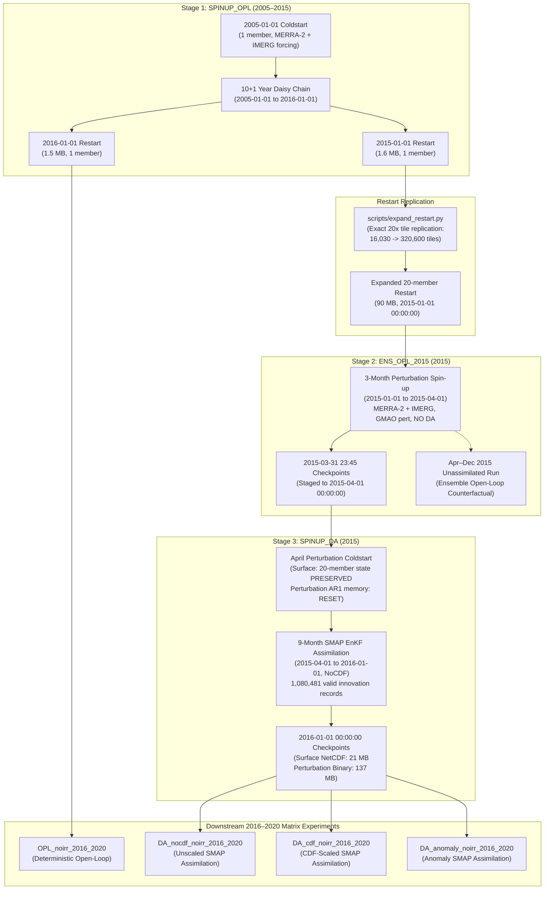

# Master Spin-up Architecture & Audit: Northern Morocco (NorthMor)

**Scope:** Centralized documentation, workflow hierarchy, and retention audit for all Land Information System (LIS) spin-up experiments supporting the Northern Morocco domain (`experiments/NorthMor/SPINUP/`).  
**Domain & Resolution:** Northern Morocco 5-km grid (16,030 active land tiles; 320,600 ensemble tiles for $N = 20$).  
**Land Surface Model:** Noah-MP 4.0.1 (4 soil layers: 0–10, 10–40, 40–100, 100–200 cm).  
**Total Hierarchy Disk Usage:** **25.8 GB** (11,881 files across three experiments).  
**Repository Branch:** `main`  
**Audit Status:** Fully verified (reconstructed execution chronology, restart integrity, source code verification of EnKF diagnostics, and conservative retention audit).

---

## 1. Master Spin-up Hierarchy & Purpose

The Northern Morocco simulation framework requires realistic land-surface initial states (soil moisture, soil temperature, snowpack, and unconfined aquifer storage) to prevent numerical cold-start shocks and to initialize ensemble Kalman filter data assimilation.

Because a single continuous simulation cannot simultaneously fulfill the multi-year integration requirements of deterministic Noah-MP and the ensemble perturbation requirements of satellite data assimilation, the spin-up is organized into a **three-stage hierarchy**:



### Detailed Component Roles:
1. **[`SPINUP_OPL`](SPINUP_OPL/README.md) (Stage 1 — Deterministic Long-Term Spin-up):**
   - **Interval:** 2005-01-01 00:00:00 to 2016-01-01 00:00:00 (11 annual chained segments).
   - **Configuration:** 1 ensemble member (deterministic, unperturbed), MERRA-2 meteorological forcing overlaid with GPM IMERG precipitation.
   - **Role:** Integrates the multi-year water balance and deep root-zone soil moisture from a nominal coldstart across 2005–2015. Produces the deterministic initial condition for the downstream 2016 Open-Loop run and the source state for ensemble expansion.
2. **[`ENS_OPL_2015`](ENS_OPL_2015/README.md) (Stage 2 — Ensemble Perturbation Generation):**
   - **Interval:** 2015-01-01 00:00:00 to 2016-01-01 00:00:00 (Job `7262240`, 7h 56m walltime).
   - **Configuration:** 20 ensemble members, MERRA-2 meteorology + GPM IMERG precipitation, GMAO stochastic perturbations (forcing & prognostic state Layer 1), zero data assimilation (`Number of data assimilation instances: 0`).
   - **Role:** Breaks symmetry from the duplicated deterministic restart (`expand_restart.py`), developing dynamic ensemble spread ($\sigma_1 pprox 0.051	ext{ m}^3/	ext{m}^3$) across Jan–Mar 2015.
3. **[`SPINUP_DA`](SPINUP_DA/README.md) (Stage 3 — Satellite Data Assimilation Spin-up):**
   - **Interval:** 2015-04-01 00:00:00 to 2016-01-01 00:00:00 (9 monthly chained segments; Jobs `7260791` through `7262178`, 13h 45m walltime).
   - **Configuration:** 20 ensemble members, MERRA-2 + IMERG forcing, NASA SMAP Level-3 Enhanced Radiometer soil moisture (`SPL3SMP_E`, R19), 1 EnKF instance, NoCDF (`Data assimilation scaling strategy: "none"`).
   - **Role:** Begins active assimilation when SMAP observations became operational in April 2015, spinning up coupled background error covariances ($P^f$) and delivering spun-up land-surface and perturbation initial conditions for the 2016–2020 DA matrix experiments.

---

## 2. Upstream and Downstream Restart Dependencies

The exact file handoffs and dependencies linking the spin-up hierarchy to production experiments are verified as follows:

| Upstream Source | Intermediate File / Artifact | Size | Target Experiment | Role in Target Experiment | Integrity Status |
| :--- | :--- | :---: | :--- | :--- | :---: |
| `SPINUP_OPL` (2014 Segment) | `SPINUP_OPL/restarts/LIS_RST_NOAHMP401_201501010000.d01.nc` | 1.6 MB | `ENS_OPL_2015` via `scripts/expand_restart.py` | Source deterministic restart replicated 20x to initialize 20 ensemble members on 2015-01-01. | **VERIFIED** (16,030 tiles expanded to 320,600 tiles). |
| `scripts/expand_restart.py` | `ENS_OPL_2015/restarts/LIS_RST_NOAHMP401_201501010000_ens20.d01.nc` | 90 MB | `ENS_OPL_2015` | Direct initial restart loaded at 2015-01-01 00:00:00 (`Start mode: restart`). | **VERIFIED** (Job `7262240` loaded and cycled cleanly). |
| `SPINUP_OPL` (2015 Segment) | `SPINUP_OPL/restarts/LIS_RST_NOAHMP401_201601010000.d01.nc` | 1.5 MB | `experiments/NorthMor/matrix_2016_2020/OPL_noirr_2016_2020` | Direct initial condition for the 2016–2020 deterministic Open-Loop baseline. | **VERIFIED** (Bitwise match with 2015 end-of-run output). |
| `ENS_OPL_2015` (March Checkpoint) | `ENS_OPL_2015/output/2015/SURFACEMODEL/201503/LIS_RST_NOAHMP401_201503312345.d01.nc` | 21 MB | `SPINUP_DA/restarts/surf/LIS_RST_NOAHMP401_201504010000.d01.nc` | Direct surface model initial condition loaded by `SPINUP_DA` on 2015-04-01 00:00:00. | **VERIFIED** (100% exact bitwise match via `cmp`). |
| `ENS_OPL_2015` (March Checkpoint) | `ENS_OPL_2015/output/2015/DAPERT/201503/LIS_DAPERT_201503312345.d01.bin` | 93 MB | `SPINUP_DA/restarts/pert/LIS_DAPERT_201504010000.d01.bin` | Staged into `restarts/pert/`, but **bypassed** by LIS due to perturbation coldstart. | **VERIFIED BYPASS** (`readpertrestart` never invoked). |
| `SPINUP_DA` (December Segment) | `SPINUP_DA/restarts/surf/LIS_RST_NOAHMP401_201601010000.d01.nc` | 21 MB | `experiments/NorthMor/matrix_2016_2020/DA_*_2016_2020` | Surface model initial condition for all three 2016–2020 DA experiments (NoCDF, CDF, Anomaly). | **VERIFIED** (SHA-256: `46de5914372a...`). |
| `SPINUP_DA` (December Segment) | `SPINUP_DA/restarts/pert/LIS_DAPERT_201601010000.d01.bin` | 137 MB | `experiments/NorthMor/matrix_2016_2020/DA_*_2016_2020` | Perturbation restart file loaded by all three 2016–2020 DA experiments. | **VERIFIED** (SHA-256: `39db9fe4ce24...`). |

---

## 3. Contrast: Open-Loop Deterministic vs Data Assimilation Initializations

A fundamental methodological distinction exists between how the 2016 Open-Loop baseline and the 2016 Data Assimilation matrix experiments are initialized:

```
[ Deterministic Path ]
SPINUP_OPL (2005–2015, MERRA-2 + IMERG) ──► OPL_noirr_2016_2020
(1 member, 11-year unperturbed physics)       (Unassimilated baseline)

[ Data Assimilation Path ]
SPINUP_OPL ──► ENS_OPL_2015 ──► SPINUP_DA ──► DA_*_noirr_2016_2020
(Deterministic) (Ensemble spread)  (SMAP EnKF)   (Observation-preconditioned)
```

1. **Deterministic Open-Loop Initialization (`OPL_noirr_2016_2020`):**
   - Initialized directly from `SPINUP_OPL`'s 11-year unperturbed restart (`LIS_RST_NOAHMP401_201601010000.d01.nc`, 1 member, 1.5 MB).
   - Free from satellite observation updates, stochastic perturbations, or ensemble variance. Reflects 11 years of continuous Noah-MP model integration under blended MERRA-2 + GPM IMERG meteorology.
2. **Data Assimilation Matrix Initializations (`DA_nocdf`, `DA_cdf`, `DA_anomaly`):**
   - Initialized from `SPINUP_DA`'s 20-member assimilation-preconditioned restart (`LIS_RST_NOAHMP401_201601010000.d01.nc`, 21 MB) and coupled perturbation binary (`LIS_DAPERT_201601010000.d01.bin`, 137 MB).
   - Preconditioned by 9 months of active SMAP EnKF observation updating and GMAO stochastic perturbations under MERRA-2/IMERG atmospheric forcing.
   - **For `DA_nocdf`:** Methodologically seamless. Both the 2015 spin-up and the 2016 production run assimilate unscaled SMAP observations.
   - **For `DA_cdf`:** `SPINUP_DA` preconditioned the land surface with unscaled SMAP observations. When `DA_cdf` begins in January 2016, it scales SMAP observations to match open-loop climatology. The model state undergoes a relaxation period in early 2016 as it adjusts toward the CDF-scaled regime.

---

## 4. The April 2015 Perturbation Coldstart

When `SPINUP_DA` commenced on 2015-04-01, an operational restart incompatibility was encountered and resolved:

1. **Failure of Direct Perturbation Handoff (Job `7260790`):**
   - Initial attempt in Job `7260790` configured `Perturbations start mode: "restart"`, attempting to load `LIS_DAPERT_201504010000.d01.bin` (93 MB from `ENS_OPL_2015`).
   - The job crashed after 7.8 seconds with a Fortran runtime error at line 2490 in `src/lisf/lis/dataassim/perturb/gmaopert/gmaopert_Mod.F90` (`End of file`).
   - **Root Cause:** `ENS_OPL_2015` was executed with `Number of data assimilation instances: 0`, producing a perturbation restart lacking observation perturbation records. When `gmaopert_Mod.F90` attempted to read observation noise arrays (`read(ftn) gtmp`), it reached the end of the file immediately.
2. **Resolution via Perturbation Coldstart (Job `7260791`):**
   - `scripts/chain_da.py` was configured with `pert_start_mode = "coldstart"` for April 2015, switching to `pert_start_mode = "restart"` for May–December.
3. **Verified Fact vs Unverified Stochastic Coldstart Details:**
   - **Verified Fact (Perturbation-Restart Bypass):** Source code inspection (`LIS_perturbMod.F90:120`, `rstFlag = .false.`) and execution logs prove that `readpertrestart` was never invoked. The staged 93 MB DAPERT file was **completely bypassed and unread**.
   - **Verified Fact (Physical-State Continuity):** Surface model restart mode was `restart`, successfully reading `LIS_RST_NOAHMP401_201504010000.d01.nc` (line 211 of `lislog_2015-04.0000`). All 20 ensemble members retained the physical prognostic state developed in Stage 2.
   - **Verified Fact (AR(1) Memory Severing):** Coldstart severed serial auto-regressive AR(1) noise correlations from March across atmospheric forcing, prognostic state, and observation perturbations.
   - **Unverified Stochastic Details:** While the restart bypass and AR(1) memory severing are verified, the precise internal initialization mechanics (e.g. initial pseudo-random number generator seeds, internal noise array zeroing vs initial drawing, or memory buffering across MPI ranks) remain unverified internal model behaviors without instrumented runtime tracing.
4. **Preserved March/April 15-Minute Timing Qualification:**
   - Staging the March 31 23:45 output under April 1 00:00:00 is standard in LIS monthly chaining. While operational continuity is demonstrated, whether the restart state integrates up to 23:45 or through 00:00 cannot be proven without cycle-level telemetry.

---

## 5. Summary of Verified Findings vs Unresolved Uncertainties

To ensure rigorous scientific integrity, the audit distinguishes verified operational realities from unresolved hypotheses:

| Aspect | Status | Verified Historical / Scientific Reality | Unresolved Uncertainty / Qualification |
| :--- | :---: | :--- | :--- |
| **Numerical Execution & Chaining** | **VERIFIED** | All 11 years of `SPINUP_OPL`, 1 year of `ENS_OPL_2015`, and 9 months of `SPINUP_DA` completed successfully with clean restart handoffs. | Hardcoded legacy paths (`step3_da_2015`) exist in scripts and config templates. |
| **Restart Bitwise Integrity** | **VERIFIED** | 100% exact bitwise match (`cmp` exit code 0) for Stage 2 $	o$ Stage 3 handoff; identical SHA-256 checksums across all 9 monthly transitions in `SPINUP_DA`. | Sub-hourly 15-minute physical timing continuity (23:45 vs 00:00) represents a naming convention; physical continuity is qualified. |
| **Ensemble Spread Metric** | **VERIFIED** | NetCDF variables `ensspread_*` store the **Ensemble Range** ($\max - \min$), computed by `LIS_historyMod.F90:7980`. True restart standard deviation is $\sigma_1 pprox 0.051	ext{ m}^3/	ext{m}^3$. | Earlier reports mistook range (0.150–0.189) for standard deviation. |
| **EnKF Diagnostic Variable Definitions** | **VERIFIED** | `ninnov_01` is a normalized innovation float; `innov_01` is raw innovation in $	ext{m}^3/	ext{m}^3$; valid observation sample size is **1,080,481 valid grid-time innovation records**. | Whether every valid record represents an accepted physical state update is unverified without internal assimilation weight logs. |
| **Hydrological Convergence** | **NOT VERIFIED** | 11 years of deterministic simulation executed without numerical instability. | **Physical hydrological convergence remains NOT VERIFIED.** Deep soil moisture layers and unconfined aquifers require formal trend and convergence tests. |
| **Statistical Filter Optimality** | **NOT DEMONSTRATED** | Filter maintained bounded spread without catastrophic ensemble collapse. | $	ext{std}(ninnov) pprox 0.55 < 1.0$ indicates **possible innovation-variance miscalibration**, but does NOT prove specifically over-estimated error covariances. |
| **Land Moisture Bias from Innovations** | **CORRECTED** | Unscaled SMAP innovations are **negative in 7 out of 9 months** ($-0.021$ in April, $-0.018$ in October), pulling Noah-MP downward ($r = 0.97$ with increments). | Innovations reflect relative discrepancy between unscaled satellite retrievals and Noah-MP climatology, NOT ground-truth physical bias. |
| **DA-CDF Relaxation Timescale** | **UNVERIFIED HYPOTHESIS** | Theoretical rationale suggests `DA_cdf` relaxes from the NoCDF preconditioned state toward open-loop climatology in early 2016. | The hypothesized 1–3 month relaxation timescale has **NOT been empirically demonstrated** in 2015 spin-up data. |

---

## 6. Retention and Cleanup Audit

An exhaustive disk usage audit was conducted across all three spin-up directories. **No deletion, archiving, compression, moving, or renaming was performed.**

### Disk Usage Summary by Experiment:
- `experiments/NorthMor/SPINUP/SPINUP_OPL`: **18 GB** (8,489 files)
- `experiments/NorthMor/SPINUP/ENS_OPL_2015`: **2.4 GB** (449 files)
- `experiments/NorthMor/SPINUP/SPINUP_DA`: **5.4 GB** (2,943 files)
- **Total Spin-up Scope:** **25.8 GB** (11,881 files)

---

### Retention Table 1: `SPINUP_OPL` (~18 GB)

| Exact Directory / File Group | Measured Disk Usage | Scientific Role | Downstream Dependencies | Classification | Evidence Required Before Any Deletion |
| :--- | :---: | :--- | :--- | :---: | :--- |
| `restarts/LIS_RST_NOAHMP401_201601010000.d01.nc` | 1.5 MB | Final 11-year unperturbed deterministic restart. | Active initial condition for `OPL_noirr_2016_2020`. | **CRITICAL KEEP** | **DO NOT DELETE.** Essential active simulation dependency. |
| `restarts/LIS_RST_NOAHMP401_201501010000.d01.nc` | 1.6 MB | Deterministic checkpoint at 2015-01-01. | Source file for `expand_restart.py` $	o$ `ENS_OPL_2015`. | **CRITICAL KEEP** | **DO NOT DELETE.** Required to reproduce ensemble expansion. |
| `restarts/` (annual 2006–2014, 9 files) | 14 MB | Intermediate annual boundary restarts. | Documents 11-year chaining continuity. | **KEEP AS PROVENANCE** | Confirm all annual transitions are fully audited before any offload. |
| `output/` (annual folders 2005–2015, 8,034 files) | 14 GB | Daily surface model history files (5-km grid). | Climatological baseline; potential convergence analysis. | **ARCHIVE CANDIDATE** | Confirm no publication figures or baseline climatologies require raw daily outputs; compress to cold storage. |
| `logs/` master ranks (`lislog_*.0000`, 11 files) | ~120 MB | Rank 0 execution telemetry and LIS output messages. | Complete record of execution flags, restarts, and dates. | **KEEP AS PROVENANCE** | Indispensable execution audit trail. |
| `logs/` worker ranks (`lislog_*.0001`–`.0031`, 341 files) | ~3.7 GB | Redundant MPI worker logs (ranks 1–31). | None (contain duplicate timing and sync lines). | **ARCHIVE CANDIDATE (REDUNDANT)** | Safe to delete if authorized; master rank 0 retains all domain metrics. |
| `logs/` orchestration (`kickoff_*.log`, `orchestrator_*.log`) | <100 KB | SLURM batch job submission records. | Documents job IDs `7247157` and `7247895`. | **KEEP AS PROVENANCE** | Permanent cluster submission evidence. |
| `experiments/NorthMor/spinup/logs/` (32 files) | 144 KB | Misplaced nested directory from 2008 run. | Errant duplicate created by relative log path in 2008. | **ARCHIVE CANDIDATE (MISPLACED)** | Verify identical to `logs/2008/` before removal. |
| `generated/` (`configs/`, `jobs/`, 22 files) | 188 KB | Exact LIS configs and SLURM batch scripts. | Full historical configuration provenance. | **KEEP AS PROVENANCE** | Required for exact configuration audit. |
| `config/`, `scripts/`, `templates/`, `job.sh` | ~44 KB | Executable pipeline scripts and config templates. | Core workflow definition. | **CRITICAL KEEP** | Retain for pipeline reproducibility. |

---

### Retention Table 2: `ENS_OPL_2015` (~2.4 GB)

| Exact Directory / File Group | Measured Disk Usage | Scientific Role | Downstream Dependencies | Classification | Evidence Required Before Any Deletion |
| :--- | :---: | :--- | :--- | :---: | :--- |
| `restarts/LIS_RST_NOAHMP401_201501010000_ens20.d01.nc` | 90 MB | 20-member expanded initial restart. | Direct input to `ENS_OPL_2015` at 2015-01-01. | **CRITICAL KEEP** | **DO NOT DELETE.** Essential provenance for 20-member initialization. |
| `output/2015/SURFACEMODEL/201503/LIS_RST_NOAHMP401_201503312345.d01.nc` | 21 MB | March 31 23:45 surface checkpoint. | Direct source for `SPINUP_DA` April 1 surface restart. | **CRITICAL KEEP** | **DO NOT DELETE.** Bitwise source for Stage 3 physical state. |
| `output/2015/DAPERT/201503/LIS_DAPERT_201503312345.d01.bin` | 93 MB | March 31 23:45 perturbation checkpoint. | Staged into `SPINUP_DA`; triggered EOF in Job `7260790`. | **KEEP AS PROVENANCE** | Required to verify perturbation restart EOF crash. |
| `output/2015/` Jan–Feb checkpoints (`201501`, `201502`) | ~250 MB | Intermediate monthly perturbation states. | Documents 3-month ensemble spread generation. | **KEEP AS PROVENANCE** | Proves spread spin-up from 0 to $\sigma pprox 0.051$. |
| `output/2015/` Apr–Dec outputs (`201504` to `201601`) | ~1.8 GB | Unassimilated 20-member ensemble open-loop run. | None (SPINUP_DA branched off at March 31). | **ARCHIVE CANDIDATE / UNRESOLVED** | Determine whether an unassimilated 2015 ensemble benchmark is required before archiving. |
| `restarts/pert/` and `restarts/surf/` | 8 KB | Empty scaffolding directories. | None (output kept in `output/2015/`). | **ARCHIVE CANDIDATE (EMPTY)** | Harmless empty folders; safe to prune if authorized. |
| `logs/` master rank (`lislog_2015.0000` + SLURM logs) | ~5 MB | Telemetry of successful Job `7262240`. | Full record of 2015 ensemble simulation. | **KEEP AS PROVENANCE** | Indispensable execution audit trail. |
| `logs/` worker ranks (`lislog_2015.0001`–`.0031`) | ~115 MB | MPI worker rank logs (ranks 1–31). | None direct. | **ARCHIVE CANDIDATE** | Keep pending checks for unique per-rank diagnostic or warning messages across processors. Preserve all logs during audit. |
| `Readme` (capital R) | 8 KB | Untracked legacy developer notes. | Historical notes superseded by `README.md`. | **ARCHIVE CANDIDATE (UNTRACKED)** | Archive content into project notes if needed before removal. |
| `config/`, `generated/`, `scripts/`, `templates/`, `job.sh` | ~80 KB | Executable scripts and config templates. | Core workflow definition. | **CRITICAL KEEP** | Retain for pipeline reproducibility. |

---

### Retention Table 3: `SPINUP_DA` (~5.4 GB)

| Exact Directory / File Group | Measured Disk Usage | Scientific Role | Downstream Dependencies | Classification | Evidence Required Before Any Deletion |
| :--- | :---: | :--- | :--- | :---: | :--- |
| `restarts/surf/LIS_RST_NOAHMP401_201601010000.d01.nc` | 21 MB | Final 2016-01-01 surface restart. | Active initial condition for all 2016–2020 DA matrix runs. | **CRITICAL KEEP** | **DO NOT DELETE.** Essential active simulation dependency. |
| `restarts/pert/LIS_DAPERT_201601010000.d01.bin` | 137 MB | Final 2016-01-01 perturbation restart. | Active initial perturbation state for all 2016–2020 DA runs. | **CRITICAL KEEP** | **DO NOT DELETE.** Essential active simulation dependency. |
| `restarts/surf/` (months 04–11, 8 files) | 168 MB | Intermediate monthly surface checkpoints. | Documents continuous monthly chaining. | **KEEP AS PROVENANCE** | Proves continuous restart integrity across all 9 months. |
| `restarts/pert/` (months 04–11, 8 files) | 1.05 GB | Intermediate monthly perturbation checkpoints. | Documents continuous covariance evolution. | **KEEP AS PROVENANCE** | Proves continuous perturbation propagation across all 9 months. |
| `output/*/EnKF/` (innov, incr, spread NetCDF files) | ~1.2 GB | Daily EnKF diagnostic files (668 cycles). | Underlies all verified assimilation diagnostics. | **KEEP AS PROVENANCE** | Essential empirical foundation for EnKF diagnostics. |
| `output/*/SURFACEMODEL/` (history files) | ~1.8 GB | Daily prognostic surface model outputs. | Evaluation of Noah-MP states under active assimilation. | **KEEP / ARCHIVE CANDIDATE** | Archive to cold storage if raw daily 2015 outputs are not actively analyzed. |
| `output/*/DAOBS/` and `DAPERT/` | ~600 MB | Processed SMAP tiles and perturbation states. | Observation preprocessing audit trail. | **KEEP AS PROVENANCE** | Retain for complete data assimilation auditability. |
| `logs/` master ranks (`lislog_*.0000` + `assim_*.log/err`) | ~30 MB | Rank 0 logs across jobs `7260791`–`7262178`. | Execution, restart loading, and chaining audit trail. | **KEEP AS PROVENANCE** | Indispensable execution audit trail. |
| `logs/` worker ranks (`lislog_*.0001`–`.0031`) | ~248 MB | MPI worker rank logs (ranks 1–31). | None direct. | **ARCHIVE CANDIDATE** | Keep pending verification that no unique rank-specific EnKF processing or assimilation warnings occurred across processors. Preserve all logs during audit. |
| `config/`, `generated/`, `scripts/`, `templates/`, `job.sh` | ~200 KB | Executable chaining scripts and templates. | Core workflow definition. | **CRITICAL KEEP** | Retain for pipeline reproducibility. |

---

## 7. Git Reproducibility Inventory

Because the repository `.gitignore` contains the broad rule `experiments/`, essential pipeline scripts, templates, and configurations across the spin-up hierarchy are currently excluded from version control.

### Inventory of Excluded Source Files Essential for Reproducibility:

```
experiments/NorthMor/SPINUP/
├── SPINUP_OPL/
│   ├── job.sh                               # Kickoff batch script
│   ├── config/experiment.ini                # Pipeline configuration
│   ├── scripts/chain_spinup.py              # Automated 11-year chaining engine
│   ├── templates/lis_spinup.config.template # Master LIS config template
│   ├── generated/configs/*.config           # 11 annual executed LIS configs
│   └── generated/jobs/*.sh                  # 11 annual SLURM batch scripts
├── ENS_OPL_2015/
│   ├── job.sh                               # Kickoff batch script
│   ├── config/experiment.ini                # Pipeline configuration
│   ├── scripts/expand_restart.py            # 1-to-20 member restart replication script
│   ├── scripts/chain_ens_opl.py             # Ensemble execution wrapper
│   ├── templates/lis_ens_opl.config.template# Master ensemble config template
│   ├── generated/configs/*.config           # Executed ensemble LIS configs
│   └── generated/jobs/*.sh                  # Executed SLURM batch scripts
└── SPINUP_DA/
    ├── job.sh                               # Kickoff batch script
    ├── config/experiment.ini                # Pipeline configuration
    ├── scripts/chain_da.py                  # Automated 9-month EnKF chaining engine
    ├── templates/lis_da.config.template     # Master EnKF DA config template
    ├── generated/configs/*.config           # 9 monthly executed LIS configs
    └── generated/jobs/*.sh                  # 9 monthly SLURM batch scripts
```

### Git Tracking Status and Future Snapshot:
- **Current README Tracking Status:** Both `experiments/NorthMor/SPINUP/README.md` and `experiments/NorthMor/SPINUP/SPINUP_DA/README.md` are **ALREADY TRACKED** in the Git index (verified via `git ls-files`). Neither file is ignored by Git, so committing documentation updates does **NOT** require `git add -f`.
- **Pipeline Source Tracking Status:** In contrast, the essential scripts, config templates, and batch files listed above are currently ignored by `.gitignore` (matching `experiments/`).
- **Future Snapshot Commit:** A separate future commit should execute a targeted force-add (`git add -f`) restricted strictly to the verified pipeline source files (`job.sh`, `experiment.ini`, chaining scripts, config templates), establishing full code reproducibility without tracking large outputs or restarts.

---

## 8. Links to Individual Experiment Documentation

- **[`SPINUP_OPL/README.md`](SPINUP_OPL/README.md):** Audit of the 10+1 year deterministic baseline spin-up (2005–2015), MERRA-2 + IMERG forcing, daisy-chaining integrity, and hydrological non-convergence qualifications.
- **[`ENS_OPL_2015/README.md`](ENS_OPL_2015/README.md):** Audit of the 20-member ensemble generation (2015), MERRA-2/IMERG forcing, restart expansion, and 3-month perturbation spread spin-up.
- **[`SPINUP_DA/README.md`](SPINUP_DA/README.md):** Audit of the 9-month SMAP EnKF assimilation spin-up (April–December 2015), NoCDF strategy, verified EnKF diagnostic mathematics, and downstream matrix initializations.\n