# Fiche Technique 05 : Évaluation des Débits HyMAP2 aux Stations In-Situ et Audit des Confrontations Historiques

**Date d'établissement :** 30 octobre 2026
**Auteur :** Antigravity / Équipe LISF-Morocco
**Statut :** DOCUMENTATION SCIENTIFIQUE DE L'ÉTAT HISTORIQUE (Étape 05)
**Branche :** `hymap-routing`
**Documents de référence :** [`README_HYMAP.md`](../README_HYMAP.md), [`checks/04_audit_routing_historique.md`](04_audit_routing_historique.md)

---

## 1. Contexte et Objectifs de l'Évaluation

Le présent document consigne l'état des connaissances et l'audit rigoureux des confrontations historiques réalisées entre les débits simulés par la chaîne couplée **Noah-MP → HyMAP2** et les observations hydrométriques in-situ sur le domaine Nord Maroc (`NorthMor`).

> [!IMPORTANT]
> **Nature strictement documentaire :**
> Ce document formalise et audite les résultats des simulations et scripts existants (`extract_and_plot_9stations_2016_2020.py`, `complete_t7bis_analysis.py`, `complete_t8_analysis_and_plots.py`). **Aucune nouvelle simulation, recalibration ou modification de métrique n'est effectuée.** Toutes les métriques présentées sont rigoureusement extraites des tables de synthèse patrimoniales de l'archive.

---

## 2. Chronologie de l'Évaluation Historique et Traçabilité des Versions

L'évaluation des débits s'est déroulée en trois phases successives qu'il est indispensable de distinguer pour lever les confusions méthodologiques du passé :

### 2.1 Phase 1 : Évaluations préliminaires sur OPL brut (STATUT : CADUQUE / SUPPLANTÉE)
- **Configuration :** Run `OPL_2016_2020` utilisant le fichier de paramètres LDT brut `lis_input.d01.nc` (où `HYMAP_baseflow_time_delay` valait $86\,400$ à $2.59 \times 10^6\text{ jours}$).
- **Scripts associés :** `extract_and_plot_9stations_2016_2020.py` (9 stations), `confrontation_adamna.py` (Ksob), `analysis_tache5bis.py` et calcul de métriques sur 12 stations.
- **Diagnostic formulé à l'époque :** Ces analyses rapportaient un déficit volumique massif de 50 % aux exutoires ($V_{out} / V_{in} \approx 50\%$) et concluaient faussement à un défaut de conservation du code ou à des pertes d'eau inexpliquées.
- **Réfutation :** L'audit interne réalisé le 26 octobre 2026 a démontré que ce déficit résultait d'une accumulation continue d'eau dans le réservoir linéaire $BSFSTO$ ($\Delta S_{BSF} = +16\,525.8\text{ hm}^3$ entre restarts). Ces scripts et résultats préliminaires sont formellement **caduques et supplantés**, mais demeurent conservés dans le dépôt comme témoins historiques.

### 2.2 Phase 2 : Évaluation de la correction sur OPL (STATUT : RÉFÉRENCE HISTORIQUE)
- **Configuration :** Run `OPL_2016_2020_corrigee` utilisant `ldt_hymap/lis_input_corrigee.d01.nc`, où `HYMAP_baseflow_time_delay` est divisé par 86 400.
- **Script associé :** `complete_t7bis_analysis.py`.
- **Résultats établis :**
  - Restitution volumique quasi-intégrale sur l'année 2018 ($V_{sim} / V_{in} \approx 99.97\%$ sur le diagnostic historique à périmètre restreint).
  - Mise en évidence de l'effet plancher numérique : `tbsflw` est écrêté par `cntime / 86400.` sur 99.90 % des mailles (15 921 / 15 937), abaissant le délai médian de vidange à 2.45 jours.
  - Détection de l'amplification de la surestimation des débits d'étiage sur les oueds intermittents (temps de tarissement médian $\tau$ réduit de 15.6 j à 2.1 j) ; maintien de 0 jour d'assec simulé à Sidi Jabeur (déjà nul en OPL brut).

### 2.3 Phase 3 : Confrontation OPL vs Assimilation DA-NoCDF (STATUT : SYNTHÈSE COMPLÈTE)
- **Configuration :** Confrontation conjointe des sorties de production quinquennale (2016–2020) :
  - `output/OPL_2016_2020_corrigee/ROUTING/` (1 827 fichiers journaliers NetCDF) ;
  - `output/DA_nocdf_2016_2020/ROUTING/` (1 827 fichiers journaliers NetCDF).
- **Script associé :** `complete_t8_analysis_and_plots.py`.
- **Produits livrés :**
  - Table de synthèse : `plots/_history/t8_ol_nocdf/synthese_hydrologique_12stations.csv` ;
  - Table des crues : `plots/_history/t8_ol_nocdf/t8_flood_events_comparison.csv` ;
  - Lot de figures documentaires : `F1_carte_situation.png` à `F6_effet_assimilation.png` accompagnées de `legendes_figures.txt`.

---

## 3. Données In-Situ et Réseau de Jaugeage

### 3.1 Inventaire complet des 12 stations hydrologiques
Le réseau de validation historique comprend 12 stations de jaugeage réparties sur trois bassins versants aux fonctionnements hydrologiques distincts :
- **Bassin du Bouregreg (4 stations) :** Pas de temps **journalier** ;
- **Bassin du Haut Sebou (7 stations) :** Pas de temps **mensuel** ;
- **Bassin du Ksob (1 station) :** Pas de temps **mensuel**.

> [!NOTE]
> **Distinction entre superficies officielles et superficies HyMAP :**
> Dans les archives d'origine (`data/streamflow_clean/stations.csv`), seules les 7 stations du Sebou disposent d'une superficie officielle documentée par l'agence de bassin ($A_{off}$). Pour les 4 stations du Bouregreg et la station d'Adamna (Ksob), aucune surface officielle n'était renseignée dans les fichiers hydrométriques. Les valeurs de superficie attribuées plus tard dans `synthese_hydrologique_12stations.csv` proviennent de la maille HyMAP appariée ($A_{sim}$) et ne doivent pas être qualifiées de données officielles.

| Identifiant station (`station_id`) | Nom de la station | Oued jaugé | Grand bassin | Code IRE officiel | Superficie officielle ($A_{off}$, $\text{km}^2$) | Pas de temps observation | Nombre d'observations ($n_{obs}$) | Couverture temporelle (2016–2020) | Provenance administrative |
| :--- | :--- | :--- | :--- | :---: | :---: | :---: | ---:| :---: | :--- |
| `b_a_loudah` | **Ain Loudah** | Korifla | Bouregreg | 2673/20 | *Indisponible* | Journalier | 1 827 | 100.0 % | ABH Bouregreg et Chaouia |
| `b_l_chafia` | **Lalla Chafia** | Bouregreg | Bouregreg | 963/21 | *Indisponible* | Journalier | 1 826 | 99.95 % (1 manquant) | ABH Bouregreg et Chaouia |
| `b_s_cherif` | **S.M. Cherif** | Mechraa | Bouregreg | 2674/20 | *Indisponible* | Journalier | 1 827 | 100.0 % | ABH Bouregreg et Chaouia |
| `b_s_jabeur` | **Sidi Jabeur** | Grou | Bouregreg | 964/21 | *Indisponible* | Journalier | 1 827 | 100.0 % | ABH Bouregreg et Chaouia |
| `adamna` | **Adamna** | Ksob | Ksob | 402/52 | *Indisponible* | Mensuel | 20 | 33.3 % (lacunaire) | ABH Tensift / Étude Ksob |
| `ain_timedrine` | **Ain Timedrine** | Sebou | Sebou | 581/22 | 4 387.0 | Mensuel | 60 | 100.0 % | ABH Sebou |
| `ait_khabbach` | **Ait Khabbach** | Guigou | Sebou | 585/22 | 1 240.0 | Mensuel | 44 | 73.3 % (16 manquants) | ABH Sebou |
| `azzaba` | **Azzaba** | Sebou | Sebou | 583/22 | 4 640.0 | Mensuel | 60 | 100.0 % | ABH Sebou |
| `dar_el_hamra` | **Dar El Hamra** | Zloul | Sebou | 1000/23 | 670.0 | Mensuel | 60 | 100.0 % | ABH Sebou |
| `el_mers` | **El Mers** | Masser | Sebou | 541/23 | 1 004.0 | Mensuel | 20 | 33.3 % (lacunaire) | ABH Sebou |
| `pont_ait_aissa` | **Pont Ait Aissa** | Guigou | Sebou | 198/30 | 205.0 | Mensuel | 60 | 100.0 % | ABH Sebou |
| `pont_de_mdez` | **Pont de Mdez** | Sebou | Sebou | 582/22 | 3 435.0 | Mensuel | 44 | 73.3 % (16 manquants) | ABH Sebou |

### 3.2 Problématique critique : Duplication exacte entre Ain Loudah et S.M. Cherif

> [!WARNING]
> **Non-indépendance démontrée des séries d'observations journalières :**
> L'audit des fichiers de données nettoyées (`data/streamflow_clean/obs_daily.csv`) révèle que les séries de débits observés pour les stations **Ain Loudah** (`b_a_loudah`, oued Korifla) et **S.M. Cherif** (`b_s_cherif`, oued Mechraa) sont **strictement identiques au bit près sur l'intégralité des 1 827 jours de la période 2016–2020** :
> - Écart absolu maximal : $\max |Q_{obs}(\text{Ain Loudah}) - Q_{obs}(\text{S.M. Cherif})| = 0.000000\text{ m}^3/\text{s}$ ;
> - 1 827 jours sur 1 827 identiques (100.0 %) ;
> - Dans le fichier de données brutes nettoyées, chaque ligne porte un indicateur explicite d'anomalie :
>   - 932 jours étiquetés `flag = 'doublon_suspect'` ;
>   - 895 jours étiquetés `flag = 'doublon_suspect;plage_constante'`.
>
> **Conséquence scientifique et réserve méthodologique :** Les stations d'Ain Loudah et de S.M. Cherif ne constituent en aucun cas deux validations indépendantes. **La cause originelle de cette identité (erreur administrative d'affectation, duplication lors de l'archivage ou de la numérisation des registres) demeure inconnue et non documentée** dans les archives à disposition. Les performances évaluées sur ces deux stations reflètent le même signal observé confronté à deux mailles HyMAP voisines mais distinctes.

### 3.3 Complétude et limitations qualitatives des observations
1. **Séries journalières continues (Bouregreg) :** Les 4 stations du Bouregreg présentent une couverture quasi-totale (100 % pour Ain Loudah, S.M. Cherif et Sidi Jabeur ; 99.95 % pour Lalla Chafia avec une seule journée manquante). Cependant :
   - Lalla Chafia se situe à l'amont immédiat de la retenue du barrage Sidi Mohamed Ben Abdellah (SMBA) ; de potentielles influences de remous ou de tarage de crue peuvent affecter les très hauts débits.
   - Sidi Jabeur sur l'oued Grou présente un régime naturel intermittent méditerranéen marqué (310 jours à débit strictement nul $Q_{obs} = 0$, et 312 jours à débit $Q_{obs} \le 0.001\text{ m}^3/\text{s}$ observés sur 5 ans).
2. **Séries mensuelles discontinues (Sebou et Ksob) :**
   - Seules 4 des 7 stations du Sebou (`ain_timedrine`, `azzaba`, `dar_el_hamra`, `pont_ait_aissa`) disposent des 60 mois complets.
   - `ait_khabbach` et `pont_de_mdez` ne disposent que de 44 mois (73.3 % de couverture).
   - `el_mers` (Sebou) et `adamna` (Ksob) ne comportent que 20 mois d'observation (33.3 % de couverture), réduisant considérablement la représentativité statistique des métriques calculées sur ces bassins.

---

## 4. Appariement des Stations sur la Grille HyMAP (0.05°)

### 4.1 Méthodologie d'appariement et distinctions opérationnelles
L'association entre une station hydrométrique ponctuelle $(lon_{obs}, lat_{obs})$ et une maille de la grille discrète HyMAP à 0.05° a reposé sur deux approches distinctes selon le bassin versant :

1. **Bassin du Sebou (7 stations) — Méthode de minimisation de l'écart de surface :**
   - Un algorithme de recherche dans le voisinage géographique immédiat a sélectionné la maille HyMAP minimisant l'écart relatif entre la superficie drainée modélisée par le réseau de drainage HyMAP (`aire_hymap_km2`) et la superficie officielle de l'agence de bassin (`aire_off_km2`).
   - Pour **4 des 7 stations** (Ain Timedrine, Azzaba, Dar El Hamra, Pont de Mdez), l'accord est remarquable avec un écart de surface $|\Delta A| / A_{off} < 2.5\%$ (et $< 0.5\%$ pour Azzaba et Pont de Mdez).
   - Pour les **3 autres stations**, l'écart est plus marqué : $+8.30\%$ pour Ait Khabbach, $-3.17\%$ pour El Mers, et $+23.77\%$ pour Pont Ait Aissa. Pour cette dernière, la faible taille du bassin versant ($205\text{ km}^2$, soit l'équivalent de seulement 8 à 9 mailles HyMAP) atteint les limites de discrétisation d'une grille à 0.05° ($\sim 5\text{ km}$).
2. **Bassins du Bouregreg (4 stations) et du Ksob (1 station) — Appariement heuristique :**
   - Dans le tableau initial `output/OPL_2016_2020/t5bis_stations_pairing.csv`, la colonne `aire_off_km2` n'était pas renseignée (`NaN`) et ces stations étaient classées en *"Niveau B (Non validable)"*. Les mailles ont été retenues par proximité géométrique et sélection manuelle sur le bief principal.
   - Les superficies drainées rapportées pour ces bassins sont donc **strictement issues du modèle HyMAP** ($A_{sim}$) et ne constituent pas une validation de surface officielle.

> [!IMPORTANT]
> **Absence de validation par connectivité topologique de réseau :**
> L'appariement des 12 stations a été vérifié sur la base de la proximité géographique (distance $0.78$ à $10.46\text{ km}$) et, pour le Sebou, de la concordance des superficies drainées. **Il n'a pas été formellement validé par un traçage topologique de connectivité sur le réseau hydrographique** (suivi amont/aval le long des vecteurs de direction d'écoulement `flow_x` / `flow_y`). La localisation de certaines mailles sur des confluences complexes ou des bras secondaires à 0.05° demeure une source d'incertitude structurelle.

### 4.2 Tableau de traçabilité de l'appariement des 12 stations

#### Clarification sur l'indexation 0-basée (Python) vs 1-basée (Fortran)
Dans les fichiers CSV sources (`t5bis_stations_pairing.csv`), les colonnes `row_hymap` et `col_hymap` correspondent aux **indices 0-basés de Python** utilisés directement pour indexer le tableau 2D `Streamflow_tavg[row_hymap, col_hymap]` dans `complete_t8_analysis_and_plots.py` (l. 69-71).
Par exemple, pour **Lalla Chafia**, le script Python extrait la maille aux indices 0-basés `[row=75, col=71]`, qui correspond exactement aux coordonnées géographiques du centre de maille $33.7750^\circ\text{N}, -6.4250^\circ\text{E}$.
Dans la convention 1-basée Fortran (dimensions $1\dots 120$ en latitude et $1\dots 180$ en longitude), les coordonnées équivalentes sont `col = col_hymap + 1 = 72` et `row = row_hymap + 1 = 76`. L'écart de notation relevé lors de l'audit provient d'une inversion lors de la transcription précédente, où `75` et `71` avaient été pris à tort pour des coordonnées 1-basées.

| Station | Grand bassin | Indices Python 0-basés (`[row, col]`) | Indices Fortran 1-basés (`col, row`) | Coordonnées observées ($^\circ\text{E}, ^\circ\text{N}$) | Coordonnées centre maille HyMAP ($^\circ\text{E}, ^\circ\text{N}$) | Distance station–maille (km) | Surface officielle $A_{off}$ ($\text{km}^2$) | Surface HyMAP $A_{sim}$ ($\text{km}^2$) | Écart relatif de surface | Statut d'appariement historique |
| :--- | :--- | :---: | :---: | :---: | :---: | ---:| :---: | ---:| :---: | :---: |
| **Ain Loudah** | Bouregreg | `[row=70, col=64]` | `col: 65, row: 71` | $(-6.7600, 33.5500)$ | $(-6.7750, 33.5250)$ | 3.24 km | *Indisponible* | 697.55 | *N/A* | Niveau B (Proximité) |
| **Lalla Chafia** | Bouregreg | `[row=75, col=71]` | `col: 72, row: 76` | $(-6.3800, 33.7000)$ | $(-6.4250, 33.7750)$ | 9.72 km | *Indisponible* | 3 341.60 | *N/A* | Niveau B (Proximité) |
| **S.M. Cherif** | Bouregreg | `[row=70, col=67]` | `col: 68, row: 71` | $(-6.6300, 33.5500)$ | $(-6.6250, 33.5250)$ | 2.83 km | *Indisponible* | 649.52 | *N/A* | Niveau B (Proximité) |
| **Sidi Jabeur** | Bouregreg | `[row=71, col=71]` | `col: 72, row: 72` | $(-6.4300, 33.5800)$ | $(-6.4250, 33.5750)$ | 0.78 km | *Indisponible* | 3 138.52 | *N/A* | Niveau B (Proximité) |
| **Adamna** | Ksob | `[row=29, col=6]` | `col: 7, row: 30` | $(-9.6847, 31.4595)$ | $(-9.6750, 31.4750)$ | 2.03 km | *Indisponible* | 1 617.01 | *N/A* | Niveau B (Proximité) |
| **Ain Timedrine** | Sebou | `[row=74, col=108]` | `col: 109, row: 75` | $(-4.5486, 33.7475)$ | $(-4.5750, 33.7250)$ | 3.86 km | 4 387.0 | 4 448.56 | $+1.40\%$ | **Niveau A (Validé $A_{off} < 2.5\%$)** |
| **Ait Khabbach** | Sebou | `[row=68, col=103]` | `col: 104, row: 69` | $(-4.7860, 33.4306)$ | $(-4.8250, 33.4250)$ | 4.38 km | 1 240.0 | 1 342.97 | $+8.30\%$ | **Niveau A (Écart modéré $> 2.5\%$)** |
| **Azzaba** | Sebou | `[row=75, col=108]` | `col: 109, row: 76` | $(-4.6475, 33.8350)$ | $(-4.5750, 33.7750)$ | 10.46 km | 4 640.0 | 4 660.72 | $+0.45\%$ | **Niveau A (Validé $A_{off} < 2.5\%$)** |
| **Dar El Hamra** | Sebou | `[row=75, col=112]` | `col: 113, row: 76` | $(-4.4120, 33.7673)$ | $(-4.3750, 33.7750)$ | 4.20 km | 670.0 | 656.33 | $-2.04\%$ | **Niveau A (Validé $A_{off} < 2.5\%$)** |
| **El Mers** | Sebou | `[row=68, col=112]` | `col: 113, row: 69` | $(-4.3983, 33.4641)$ | $(-4.3750, 33.4250)$ | 5.06 km | 1 004.0 | 972.22 | $-3.17\%$ | **Niveau A (Écart modéré $> 2.5\%$)** |
| **Pont Ait Aissa** | Sebou | `[row=62, col=98]` | `col: 99, row: 63` | $(-5.0695, 33.1670)$ | $(-5.0750, 33.1250)$ | 4.70 km | 205.0 | 253.73 | $+23.77\%$ | **Niveau A (Résolution limite)** |
| **Pont de Mdez** | Sebou | `[row=72, col=109]` | `col: 110, row: 73` | $(-4.5224, 33.6748)$ | $(-4.5250, 33.6250)$ | 5.55 km | 3 435.0 | 3 429.12 | $-0.17\%$ | **Niveau A (Validé $A_{off} < 2.5\%$)** |

---

## 5. Alignement Temporel et Agrégation des Données

### 5.1 Convention d'horodatage des fichiers d'historique LIS
La convention de nommage et d'écriture de l'historique LISF a été vérifiée dans le code source de LIS et dans le script d'évaluation T8 (`complete_t8_analysis_and_plots.py`) :
1. **Période d'accumulation journalière :** Avec une fréquence d'écriture journalière (`output frequency: 1d` à `00:00:00 UTC`), la variable `Streamflow_tavg` représente la moyenne temporelle intégrée sur les 24 heures précédant l'horodatage du fichier.
2. **Exemple type :** Le fichier nommé `LIS_HIST_201601020000.d01.nc` correspond à la moyenne des flux calculés entre le **2016-01-01 à 00:00:00** et le **2016-01-02 à 00:00:00 UTC**.
3. **Traitement dans le script T8 :** Le script implémente explicitement la correction d'un jour pour réconcilier la date de sortie LIS avec le jour physique d'observation :
   ```python
   # Extrait de complete_t8_analysis_and_plots.py (l. 61-64)
   file_dt = base_dt + datetime.timedelta(minutes=float(t_val))
   sim_dt = file_dt - datetime.timedelta(days=1)
   dt_str = sim_dt.strftime("%Y-%m-%d")
   ```
   Cette attribution garantit l'alignement rigoureux entre les 1 827 fichiers journaliers (`LIS_HIST_201601020000` à `LIS_HIST_202101010000`) et les 1 827 jours civils du 1er janvier 2016 au 31 décembre 2020.

### 5.2 Agrégation mensuelle des débits simulés
Pour les 8 stations à fréquence d'observation mensuelle (7 dans le Sebou et Adamna dans le Ksob), les débits journaliers simulés extraits aux coordonnées de la maille sont agrégés par moyenne arithmétique sur chaque mois civil :
```python
# Extrait de complete_t8_analysis_and_plots.py (l. 82-83)
df_q_da_d["year_month"] = pd.to_datetime(df_q_da_d["date"]).dt.to_period("M").astype(str)
df_q_da_m = df_q_da_d.groupby("year_month").mean(numeric_only=True).reset_index()
```
Cette moyenne mensuelle en $\text{m}^3/\text{s}$ est directement appariée aux séries de débits moyens mensuels observés de `data/streamflow_clean/obs_monthly.csv`.

---

## 6. Performances Hydrologiques Comparées (OPL vs DA-NoCDF)

### 6.1 Tableau de synthèse complet des métriques aux 12 stations

Les métriques ci-dessous sont rigoureusement extraites du fichier patrimonial `experiments/NorthMor/routing/plots/_history/t8_ol_nocdf/synthese_hydrologique_12stations.csv` issu de l'exécution du script `complete_t8_analysis_and_plots.py` (26 octobre 2026).

| Station | Grand bassin | Pas de temps | Éch. ($n_{obs}$) | KGE OPL | KGE DA | $\Delta$ KGE | NSE OPL | NSE DA | $r$ OPL | $r$ DA | PBIAS OPL | PBIAS DA | $\text{VALUE} > 0$ (%) | Ratio Détect. $|\Delta Q| / |\text{Err}_{OPL}|$ |
| :--- | :--- | :---: | ---:| :---: | :---: | :---: | :---: | :---: | :---: | :---: | :---: | :---: | :---: | :---: |
| **Ain Loudah** | Bouregreg | jour | 1 827 | $-0.10$ | $-2.95$ | **$-2.85$** | $+0.07$ | $-1.05$ | $0.32$ | $0.24$ | $+13.0\%$ | $+387.2\%$ | $3.4\%$ | $2.73$ |
| **Lalla Chafia** | Bouregreg | jour | 1 826 | $+0.10$ | $-2.89$ | **$-2.99$** | $+0.18$ | $-2.42$ | $0.47$ | $0.47$ | $+4.3\%$ | $+380.6\%$ | $5.3\%$ | $3.47$ |
| **S.M. Cherif** | Bouregreg | jour | 1 827 | $-0.05$ | $-3.86$ | **$-3.81$** | $+0.10$ | $-1.46$ | $0.39$ | $0.26$ | $+14.6\%$ | $+480.4\%$ | $3.3\%$ | $3.41$ |
| **Sidi Jabeur** | Bouregreg | jour | 1 827 | $-0.14$ | $-0.41$ | **$-0.27$** | $+0.06$ | $-0.04$ | $0.47$ | $0.32$ | $-42.8\%$ | $+114.6\%$ | $11.5\%$ | $1.52$ |
| **Adamna** | Ksob | mois | 20 | $-0.06$ | $-0.35$ | **$-0.29$** | $-0.84$ | $-2.08$ | $0.50$ | $0.45$ | $+87.3\%$ | $+122.8\%$ | $10.0\%$ | $0.35$ |
| **Ain Timedrine** | Sebou | mois | 60 | $-0.32$ | $-0.07$ | **$+0.26$** | $-1.38$ | $-0.80$ | $0.38$ | $0.57$ | $-77.3\%$ | $-65.0\%$ | $95.0\%$ | $0.16$ |
| **Ait Khabbach** | Sebou | mois | 44 | $-0.18$ | $-0.24$ | **$-0.06$** | $-0.21$ | $+0.03$ | $0.26$ | $0.81$ | $+74.4\%$ | $+120.9\%$ | $38.6\%$ | $0.40$ |
| **Azzaba** | Sebou | mois | 60 | $-0.25$ | $-0.08$ | **$+0.17$** | $-0.70$ | $-0.33$ | $0.64$ | $0.72$ | $-77.5\%$ | $-65.7\%$ | $96.7\%$ | $0.15$ |
| **Dar El Hamra** | Sebou | mois | 60 | $-0.26$ | $+0.25$ | **$+0.51$** | $-0.29$ | $+0.24$ | $0.67$ | $0.54$ | $-78.1\%$ | $-25.4\%$ | $51.7\%$ | $0.64$ |
| **El Mers** | Sebou | mois | 20 | $-0.10$ | $-0.25$ | **$-0.15$** | $-0.38$ | $-0.57$ | $0.59$ | $0.31$ | $-55.9\%$ | $-61.4\%$ | $30.0\%$ | $0.15$ |
| **Pont Ait Aissa** | Sebou | mois | 60 | $-0.35$ | $-0.08$ | **$+0.27$** | $-1.10$ | $-0.68$ | $0.21$ | $0.32$ | $-74.0\%$ | $-60.8\%$ | $86.7\%$ | $0.18$ |
| **Pont de Mdez** | Sebou | mois | 44 | $-0.19$ | $-0.12$ | **$+0.07$** | $-0.41$ | $-0.35$ | $0.39$ | $0.46$ | $-57.9\%$ | $-57.3\%$ | $59.1\%$ | $0.09$ |

### 6.2 Définition de la métrique VALUE et du ratio de détectabilité
Dans l'évaluation T8, deux indicateurs complémentaires ont été déployés pour quantifier rigoureusement l'apport effectif de l'assimilation d'humidité du sol :

1. **Métrique de valeur ajoutée ($\text{VALUE}$) :**
   $$\text{VALUE}(t) = |Q_{OPL}(t) - Q_{obs}(t)| - |Q_{DA}(t) - Q_{obs}(t)|$$
   - $\text{VALUE}(t) > 0$ : L'assimilation rapproche la simulation de la vérité terrain (réduction de l'erreur absolue).
   - $\text{VALUE}(t) = 0$ : L'erreur absolue de la simulation avec assimilation est **strictement identique (inchangée)** par rapport à celle de la boucle ouverte.
   - $\text{VALUE}(t) < 0$ : L'assimilation dégrade la simulation en éloignant le débit prédit du débit observé (augmentation de l'erreur absolue).
   - La colonne `pos_val_tot` rapporte le pourcentage temporel d'échantillons vérifiant $\text{VALUE} > 0$.
2. **Ratio de détectabilité de l'assimilation :**
   $$\text{Ratio Détectabilité} = \frac{\overline{|\Delta Q|}}{\overline{|\text{Err}_{OPL}|} + 10^{-6}} = \frac{\frac{1}{N}\sum |Q_{DA} - Q_{OPL}|}{\frac{1}{N}\sum |Q_{OPL} - Q_{obs}| + 10^{-6}}$$
   - Dans le Bouregreg, le ratio est très élevé ($1.52$ à $3.47$), indiquant que l'impact de l'assimilation domine largement l'erreur initiale (sur-correction violente).
   - Dans le Sebou, le ratio est faible ($0.09$ à $0.64$), traduisant une modification modérée par rapport à l'erreur initiale de boucle ouverte.

---

## 7. Interprétation Hydrologique par Grand Bassin Versant

L'analyse des résultats met en évidence trois régimes de réponse hydrologique totalement contrastés. Pour chaque bassin, les faits sont articulés selon la grille épistémologique stricte :
- **(A) Résultat numérique observé** : faits mathématiques mesurés ;
- **(B) Explication plausible** : mécanismes physiques ou numériques étayés ;
- **(C) Cause non vérifiée** : hypothèses ouvertes nécessitant des investigations complémentaires.

```mermaid
flowchart TD
    subgraph Bouregreg [BASSIN DU BOUREGREG : Régime Pluvial Atlantique]
        B1["(A) OPL équilibré (PBIAS +4% à +14%, Grou -43%)
DA-NoCDF explose (+114% à +480%)
0 jour d'assec simulé à Sidi Jabeur (vs 310-312 obs)"]
        B2["(B) Hypothèse : SMAP L3 humide injecte de l'eau sans CDF matching
Régime d'étiage soutenu sur les 3 runs (0 j assec)
Rôle du plancher cntime non isolé"]
        B3["(C) Causes non prouvées : drainage Noah-MP / pas de pertes en lit mineur
Raison duplication Ain Loudah / SM Cherif inconnue"]
        B1 --> B2 --> B3
    end

    subgraph Sebou [BASSIN DU HAUT SEBOU : Régime du Moyen Atlas]
        S1["(A) OPL en fort déficit sur 6/7 stations (-56% à -78%), Ait Khabbach +74%
DA-NoCDF améliore le KGE sur 5/7 stations (dégrade 2/7)
VALUE > 85% pour 3 stations seulement (30% à 59% pour 4 stations)"]
        S2["(B) Hypothèse : Injection d'eau SMAP compense arithmétiquement le déficit
Production de ruissellement Noah-MP inférieure aux débits observés"]
        S3["(C) Causes non départagées : karst seul non prouvé, sous-estimation pluies montagne ?
Prélèvements agricoles ? Sur-évapotranspiration Noah-MP ?"]
        S1 --> S2 --> S3
    end

    subgraph Ksob [BASSIN DU KSOB : Régime Semi-Aride Éphémère]
        S_K1["(A) OPL surestime (+87%)
DA-NoCDF amplifie (+123%)
KGE négatif (-0.06 à -0.35)"]
        S_K2["(B) Hypothèse : Noah-MP produit trop de ruissellement sur sol aride
HyMAP2 ne modélise pas les pertes en lit mineur"]
        S_K3["(C) Échantillon limité à 20 mois (33% couverture)
Crues éclair mal échantillonnées au pas mensuel"]
        S_K1 --> S_K2 --> S_K3
    end
```



### 7.1 Bassin du Bouregreg (Régime pluvial atlantique)
- **A. Résultats numériques observés :**
  - En OPL corrigé, le biais volumique est modéré sur les stations principales : $+4.31\%$ à Lalla Chafia, $+13.04\%$ à Ain Loudah, $+14.57\%$ à S.M. Cherif (et $-42.81\%$ à Sidi Jabeur sur l'oued Grou).
  - Sous assimilation DA-NoCDF, les débits simulés augmentent très fortement : le biais volumique par rapport aux observations (PBIAS) atteint $+380.6\%$ à Lalla Chafia, $+387.2\%$ à Ain Loudah, $+480.4\%$ à S.M. Cherif et $+114.6\%$ à Sidi Jabeur.
  - Le critère de Kling-Gupta s'effondre massivement : $\Delta\text{KGE}$ varie de $-2.85$ à $-3.81$ (KGE tombant à $-2.89$ à Lalla Chafia et $-3.86$ à S.M. Cherif).
  - La valeur ajoutée de l'assimilation est faible : le pourcentage d'échantillons où l'assimilation améliore l'estimation ($\text{VALUE} > 0$) n'est que de $3.3\%$ à $5.3\%$ sur les stations du Bouregreg principal ($11.5\%$ sur le Grou).
  - **Assecs à Sidi Jabeur (provenance T7bis et F3 de T8) :** L'observation in-situ sur l'oued Grou comporte **310 jours à débit strictement nul ($Q_{obs} = 0.000\text{ m}^3/\text{s}$)** et **312 jours à débit $Q_{obs} \le 0.001\text{ m}^3/\text{s}$** (seuil hydrologique d'assec adopté dans `t7bis_lowflow_comparison.csv`). Dans les trois simulations historiques (`OPL_2016_2020` brut, `OPL_2016_2020_corrigee`, et `DA_nocdf_2016_2020`), le modèle produit **0 jour d'assec simulé sur 5 ans** (1 827 jours consécutifs de débit positif, avec un minimum de $0.98\text{ m}^3/\text{s}$ en OPL corrigé et $1.78\text{ m}^3/\text{s}$ sous DA).
- **B. Explications plausibles et hypothèses :**
  - **Hypothèse d'absence de mise à l'échelle (CDF matching) :** Le produit d'humidité satellitaire SMAP L3 présente un biais humide systématique par rapport à la climatologie de surface de Noah-MP en région méditerranéenne. L'assimilation par filtre de Kalman d'ensemble (EnKF) sans correction préalable injecterait continuellement de l'eau dans le profil de sol. Les couches supérieures restant proches de la saturation, chaque épisode pluvial générerait un ruissellement superficiel et un drainage disproportionnés.
  - **Hypothèses sur le soutien continu d'étiage :** Le paramètre de vidange souterraine forcé à $cntime / 86400.$ (délai médian de $2.45\text{ jours}$) accélère la vidange du réservoir linéaire $BSFSTO$ vers le réseau hydrographique et soutient les débits d'étiage. Cependant, **les trois simulations historiques (OPL brut, OPL corrigé et DA-NoCDF) présentent toutes 0 jour d'assec simulé à Sidi Jabeur** (minima respectifs de $0.20\text{ m}^3/\text{s}$, $0.98\text{ m}^3/\text{s}$ et $1.78\text{ m}^3/\text{s}$). L'absence de jours d'assec étant déjà totale dans la simulation OPL brute (où `tbasflw` n'était pas tronqué par `cntime`), **la contribution du plancher numérique à l'absence de tarissement n'est pas isolée** et ne peut être affirmée comme une cause établie.
- **C. Causes non vérifiées et incertitudes :**
  - L'ampleur respective des incréments d'analyse EnKF absorbée par les différentes couches de sol et directement convertie en flux de surface demeure une **hypothèse non quantifiée par un budget d'incréments dédié**.
  - Le maintien artificiel des étiages et l'absence d'assec résultent très probablement de causes amont ou structurelles non résolues : la fourniture ininterrompue de drainage profond $Q_{sb}$ par Noah-MP tout au long de l'été et l'absence dans HyMAP2 de modélisation des pertes par infiltration alluviale en lit mineur (*transmission losses*) ou de l'évaporation sur les plans d'eau.
  - La cause exacte de l'identité des débits observés entre Ain Loudah et S.M. Cherif demeure **inconnue**, ce qui limite l'interprétation de la validation sur ces affluents.

### 7.2 Bassin du Haut Sebou (Régime du Moyen Atlas)
- **A. Résultats numériques observés :**
  - En OPL corrigé, **6 des 7 stations** du Haut Sebou présentent un déficit volumique chronique compris entre $-55.9\%$ et $-78.1\%$ (PBIAS de $-77.3\%$ à Ain Timedrine, $-77.5\%$ à Azzaba, $-78.1\%$ à Dar El Hamra, $-74.0\%$ à Pont Ait Aissa, $-57.9\%$ à Pont de Mdez, $-55.9\%$ à El Mers). À l'inverse, **1 station présente un PBIAS positif** : Ait Khabbach ($+74.4\%$).
  - Les coefficients KGE en OPL sont tous négatifs ($-0.10$ à $-0.35$).
  - Sous DA-NoCDF, le volume simulé augmente, ce qui réduit arithmétiquement le déficit volumique : le PBIAS passe de $-78.1\%$ à $-25.4\%$ à Dar El Hamra, et de $-77.3\%$ à $-65.0\%$ à Ain Timedrine.
  - Le critère KGE **s'améliore pour 5 des 7 stations** ($\Delta\text{KGE} = +0.51$ à Dar El Hamra, $+0.27$ à Pont Ait Aissa, $+0.26$ à Ain Timedrine, $+0.17$ à Azzaba, $+0.07$ à Pont de Mdez), mais **se détériore pour 2 stations** (`ait_khabbach` : $\Delta\text{KGE} = -0.06$, passant de $-0.18$ à $-0.24$ ; `el_mers` : $\Delta\text{KGE} = -0.15$, passant de $-0.10$ à $-0.25$).
  - Le taux très élevé de $\text{VALUE} > 85\%$ ne concerne que **3 des 7 stations** (`azzaba` $96.7\%$, `ain_timedrine` $95.0\%$, `pont_ait_aissa` $86.7\%$). Pour les 4 autres stations, la fraction d'échantillons améliorés est nettement plus modérée (`pont_de_mdez` $59.1\%$, `dar_el_hamra` $51.7\%$, `ait_khabbach` $38.6\%$, `el_mers` $30.0\%$).
- **B. Explications plausibles et hypothèses :**
  - Le ruissellement total issu de Noah-MP ($V_{in}$) est inférieur à la lame d'eau observée aux stations ($V_{obs}$). En l'absence de volume suffisant fourni à HyMAP2, le routage ne peut restituer les débits observés.
  - L'apport d'eau lié à l'assimilation SMAP sans CDF matching vient accroître le ruissellement produit, ce qui compense arithmétiquement une partie du déficit initial sur les stations déficitaires.
- **C. Causes non vérifiées et incertitudes :**
  - **L'hypothèse karstique n'est pas démontrée comme cause unique :** Bien que le Moyen Atlas comporte d'importants massifs karstiques liasiques (sources vauclusiennes), d'autres causes potentielles n'ont pas été quantifiées :
    1. Une sous-estimation orographique des précipitations dans les forçages atmosphériques en altitude ;
    2. Une surestimation potentielle de l'évapotranspiration réelle par Noah-MP en zone forestière montagnarde ;
    3. Des prélèvements d'irrigation et dérivations agricoles non jaugés dans les vallées.
  - **L'égalité $V_{in} \approx V_{sim}$ ne prouve pas une fermeture complète du bilan de masse de HyMAP** : la concordance pluriannuelle station par station entre le volume entrant produit par Noah-MP ($V_{in}$) et le volume routé simulé ($V_{sim}$) montre un équilibre d'écoulement moyen, mais **ne constitue pas la preuve d'une fermeture complète du bilan de masse sans comptabilisation explicite des variations de stockage interne dans les réservoirs ($\Delta S$)**. De plus, cette égalité seule ne permet pas d'assigner l'entière responsabilité du déficit hydrologique du Sebou à Noah-MP seul (les incertitudes sur les forçages pluviométriques en montagne, l'appariement spatial et les prélèvements d'eau non modélisés n'y sont pas isolés).
  - L'amélioration apparente sous DA-NoCDF sur certaines stations constitue une **compensation d'erreurs arithmétique** très probable : l'injection d'eau liée au biais de SMAP vient réduire un déficit volumique sans prouver que la représentation des écoulements soit améliorée.

### 7.3 Bassin du Ksob (Régime semi-aride éphémère d'Essaouira)
- **A. Résultats numériques observés :**
  - À la station d'Adamna (`adamna`, superficie modélisée $A_{sim} = 1\,617.01\text{ km}^2$), le modèle OPL surestime fortement les volumes observés (PBIAS de $+87.3\%$, $V_{sim} = 23.9\text{ mm/an}$ vs $V_{obs} = 12.8\text{ mm/an}$).
  - Sous DA-NoCDF, cette surestimation s'accentue (PBIAS atteignant $+122.8\%$, KGE chutant de $-0.06$ à $-0.35$).
  - La valeur ajoutée de l'assimilation est marginale ($\text{VALUE} > 0$ sur seulement $10.0\%$ des 20 mois disponibles).
- **B. Explications plausibles :**
  - En zone semi-aride à couverture végétale clairsemée, le ruissellement réel est très faible. Noah-MP peut surestimer le ruissellement de surface sur sol sec encroûté.
  - HyMAP2 ne simule pas l'évaporation sur le plan d'eau libre des cours d'eau ni les pertes par infiltration dans les lits d'oued alluviaux asséchés, transférant l'intégralité du volume produit jusqu'à la station.
- **C. Causes non vérifiées et incertitudes :**
  - La série d'observation à Adamna ne comporte que **20 mois sur 60** (66.7 % de lacunes), limitant la robustesse statistique de l'évaluation.
  - La dynamique des crues éclairs semi-arides ne peut être fidèlement appréhendée à un pas de temps mensuel.

---

## 8. Inventaire et Analyse Critique des Figures Historiques (F1 à F6)

Les huit fichiers graphiques générés le 26 octobre 2026 par le script `complete_t8_analysis_and_plots.py` sont stockés dans le répertoire [`experiments/NorthMor/routing/plots/_history/t8_ol_nocdf/`](../plots/_history/t8_ol_nocdf/). Le tableau ci-dessous explicite leur apport démonstratif et leurs limites d'interprétation.

| Fichier graphique | Titre officiel / Légende | Ce que la figure démontre | Limites d'interprétation et biais potentiels |
| :--- | :--- | :--- | :--- |
| [`F1_carte_situation.png`](../plots/_history/t8_ol_nocdf/F1_carte_situation.png) | Réseau hydrographique HyMAP et localisation des 12 stations hydrologiques d'évaluation | Disposition spatiale des 12 stations réparties entre les 3 grands régimes (Bouregreg en bleu, Sebou en vert, Ksob en orange) et hiérarchie du réseau hydrographique 0.05°. | Ne figure pas les contours topographiques ni les directions de drainage maille par maille ; ne permet pas de vérifier visuellement si une maille est sur le bief principal ou un bras secondaire. |
| [`F2a_hydrogrammes_bouregreg.png`](../plots/_history/t8_ol_nocdf/F2a_hydrogrammes_bouregreg.png) | Hydrogrammes comparatifs journaliers — Bassin du Bouregreg (2016–2020) | Forte augmentation des débits sous DA-NoCDF (courbe rouge) par rapport à OPL (bleu) et aux observations (noir) ; maintien continu d'un débit d'étiage en été ; identité visuelle parfaite des observations entre Ain Loudah et S.M. Cherif. | L'échelle linéaire masque la structure fine des étiages sévères ; les très hautes crues sous DA écrasent la visibilité des débits d'étiage OPL. |
| [`F2b_hydrogrammes_sebou.png`](../plots/_history/t8_ol_nocdf/F2b_hydrogrammes_sebou.png) | Hydrogrammes comparatifs mensuels — Bassin du Sebou (2016–2020) | Déficit de l'OPL sur 6 des 7 stations du Haut Sebou (et surestimation à Ait Khabbach) ; relèvement systématique des débits par DA-NoCDF réduisant le déficit sur les stations concernées. | L'agrégation mensuelle lisse les dynamiques journalières ; 3 des 7 stations comportent des interruptions de série (courbes tronquées). |
| [`F2c_hydrogrammes_ksob.png`](../plots/_history/t8_ol_nocdf/F2c_hydrogrammes_ksob.png) | Hydrogramme mensuel à Adamna — Bassin du Ksob (2016–2020) | Surestimation des écoulements en climat semi-aride ; accentuation du biais par DA-NoCDF ; dynamique d'étiage soutenue. | Seulement 20 points observés sur 5 ans ; impossible d'analyser la forme des hydrogrammes de crue éclair. |
| [`F3_courbes_debits_classes.png`](../plots/_history/t8_ol_nocdf/F3_courbes_debits_classes.png) | Courbes des débits classés (Flow Duration Curves) — 4 stations journalières du Bouregreg | Démonstration en échelle log de l'absence d'assecs simulés à Sidi Jabeur (0 j simulé vs 310 j observés à $Q=0$ et 312 j à $Q \le 0.001\text{ m}^3/\text{s}$) ; surestimation de plusieurs ordres de grandeur des quantiles d'étiage ($Q_{90}, Q_{95}$). | Restreint au bassin du Bouregreg (les stations mensuelles du Sebou et du Ksob ne permettent pas de tracer des courbes de débits classés journalières). |
| [`F4_climatologie_mensuelle.png`](../plots/_history/t8_ol_nocdf/F4_climatologie_mensuelle.png) | Climatologie mensuelle (Cycle annuel moyen 2016–2020) aux 12 stations | Opposition fondamentale des cycles saisonniers : régime pluvial d'hiver dans le Bouregreg vs régime soutenu par la fonte/nappe au printemps dans le Sebou ; décalage des pics de crue. | Moyenne établie sur seulement 5 années hydrologiques, sensible aux extrêmes climatiques ponctuels (ex. crue de mars 2018). |
| [`F5_decomposition_deficit.png`](../plots/_history/t8_ol_nocdf/F5_decomposition_deficit.png) | Décomposition du déficit volumique annuel moyen (2016–2020) | Concordance étroite entre la lame d'eau annuelle moyenne entrant dans le routeur ($V_{in}$) et la lame d'eau simulée à l'exutoire ($V_{sim}$) station par station. | **La quasi-égalité $V_{in} \approx V_{sim}$ ne prouve pas une fermeture complète du bilan de masse de HyMAP sans prise en compte des variations de stockage interne dans les réservoirs ($\Delta S$)**. F5 compare uniquement des lames d'eau moyennes annuelles en $\text{mm/an}$ ; elle ne permet pas d'assigner l'entière responsabilité du déficit du Sebou à Noah-MP seul (les forçages pluviométriques et les prélèvements n'y sont pas isolés). |
| [`F6_effet_assimilation.png`](../plots/_history/t8_ol_nocdf/F6_effet_assimilation.png) | Évaluation diagnostique de la valeur ajoutée de l'assimilation SMAP (DA_nocdf vs OPL) | Panneau supérieur : incrément de débit $\Delta Q$ positif en toutes saisons (concentré en hiver/printemps dans le Bouregreg). Panneau inférieur : contraste de la métrique VALUE ($< 12\%$ dans le Bouregreg vs $> 85\%$ pour 3 stations du Sebou, 30% à 59% pour les 4 autres). | Le fort pourcentage de VALUE positive sur 3 stations du Sebou est le résultat direct de l'addition d'eau sur une simulation déficitaire (compensation d'erreurs) et ne prouve pas une amélioration de la physique du transfert. |

---

## 9. Questions Ouvertes et Points Techniques Prioritaires pour Augusto Getirana

À l'issue de cet audit approfondi des évaluations hydrologiques historiques, quatre questions scientifiques et techniques fondamentales sont formulées pour guider les échanges futurs avec le concepteur de HyMAP :

1. **Rôle et justification hydrodynamique du plancher numérique sur `tbsflw` :**
   - Dans le code LISF (`HYMAP2_routingMod.F90`, l. 1265–1267), le délai de vidange du débit de base est borné inférieurement par le temps de concentration superficielle :
     $$\text{where}(tbsflw < cntime/86400.) \quad tbsflw = cntime/86400.$$
   - Dans le domaine Nord Maroc, cette condition s'active sur **99.90 % des mailles (15 921 / 15 937)**, substituant au paramètre de nappe un temps de concentration médian de **2.45 jours**.
   - *Question :* Quelle est la justification théorique ou numérique d'imposer à la vidange d'un réservoir d'eau souterraine un plancher issu de la concentration d'écoulement superficiel ? Comment ce mécanisme a-t-il été calibré dans les applications globales de HyMAP, et quel format/unité était initialement prévu dans la grille binaire `lis_tbasflw_005.bin` ?
2. **Représentation des cours d'eau temporaires et pertes en lit mineur :**
   - En climat méditerranéen et semi-aride (ex. Oued Grou à Sidi Jabeur, Oued Ksob à Adamna), les cours d'eau subissent des périodes d'assec prolongées (jusqu'à 310–312 jours observés sur 5 ans). Les trois configurations historiques (OPL brut, OPL corrigé et DA-NoCDF) maintiennent toutes un écoulement continu ininterrompu (0 jour d'assec simulé).
   - *Question :* HyMAP2 dispose-t-il d'options de configuration (ou de développements prévus) permettant de modéliser des pertes par infiltration dans les alluvions des lits d'oued (*transmission losses*), une évaporation fluviale en lit mineur, ou un seuil d'interruption de vidange du réservoir souterrain pour reproduire les régimes intermittents ?
3. **Protocole d'appariement sous grille fine (0.05°) et validation topologique :**
   - L'appariement des exutoires sur des sous-bassins de taille modérée ($200\text{ à }1\,000\text{ km}^2$, représentant 8 à 40 mailles) est sensible aux imprécisions de tracé du réseau hydrographique discrétisé.
   - *Question :* Existe-t-il des outils ou recommandations formalisées dans la suite LIS/LDT pour valider la connectivité topologique amont d'une maille station (cheminement d'écoulement strict le long de `flow_x` / `flow_y`) au-delà de la simple correspondance de superficie drainée ?
4. **Stratégie de couplage assimilation de surface / routage :**
   - L'assimilation sans correction de biais (DA-NoCDF) produit des comportements contrastés : dégradation en régime pluvial atlantique ($PBIAS$ de $+114\%$ à $+480\%$) vs compensation arithmétique apparente en zone karstique déficitaire.
   - *Question :* Quelle chaîne de post-traitement des incréments d'analyse EnKF ou de calibrage de CDF matching préalable est recommandée par l'équipe de développement pour coupler de manière cohérente l'assimilation d'humidité du sol satellite (SMAP) et le routage hydrodynamique continental ?
